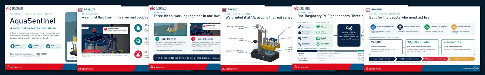

[← back to the project page](../README.md)

# 🎤 The finale presentation

**[AquaSentinel_Finale_7min.pdf](AquaSentinel_Finale_7min.pdf)**: our 7-minute pitch for the AAKRUTI 2026 India Geo Finale (20 Nov 2026, Pune).

| Slides | What |
|---|---|
| 1–16 | the pitch: the hidden crisis → the gap → our idea → three innovations → CAD and simulation → the 1:5 LIVE model → electronics → the booth demo → who it serves → our journey |
| 17 | the questions menu |
| 18–28 | Q&A backups: comparison with existing tools, the 14 design checks, the pole safety factor, power, decision logic, cost, market, risks, roadmap, prototype levels, materials |

The PDF is the backup of the PowerPoint we present from; the PowerPoint itself (with four short muted videos) is too large to keep here.
