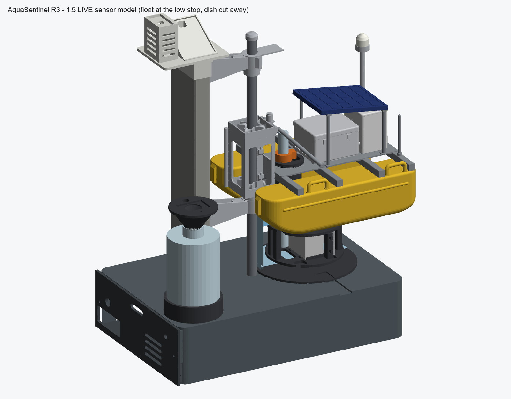
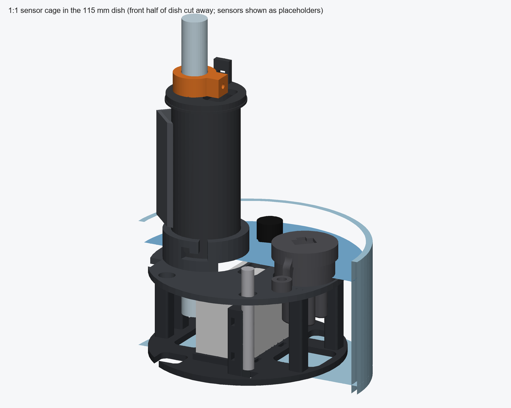

# AquaSentinel R3 – 1:5 LIVE sensor model

**Status:** CAD concept, geometry-checked in CAD. **Not yet printed or wet-tested.** All fits and clearances below are
nominal CAD values (no print shrinkage or tolerance stack). Sensor sizes other than the SEN0189 are assumptions – see
"Measure before printing".

The semi-final 1:5 float-on-pier display, turned into a working demo: the **real full-size sensors** hang under the float in
a 1:1 cage and dip into a **Ø115 × 65 mm glass dish** of water; the Raspberry Pi electronics live in a new **plinth**; the
rain / DHT11 / LDR sensors sit on a **met head** on the pier column; the **MQ-3** sniffs the headspace of a sample bottle
filled by the pump; the mast carries a **bicolour LED beacon**. To change the water sample, lift the float 60 mm, clip the
park sleeve on the rod and slide the dish out to the front.

## What changed versus the original 1:5 kit

| Original | LIVE model | Why |
|---|---|---|
| S01 display base | **LD-S01 plinth** (300 × 200 × 72) + **LD-S08 tray** | raises the whole stand 64 mm so the dish fits under the float; electronics bay inside |
| F05 well + 1:5 cage | **LD-F05 well** (same OD/flange, fits the F03 hatch) with 2 bayonet pins | carries the real-sensor cage |
| F08 probe cluster | **LD-F16a cage plate + LD-F16b basket** (1:1) | holds SEN0189, pH electrode, TDS probe, DS18B20, pump |
| F07 cartridge cap | **LD-F07 cap** (pH bore, cable window, zip-tie tab) + **LD-F17 pH collar** | electrode depth adjustable, works for 120 or 160 mm electrodes |
| F06 deflector (down to z −66) | **LD-F06** same shape, ends at the keel line | the original would cut through the cage and the dish |
| F12 mast + F13/F14 lenses | **LD-F12 mast** (wire channel, solder chamber, 5 mm LED seat) + **LD-F13 diffuser** | real beacon LED |
| – | **LD-S09 dish seat**, **LD-S10a/b met head**, **LD-S11 bottle collar**, **LD-S12 MQ-3 cone**, **LD-S13 grommets**, **LD-S15 park sleeve** | new functions |

Everything else (hulls, frame, carriage, pod, sampler, canopy, handles, column, brackets, collars, pole cap, rod) is the
unchanged original and is copied into `STL_print` with an `ORIG-` prefix.

## Folder

- `STL_print/` – every file you need to print, already in print orientation, centred, on the bed (35 files).
  Parts already printed are moved to `STL_print/02_PRINTED/`; the loose STLs are the ones still to print.
- `CAD/` – SOLIDWORKS parts of all 17 new parts (feature trees with named sketches/features).
- `concept_renders/` – renders. `print_list.csv`, `verification_summary.json`.

## Printing (Bambu Lab H2D)

> **Our actual printers (Oct 2026): Bambu P1S + A1, 256 mm beds.** How to send a plate, the A1 PETG settings
> (raised first layer) and the plate log are in `STL_print/PRINT_INSTRUCTIONS.md`; part-by-part status is in
> `STL_print/PRINT_STATUS.csv`. LD-S01 (300 × 200 mm), ORIG-S02 (304 mm) and the optional rod halves do not fit these beds.

All parts fit the H2D (even the 300 mm dual-nozzle area). 0.4 mm nozzle, 0.2 mm layers, 3 walls, 15–20 % gyroid.
**PETG for everything that gets wet or sits outside** (well, cage, cap, collar, seat, MQ-3 cone, met plate); PLA elsewhere.
No supports are needed in the given orientations; the longest bridges are ~33 mm (LM393 pocket ceiling in the met plate)
and ~21 mm (DHT11 screen roof). The plinth is the big one (~540 cm³, roughly 650 g PLA) – use a brim.

| File (STL_print) | Qty | Material | Orientation / note |
|---|---|---|---|
| LD-F05_sensor_well_bayonet | 1 | PETG black | flange on the bed |
| LD-F06_debris_deflector_short | 1 | PETG/PLA black | on its V footprint |
| LD-F07_cartridge_cap_cable_gland | 1 | PETG black | disc on the bed |
| LD-F12_beacon_mast_LED | 1 | PLA silver | beacon base on the bed |
| LD-F13_beacon_diffuser_lens | 1 | natural/translucent PETG or PLA | base on the bed |
| LD-F16a_sensor_cage_plate_hub | 1 | PETG | plate on the bed |
| LD-F16b_sensor_cage_basket | 1 | PETG | floor on the bed |
| LD-F17_pH_electrode_collar | 1 | PETG (contrast colour) | ring on the bed |
| LD-S01_plinth_electronics_bay | 1 | PLA | upside down (top on the bed) |
| LD-S08_electronics_tray_end_panel | 1 | PLA | floor on the bed |
| LD-S09_dish_seat | 1 | PETG | flat |
| LD-S10a_met_column_cap | 1 | PLA | top plate on the bed |
| LD-S10b_met_plate_rain_LDR_DHT11 | 1 | PETG white | base on the bed |
| LD-S11_bottle_collar | 1 | PLA/PETG | ring on the bed |
| LD-S12_MQ3_headspace_cap | 1 | PETG | top plate on the bed, cone up |
| LD-S13_cable_grommets | 1 set (3) | TPU 95A (or PETG) | lips down |
| LD-S15_park_sleeve | 1 | PETG/PLA | upright |
| ORIG-F01, F02, F03, F04, F09, F10, F11, F15a–d | 1 each | as the original guide | unchanged |
| ORIG-S02, S03, S04, S05a, S05b, S06 | 1 each | as the original guide | unchanged (S02 is 304 mm tall – fits the H2D) |
| ORIG-OPT_rod_half_print_2 | 2 | PLA | only if you print the 12 mm rod |

## Extra parts to buy

- 2–4 glass crystallizing dishes **Ø115 × 65 mm** (≈ 0.5 L). Any straight-walled dish with OD ≤ 116 mm, ID ≥ 100 mm and
  60–68 mm tall works; otherwise change `DISH_OD` / `DISH_H` (the seat height follows).
- 250 mL bottle, **Ø62 mm** body (else change `BOTTLE_OD`), mouth 18–50 mm.
- Silicone hose **6 mm ID** (fits the 7.5 mm pump outlet), about 0.6 m.
- 5 mm **bicolour LED**, common cathode (red/green), 220 Ω + 150 Ω resistors, 30 AWG wire-wrap wire (3 × 0.6 m).
- 1.75 mm filament pins: 3 × 6 mm (dish seat), 2 × 6 mm (met plate).
- M3 × 12 nylon thumb screw (pH collar); 2 × M3 × 12 (tray end panel); M3 screws/nuts for the tray grid; M2.5 × 6 (Pi).
- Zip ties 2.5 mm (TDS/DS cradles, pump strap, cable strain relief).
- Panel DC jack 5.5/2.1 (Ø11.2 hole) and SMA bulkhead (Ø6.5 hole) for the SIM800L antenna.
- 12 mm rod, 310 mm (as the original).

## Assembly

**Stand**
1. Press the TPU grommets into the three plinth holes. Column tenon into the mortise (0.2 mm clearance, glue optional), rod
   into its socket, then brackets/collars exactly as in the original guide – everything simply sits 64 mm higher.
2. Dish seat: three 6 mm filament pins into the plinth holes, press the seat on.
3. Met head: cap on the column top (the U-skirt is open towards the bracket face), two filament pins, met plate on top.
   Rain plate into the 30° pocket facing the jury, its pins down through the slot into the LM393 board pocket (board slides
   in from the back). DHT11 inside the louvred screen, LDR module in the roof pocket. Wires drop behind the column to the
   12 mm grommet behind-left of the column.
4. Tray: Pi 3B+ on the standoffs with USB/Ethernet towards the end panel; other boards on the M3 grid; slide in from the
   left end; two M3 screws into the end bosses.

**Float**
5. Originals F01–F04, F09–F11, F15 as in the original guide.
6. LD-F05 well into the deck hatch (flange on the deck). Glue LD-F06 under crossbeam 1 and, recommended, glue its tabs to
   the well too – that stops the well (and therefore the cage) from turning.
7. Beacon: trim the LED legs to ~6 mm, solder the three 30 AWG wires (heat-shrink), pull the wires down the mast channel
   and out of the side hole at deck level, press the LED into its seat (flange flush), press the diffuser on.
   LD-F12 pin into the beam-4 socket.
8. LD-F07 cap on the flange. pH electrode through the cap bore; slide the LD-F17 collar on and set the tip ~30 mm under
   the water line (≈ 45 mm below the keel); tighten the thumb screw.

**Sensor cage** (on the bench, then onto the well)
9. Pump on the basket floor between the stops, **outlet facing the front (−y)**; zip tie through the strap slots.
10. Plate onto the four post pins (push fit; a drop of CA if loose).
11. SEN0189: drop the head through the plate bore; the ears sit over the two pins.
12. TDS probe through the TDS notch into its V cradle, DS18B20 through its hole into its cradle; two zip ties each.
    Tips 3–10 mm above the floor – they may hang up to 3 mm below it through the drop windows.
13. All cables (and pump wires) through the hub's front window into the well, up the well and out of the cap window;
    zip-tie them to the cap tab.
14. **Bayonet:** seen from above, turn the cage 25° clockwise from its final position, push it up so the two well pins
    enter the open slots, turn 25° counter-clockwise and let go – it drops 2.4 mm into the lock notches and cannot turn.
    To remove: lift 2.4 mm, turn back, lower. Final orientation: turbidity sensor towards the stern, pump outlet to the front.

**Water, hose, umbilical**
15. Slide the dish onto the seat from the front until it touches the rear stop. Fill with about 380 mL so the water stands
    **1–2 mm over the cage plate** (10 mm below the dish rim).
16. Hose: from the pump outlet run it under the plate towards the bow, up through the hose notch at the bow-port edge of
    the plate, over the dish rim between the hulls, down to the plinth and across to the bottle; push it through the
    Ø8.2 hole of the MQ-3 cone (the cone doubles as a funnel).
17. Umbilical (sensor cables + LED wires): from the cap window along the deck to the bow, down beside the rod with a
    ≥ 70 mm service loop (the float must still lift 60 mm), into the Ø18 grommet behind the rod.

## Wiring

Exactly the pin map of `13_RPI_PROTOTYPE_DESIGN/AquaSentinel_RPi_Prototype_Design.md` (ADS1115 0x48: pH, TDS, turbidity,
MQ-3; 0x49: LDR, rain, battery; DS18B20 GPIO4; DHT11 GPIO17; rain DO GPIO27 / power GPIO22; LDR DO GPIO5; pump MX1508
IN1 GPIO23; pH/TDS board switches GPIO6/GPIO13 – never both on; MQ-3 heater GPIO19; SIM800L UART + RST GPIO18).
Beacon LED: **green → 150 Ω → GPIO26** (pin 37, the status-LED pin in that map), **red → 220 Ω → GPIO12** (pin 32, free),
common cathode → GND (≈ 4–8 mA per colour; the prototype's transistor stage on GPIO26 also works).

## Demo: swap the water sample

1. Lift the float 60 mm by hand, clip LD-S15 on the rod under the carriage, lower the float onto it
   (the cage now hangs 6 mm above the dish rim).
2. Move the hose aside, slide the dish out to the front, slide the next one in (clean / salty / vinegar / muddy water).
3. Lift the float, remove the sleeve, lower the float. Readings settle; run the pump for a 50 mL sample into the bottle
   for the MQ-3 (calibrate the pump time once). Each 50 mL sample lowers the dish level 5.4 mm – top up after each sample.

## Measure before printing (parameter in `_build/build_live_model_sw.py`)

| Item | Assumed | If different |
|---|---|---|
| pH electrode Ø | 12 mm (length 120 or 160 both fine) | `PH_D` |
| TDS probe | Ø 5–16 mm, body ≤ 60 mm (its top must stay under the starboard hull) | `TDS_CRADLE` |
| DS18B20 | Ø6 × 50 mm tube | `DS_CRADLE` |
| Pump | 45 × 24 × 33 mm, outlet on a short end | `PUMP_X0/X1/Y0/Y1/H` |
| SEN0189 | from the supplied CAD (ears 44.1 mm pitch, head Ø28 → Ø22) | `TURB_*` |
| Dish | Ø115 × 65 mm, wall ≈ 3 mm | `DISH_OD`, `DISH_H` |
| Bottle | Ø62 mm, mouth 18–50 mm | `BOTTLE_OD` |
| MQ-3 module | board ≤ 33 × 23 mm, can ≤ Ø20.6 | `build_mq3_cap` |
| Rain plate / LDR / LM393 | 54 × 40 / ≤ 33 × 16 / ≤ 33 × 12 × 19 mm | `RAIN_*`, `LDR_*` |
| Pi 3B+ ports | USB at 29/47 mm, Ethernet at 10.25 mm from the power edge | `build_tray` panel openings |

## Checks done (in CAD)

- All 17 new parts are single watertight solids; every cut, slot and pocket was confirmed by point-in-solid probes
  (about 170 probes, all pass).
- Interference at the low stop between every new part and the original float/stand: **no overlaps**; only designed
  contacts (cap on flange, collar on cap, tenon in mortise, seat on plinth, met cap on column).
- Cage → dish wall 8.5 mm (assuming ID 109), cage → dish floor 7.0 mm, keel → dish rim 5.0 mm.
- Parked +60 mm: cage 6.0 mm above the rim, carriage 5.0 mm below the upper collar, park sleeve seats on the lower collar.
- Water: 476 mL gross to the line; after a 50 mL sample the turbidity optical gap is still 1.1 mm under water, the pump 2.6 mm.

## Known limits

- Not printed, not wet-tested; bayonet lock, post push-fits and LED seat are untested fits.
- The float can still turn about the rod (as in the original); the cage reaches the dish wall at about ±7° – keep the float
  square when lowering it.
- The pump hose route is free-form (not modelled); sensor positions assume the dimensions above.
- The dish is a 0.5 L sample, not a river: the model demonstrates the measurement chain, not field performance.

## Regenerating

The parts were generated by a build script driving the SOLIDWORKS API (not included in this repository). Every blind cut is a mid-plane "slab" between two explicit coordinates, so
results do not depend on SOLIDWORKS' default cut direction.
