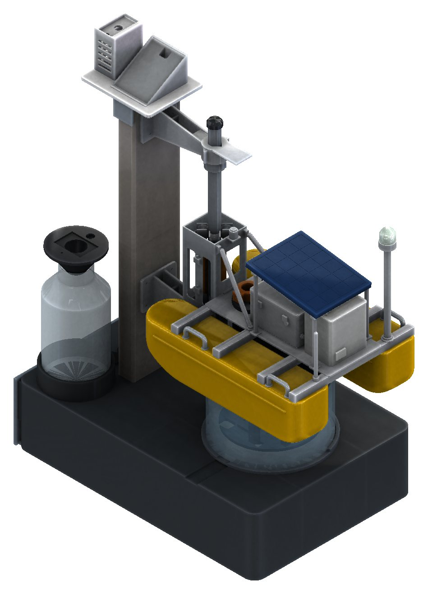
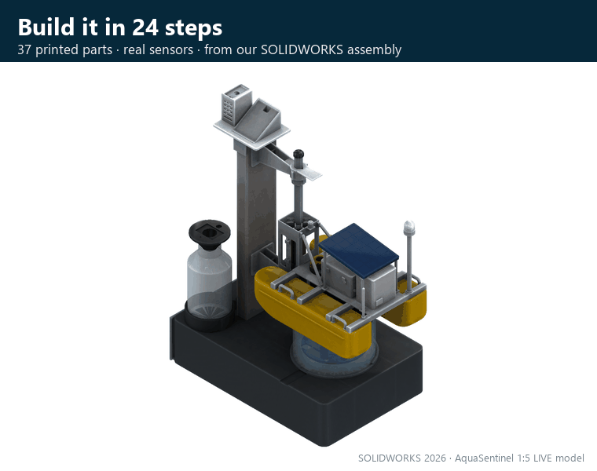

[← back to the project page](../README.md)

# 🧩 The 1:5 LIVE model

<table><tr>
<td width="50%"></td>
<td width="50%"></td>
</tr></table>

Our R3 float at **1:5**, printed around **real sensors at 1:1**: pH, dissolved solids, turbidity and temperature probes dip into a dish of water under the float; the Raspberry Pi sits in the base; rain, light and humidity sensors on the column; an MQ-3 sniffs the sample bottle; a red/green beacon on the mast. It proves the whole chain from sensor to SMS. A 0.5 L dish is not a river, so it does not prove river-scale performance.

> **🧊 Spin it in 3D:** [`AquaSentinel_LIVE_1to5_ASSEMBLED.stl`](AquaSentinel_LIVE_1to5_ASSEMBLED.stl) is the whole model in its assembled position (all 40 bodies, mm). GitHub shows it in 3D; drag to rotate.

| Folder / file | Inside |
|---|---|
| [`00_ASSEMBLY_MANUAL`](00_ASSEMBLY_MANUAL) | **the 30-page assembly manual**, every picture taken from our SOLIDWORKS 2026 assembly: parts, tools, 24 steps (A stand · B float · C sensor cage · D final), checks |
| [`01_FINAL_STL`](01_FINAL_STL) | the 37 print files + [`PARTS_LIST.csv`](01_FINAL_STL/PARTS_LIST.csv) (ID, name, quantity, step, plate, size) |
| [`02_CAD_SOLIDWORKS`](02_CAD_SOLIDWORKS) | the 17 parts designed new for this model (LD-), as native SOLIDWORKS parts with feature trees |
| [`03_SOLIDWORKS_ASSEMBLY`](03_SOLIDWORKS_ASSEMBLY) | `AquaSentinel_LIVE_1to5_Assembly.SLDASM` with its 40 components (SOLIDWORKS 2026) |
| [`04_DESIGN_NOTES`](04_DESIGN_NOTES) | design notes, print list, verification summary and the concept renders |

**Part names:** `LD-` = new for the LIVE model · `ORIG-` = unchanged parts of our original 1:5 kit · `P-` = bought or placeholder parts (bottle, dish, rod, turbidity sensor).

**Status (8 Nov 2026):** designed ✓ · printed ✓ · assembly, wiring and code before the booth on 19 Nov · not yet wet-tested.
