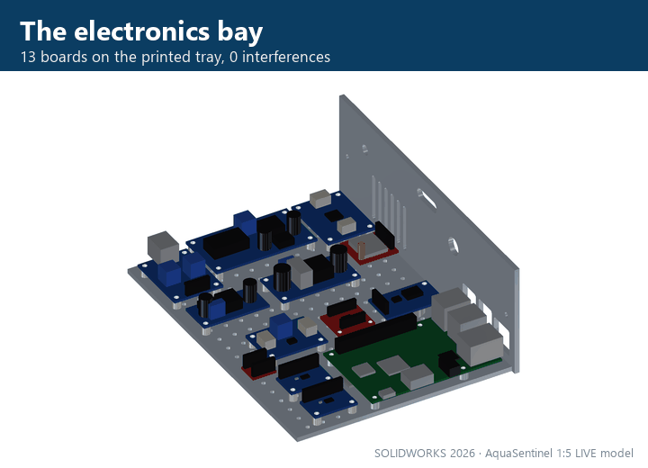
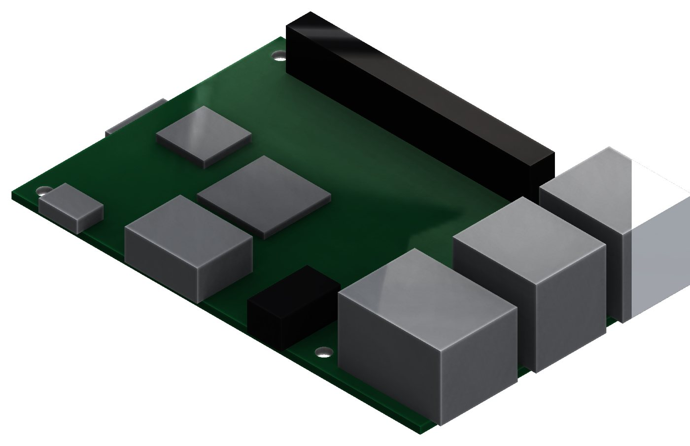
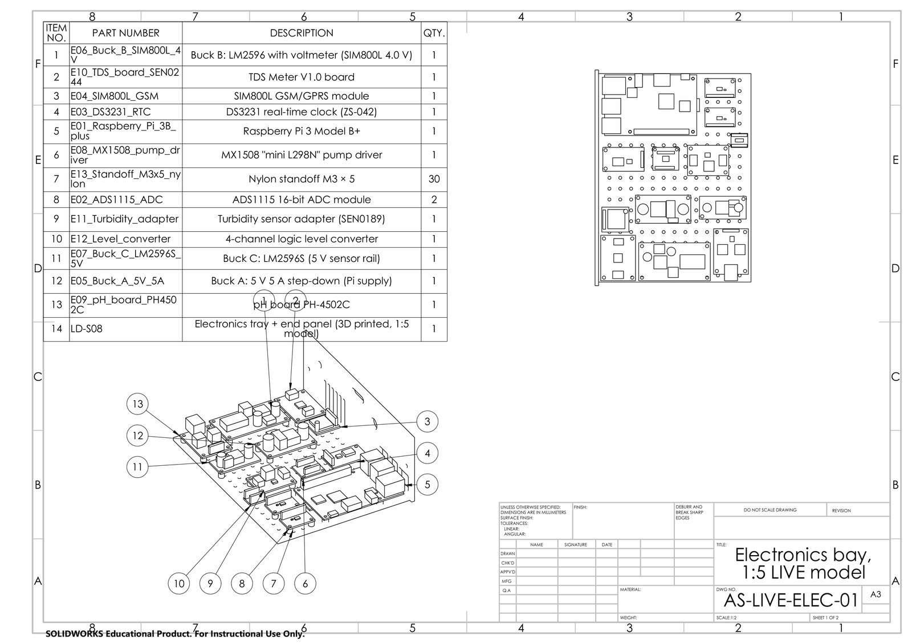

[← back to the project page](../README.md)

# ⚡ The electronics: one Raspberry Pi, eight sensors, three actions

<table><tr>
<td width="55%"></td>
<td> The Raspberry Pi 3B+ as a SOLIDWORKS part: 16 features, from the 40-pin header to the micro-SD slot, on the official 85 × 56 mm outline and 58 × 49 mm hole pattern</td>
</tr></table>

| File | What |
|---|---|
| [`AquaSentinel_Electronics_in_SOLIDWORKS.pdf`](AquaSentinel_Electronics_in_SOLIDWORKS.pdf) | 7 pages: the 13 SOLIDWORKS parts, the bay assembly, interference detection (2 clashes found and fixed), a thermal hand check, and the two A3 sheets of drawing AS-LIVE-ELEC-01 |
| [`AquaSentinel_RPi_Prototype_Design.pdf`](AquaSentinel_RPi_Prototype_Design.pdf) ([Markdown](AquaSentinel_RPi_Prototype_Design.md)) | the full design: components, wiring, pin map, ADC channels, power rails, energy budget, decision logic, software plan |
| [`SOLIDWORKS_Electronics_Bay`](SOLIDWORKS_Electronics_Bay) | 13 native parts (E01 Raspberry Pi 3B+ … E13 standoff), the bay assembly on the model's tray and plinth, drawing `AS-LIVE-ELEC-01` (+ PDF), and a part prepared for a thermal study |

 Drawing AS-LIVE-ELEC-01, sheet 1 (SOLIDWORKS 2026, A3, ISO): BOM and balloons

**Thermal check (hand estimate):** about 3.2 W in the closed plinth, so the Pi's chip runs at about 64 °C in a 30 °C booth. Fine for logging every 15 minutes; a ₹50 heatsink and clear vents for safety. In the field the Pi runs in timed mode (on 3 minutes of every 15). A SOLIDWORKS Flow Simulation run is the next step.
