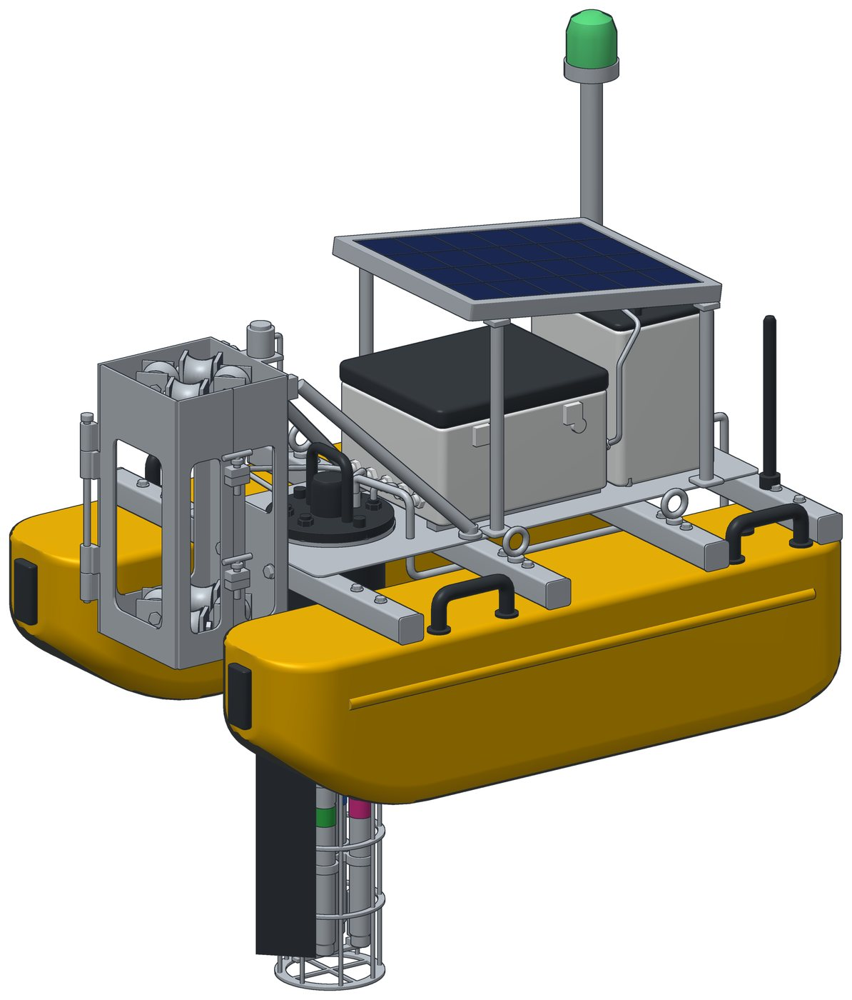
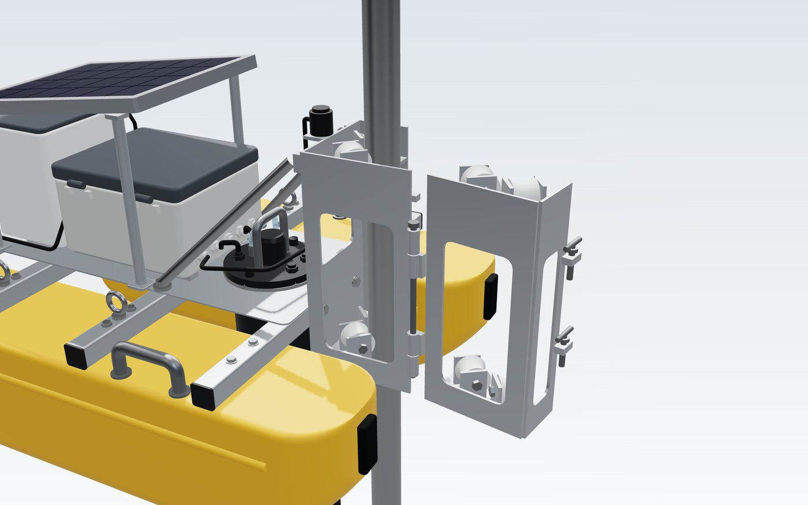
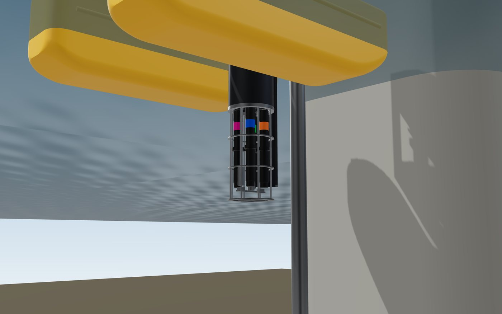
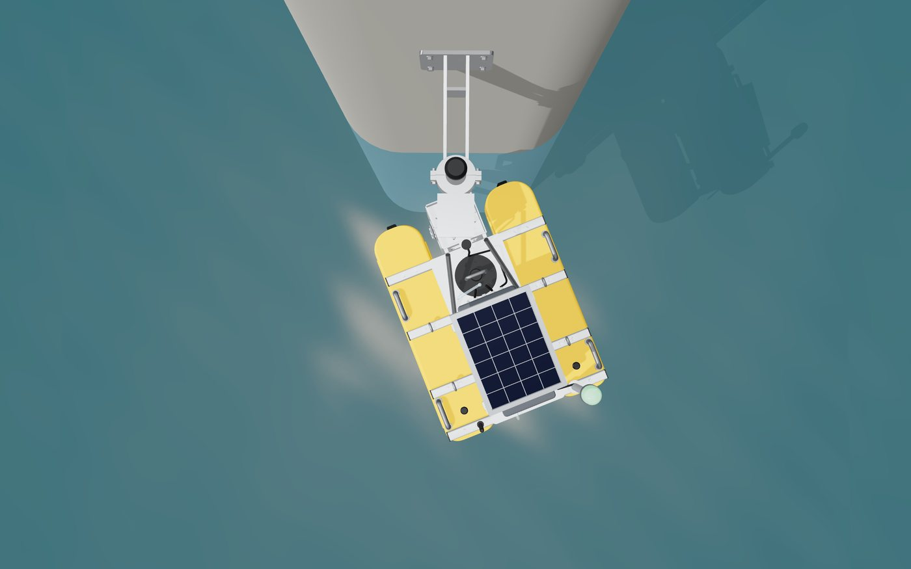

[← back to the project page](../README.md)

# 📐 The full-size R3

The full-size AquaSentinel float: two rotomoulded hulls, a guide carriage with 8 UHMW rollers on a 2-inch pole, a sensor well with a lift-out cartridge, a power and control pod, a 20 W solar canopy, a beacon and a sampler. 66 parts. The geometry comes from our own parametric model; it was assembled, checked and simulated in SOLIDWORKS.

| Folder / file | Inside |
|---|---|
| [`00_ASSEMBLY_MANUAL`](00_ASSEMBLY_MANUAL) | **27-page assembly manual** with pictures from the SOLIDWORKS 2026 assembly |
| [`01_BOM_R3.csv`](01_BOM_R3.csv) | bill of materials: part number, material, process, mass |
| [`02_SOLIDWORKS_PackAndGo`](02_SOLIDWORKS_PackAndGo) | the SOLIDWORKS Pack and Go we submitted at the Final Design Challenge (3DEXPERIENCE SOLIDWORKS; older desktop versions cannot open it) |
| [`04_Drawings`](04_Drawings) | 6-sheet drawing set computed from the CAD: general arrangement, installation, carriage, sensor well, hull, pier bracket |
| [`05_Design_Checks`](05_Design_Checks) | the 14 design checks (buoyancy, stability, clearances, jamming, pole strength) and the STEP validation |
| [`06_Renders`](06_Renders) | renders of the R3 at the river, in service and in section |
| [`07_Parts_STEP_STL`](07_Parts_STEP_STL) | every part as STEP and STL; GitHub shows the STL files in 3D |
| [`08_Assembly_STEP_GLB`](08_Assembly_STEP_GLB) | the whole assembly as STEP (any CAD tool) and GLB (any 3D viewer) |

<table><tr>
<td> the carriage gate opens for service</td>
<td> the sensor cage under water</td>
<td> the current turns it like a weathervane</td>
</tr></table>

> **Since the finale update:** the electronics moved from the ESP32/RS485 pod shown in this CAD to the Raspberry Pi set of the 1:5 LIVE model ([`03_ELECTRONICS_RASPBERRY_PI`](../03_ELECTRONICS_RASPBERRY_PI)); the mechanics are unchanged. For production we plan galvanised steel and bolted aluminium + HDPE in place of 316L and welded aluminium (see [`07_COST_AND_BUSINESS`](../07_COST_AND_BUSINESS)).
