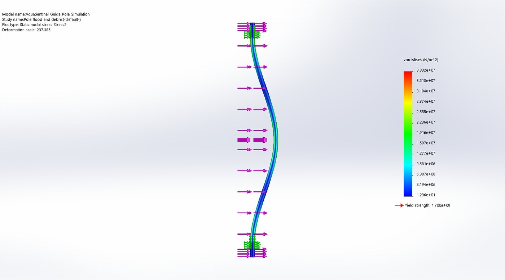
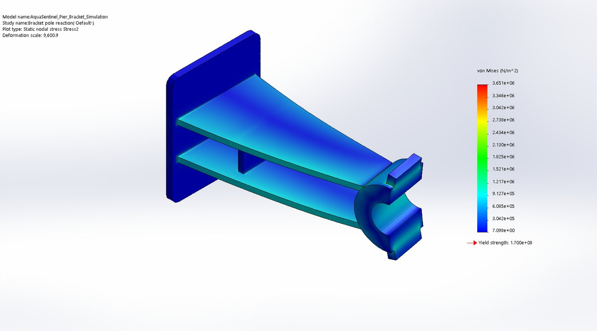

[← back to the project page](../README.md)

# 🧮 SOLIDWORKS Simulation

<table><tr>
<td width="50%"> Guide pole: von Mises stress under flood drag + debris</td>
<td width="50%"> Pier bracket: von Mises stress under the pole reaction</td>
</tr></table>

| Study | Load | Result |
|---|---|---|
| Guide pole, 2-inch 316L, both clamps fixed | 642 N at the float (1.5 m/s current drag 142 N + 500 N debris) plus drag on the pole | 38.3 MPa peak, safety factor 4.4 |
| Pier bracket | 430 N reaction | 3.7 MPa peak |

We quote a lower **2.66** for the pole, from a pinned hand calculation with the carriage moment, because real clamps are not rigid. Not yet checked: debris impact factor, fatigue, vortex shedding, anchors and welds.

Files: the two study parts (`.SLDPRT`), the study reports (`.docx`) and the stress and displacement plots.
