<div align="center">

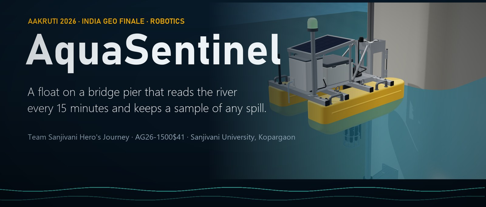

[](https://soham0777.github.io/AquaSentinel/)
[](05_R3_FULL_SIZE_CAD)
[](06_SIMULATION)
[](14_RASPBERRY_PI_SOFTWARE)
[](LICENSE)

**[Website](https://soham0777.github.io/AquaSentinel/)** · **[Pitch film](docs/media/aquasentinel-pitch-film.mp4)** · **[Journey film](docs/media/aquasentinel-journey-film.mp4)** · **[Finale deck](01_FINALE_PRESENTATION/AquaSentinel_Finale_7min.pdf)** · **[Drawings](05_R3_FULL_SIZE_CAD/04_Drawings/AquaSentinel_R3_Drawing_Set.pdf)** · **[Cost sheet](07_COST_AND_BUSINESS/04_AquaSentinel_Cost_48k_Value_Engineered.pdf)**

</div>

---

## The problem, in four numbers

| | |
|---:|---|
| **1.4 million** | people die every year from unsafe drinking water, sanitation and hygiene (WHO, 2023) |
| **2 lakh** | Indians die every year for lack of safe water (NITI Aayog, 2018) |
| **296** | polluted river stretches and locations in India; **54** in Maharashtra, the most of any state (CPCB, 2025) |
| **once a month** | how often most river monitoring points are sampled, by hand. A spill lasts a few hours. |

On the Godavari at Kopargaon, a spill at two in the morning looks like water. By sunrise it has moved on, and nobody was there to take the sample.

## Our answer

> **AquaSentinel rides a guide pole on a bridge pier, reads the water every 15 minutes, and when the river changes it lights a red beacon, raises an SMS alert and bottles a sample of that water, at that minute, for the lab.**

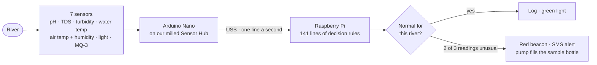

## Watch it

<table>
<tr>
<td width="50%" align="center"><a href="docs/media/aquasentinel-pitch-film.mp4">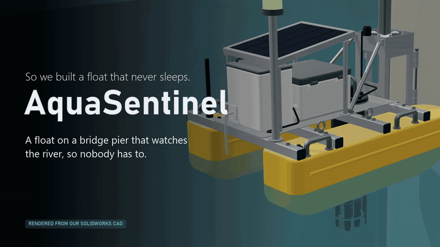</a><br><b>The pitch</b> · 92 s<br><sub>The problem, the float, how it works and what it costs.</sub></td>
<td width="50%" align="center"><a href="docs/media/aquasentinel-journey-film.mp4">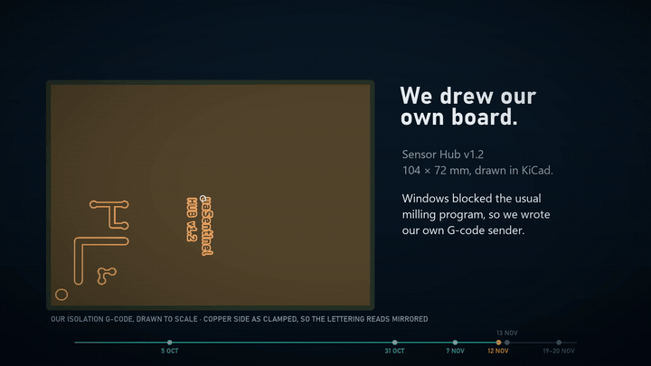</a><br><b>Our journey</b> · 92 s<br><sub>From our first handwritten page to the board we milled, and what we learned.</sub></td>
</tr>
</table>

<sub>Both films are made only from our own CAD, renders, drawings, dashboard captures and sourced figures. The milling shot is drawn from our real isolation G-code.</sub>

## Pour something in

The 1:5 LIVE model on our table carries the real, full-size sensors in a dish of water. Change the water and it names what it sees.

| Put this in the dish | It says | Because |
|---|---|---|
| Clean tap water | 🟢 **NORMAL** | readings stay where it learned them |
| A spoon of salt | 🔴 **INDUSTRIAL** | dissolved solids jump |
| A little vinegar | 🔴 **ACIDIC** | pH falls |
| A spoon of soil | 🔴 **RUNOFF** | the water turns cloudy while the salts stay flat |
| Sanitiser held at the bottle | 🔴 **SOLVENT** | vapour above the sample |
| Pull out the temperature probe | 🔴 **SENSOR FAULT** (blinking) | a dead sensor is never reported as clean water |

It learns the dish for 20 seconds first, and needs two unusual readings out of three before it calls anything.

<p align="center"><br><sub>The Raspberry Pi's dashboard after a spoon of salt, captured from the simulator built into our software.</sub></p>

## The board we milled

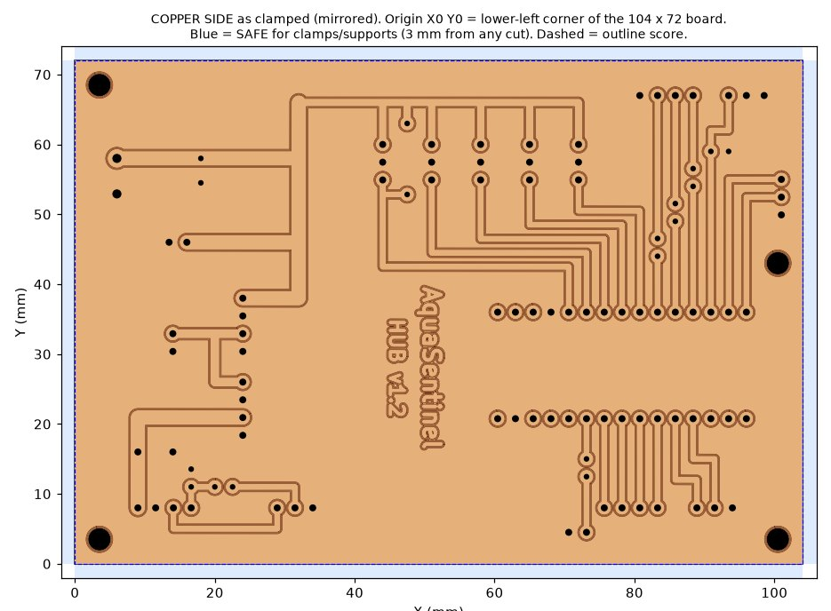

- **Why:** ten small boards on a tray clashed twice in SOLIDWORKS, so we drew one board instead.
- **What:** Sensor Hub v1.2, 104 × 72 mm, single-sided, drawn in KiCad, milled on a desktop CNC on **12 November**.
- **How:** an Arduino Nano reads all seven sensors and drives the light and the pump; every sensor has its own labelled header.
- **Learned:** Windows blocked the usual milling program, so we wrote our own G-code sender. The TDS board disturbs the pH probe, so the Nano powers it only while it reads.
- **Tested:** on **13 November** all seven sensors, the beacon and the pump answered through the board.

<br clear="right">

## The full-size float, R3

<p align="center">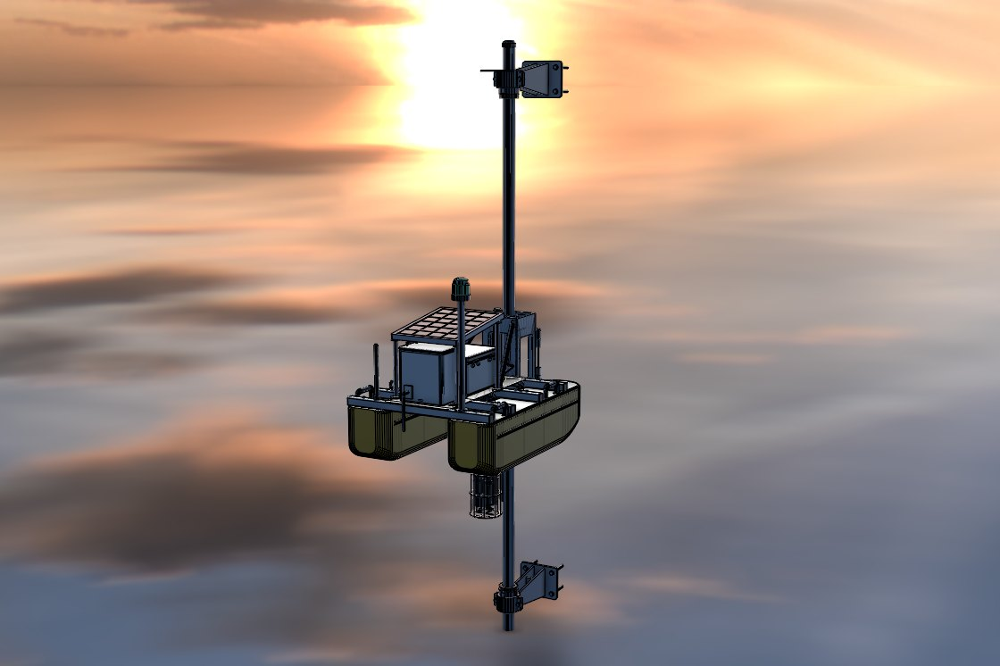 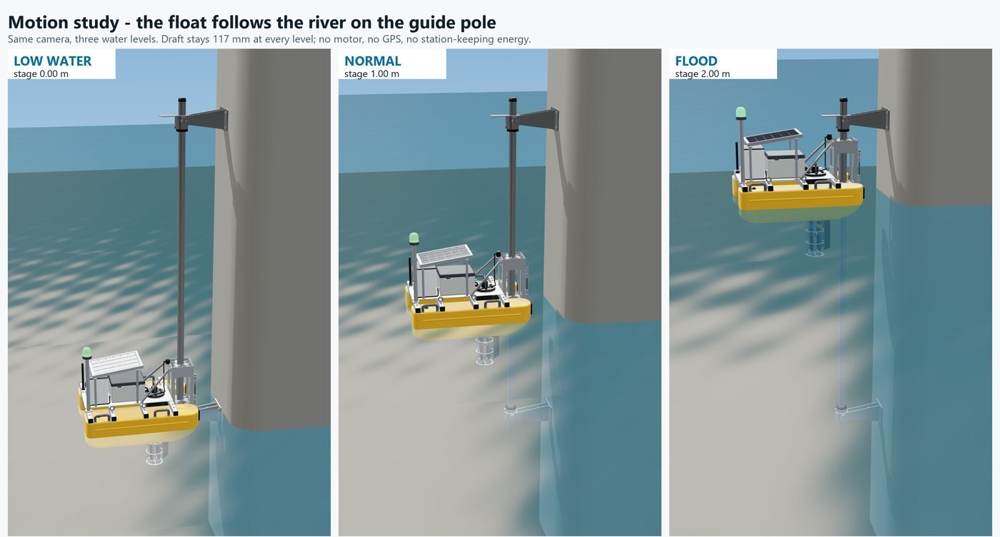<br><sub>Left: the R3 at dusk, rendered in 3DEXCITE Creative Experience on the 3DEXPERIENCE platform. Right: the float follows the river through 2 m of rise.</sub></p>

| | |
|---|---|
| **Assembly** | 66 part numbers, 144 parts, 48.5 kg, one SOLIDWORKS assembly |
| **Structure** | 316L pole and pier brackets, 6061 aluminium frame, rotomoulded PE hulls |
| **Motion** | rides a 2-inch pole on eight rollers through 2 m of river rise; turns with the current like a weathervane |
| **Design checks** | **14 of 14 pass**: reserve buoyancy 2.27, freeboard 143 mm, righting arm positive to 60° |
| **Guide pole** | 64.0 MPa with pinned ends and the carriage couple: safety factor **2.66** on 170 MPa |
| **CAD caught** | the pole running through the electronics pod, and a mass of 48.5 kg, not the 25.4 kg we guessed |

### Six SOLIDWORKS drawings

<p align="center"><a href="05_R3_FULL_SIZE_CAD/04_Drawings/AquaSentinel_R3_Drawing_Set.pdf">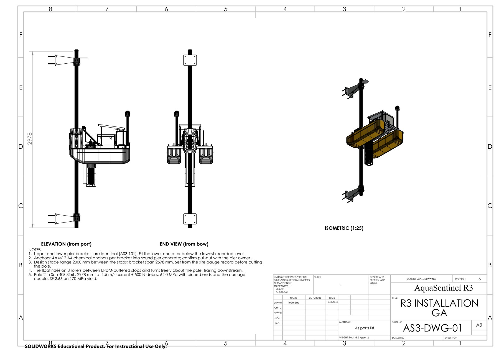</a> <a href="05_R3_FULL_SIZE_CAD/04_Drawings/AquaSentinel_R3_Drawing_Set.pdf">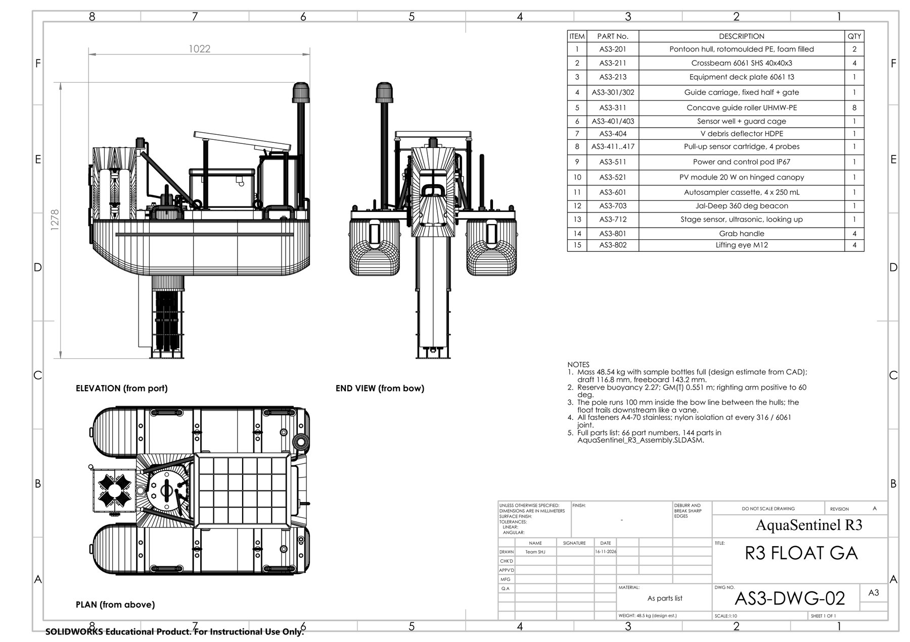</a> <a href="05_R3_FULL_SIZE_CAD/04_Drawings/AquaSentinel_R3_Drawing_Set.pdf">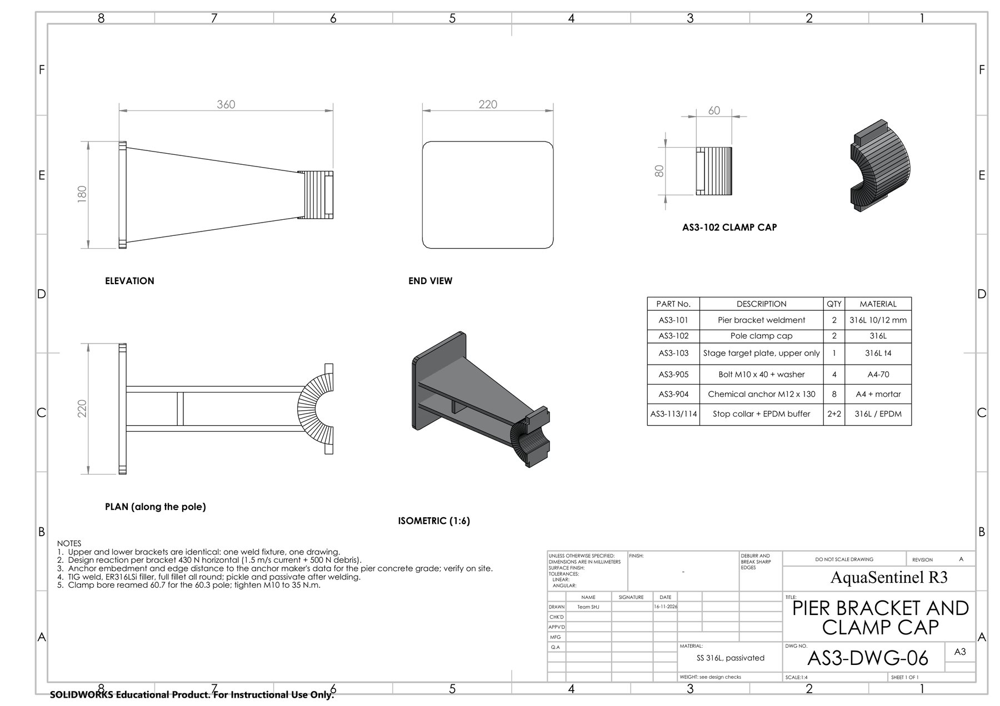</a><br><sub>AS3-DWG-01 to 06, A3, first-angle: installation, float, guide carriage, sensor well, hull, pier bracket. Native <code>.SLDDRW</code> files in <a href="05_R3_FULL_SIZE_CAD/04_Drawings/SOLIDWORKS">04_Drawings/SOLIDWORKS</a>.</sub></p>

<p align="center">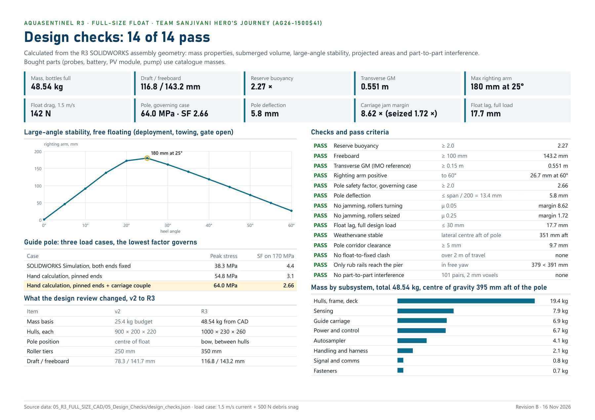</p>

## How we got here

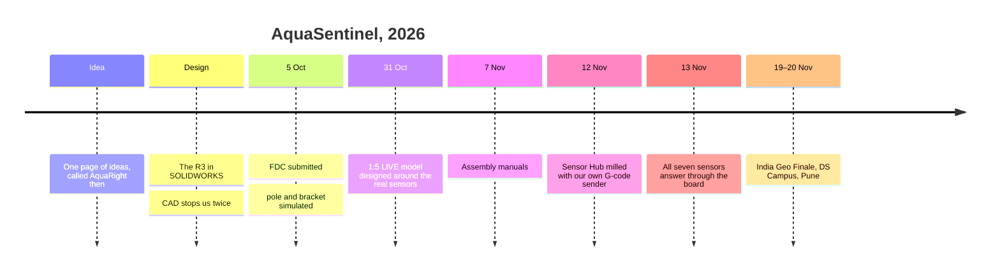

## What it costs

| | |
|---|---|
| One sentinel at 100 units | **₹47,886** before GST |
| The first one | ₹64,616 |
| One real-time monitoring station | ₹35–40 lakh, the price of **73–84** sentinels |
| Proposed service | ₹8,000 a month; hardware paid back in about 12 months |

Costed from Indian supplier listings, November 2026, line by line in [the cost sheet](07_COST_AND_BUSINESS/04_AquaSentinel_Cost_48k_Value_Engineered.pdf).

## Run the software, no hardware needed

```bash
cd 14_RASPBERRY_PI_SOFTWARE/aquasentinel
python3 -m aquasentinel --simulate     # dashboard on http://localhost:8080, plays the six waters
python3 tools/self_test.py             # checks the decision rules on every water
```

On the Raspberry Pi, `bash install.sh` sets up the service, the SIM800L port and the full-screen dashboard. See [PI_SETUP_AND_OPERATION.md](14_RASPBERRY_PI_SOFTWARE/aquasentinel/PI_SETUP_AND_OPERATION.md).

## Inside this repository

| Folder | What you will find |
|---|---|
| [`01_FINALE_PRESENTATION`](01_FINALE_PRESENTATION) | the 28-slide finale deck |
| [`02_LIVE_MODEL_1to5`](02_LIVE_MODEL_1to5) | 31-page assembly manual, 38 STL print files, SOLIDWORKS parts and assembly, part labels |
| [`05_R3_FULL_SIZE_CAD`](05_R3_FULL_SIZE_CAD) | R3 assembly manual, Pack and Go, six SOLIDWORKS drawings, design checks, renders, STEP for every part |
| [`06_SIMULATION`](06_SIMULATION) | SOLIDWORKS Simulation of the guide pole and the pier bracket |
| [`07_COST_AND_BUSINESS`](07_COST_AND_BUSINESS) | the costed parts list and the cost sheet |
| [`12_ELECTRONICS_MANUAL_1to5`](12_ELECTRONICS_MANUAL_1to5) | electronics manual, Sensor Hub KiCad design, G-code, our G-code sender, Nano firmware |
| [`13_CREATIVE_EXPERIENCE_STORYTELLING`](13_CREATIVE_EXPERIENCE_STORYTELLING) | 3DEXCITE storyline and render, AR model, story animation |
| [`14_RASPBERRY_PI_SOFTWARE`](14_RASPBERRY_PI_SOFTWARE) | decision rules, dashboard, SMS, logging, installer, self-test |
| [`docs`](docs) | the project website, the two films and every image above |

## The team

| | |
|---|---|
| **Soham Prabhakar Kadu** | Team leader, project lead |
| **Prasad Satish Ugale** | System design |
| **Bhakti Ajay Kadam** | Electronics lead |
| **Tanmay Nilesh Pendbhaje** | Software lead |
| **Dr. Kiran Wakchaure** | Mentor, Director Projects |

Team Sanjivani Hero's Journey · AG26-1500$41 · Sanjivani University, Kopargaon · AAKRUTI Innovation Competition 2026 by Dassault Systèmes

<sub>Code and documentation are under the MIT licence; the presentation, films, renders and drawings are the team's copyright. See [LICENSE](LICENSE).</sub>
