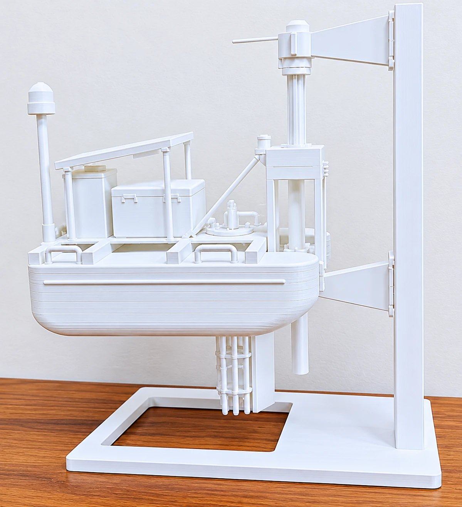
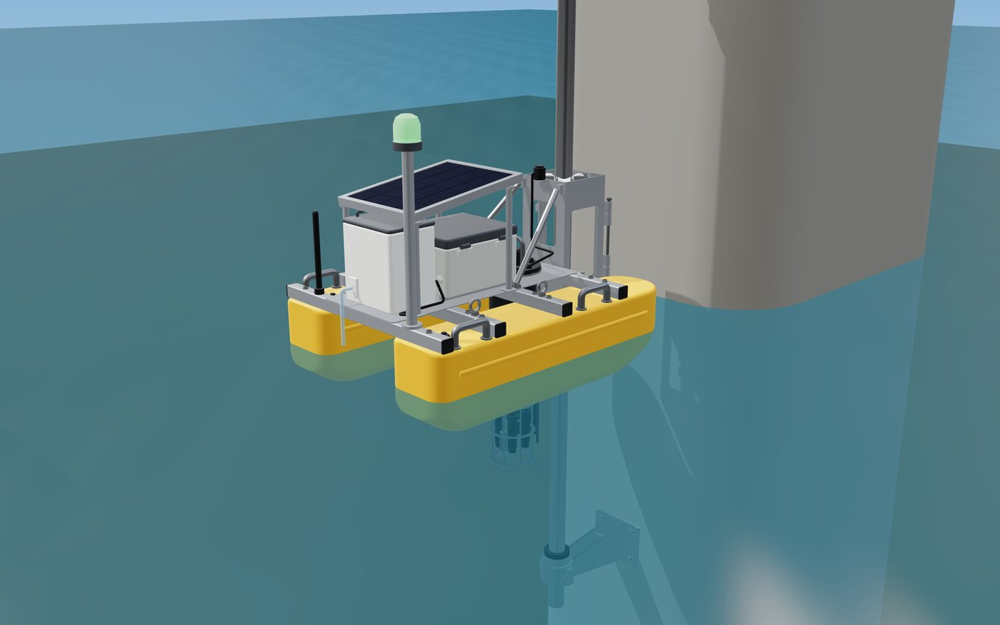
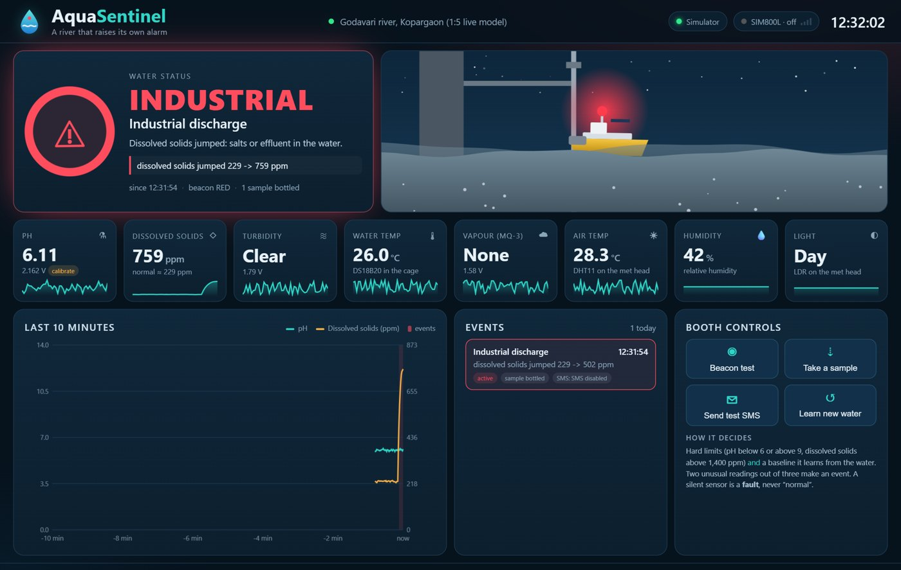
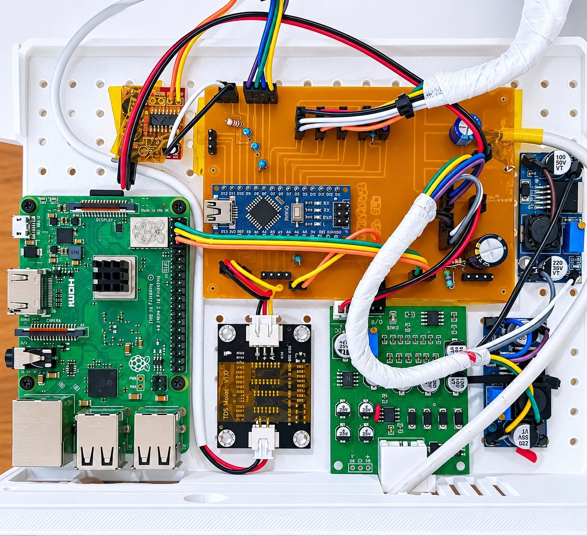
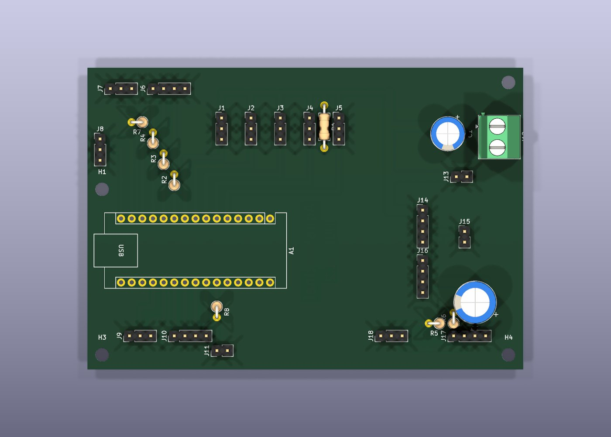

<div align="center">

# AquaSentinel

**A float on a bridge pier that watches the river at night, so nobody has to.**

Team Sanjivani Hero's Journey · AG26-1500$41 · Sanjivani University, Kopargaon
AAKRUTI Innovation Competition 2026 · India Geo Finale · Robotics

[Project website](https://soham0777.github.io/AquaSentinel/) · [Finale deck (PDF)](01_FINALE_PRESENTATION/AquaSentinel_Finale_7min.pdf) · [Electronics manual](12_ELECTRONICS_MANUAL_1to5/AquaSentinel_LIVE_1to5_Electronics_Assembly_Manual.pdf) · [Cost sheet](07_COST_AND_BUSINESS/04_AquaSentinel_Cost_48k_Value_Engineered.pdf)

&nbsp;

<sub>Left: our printed 1:5 model on its stand. Right: the full-size design, rendered from our CAD.</sub>

</div>

---

The Godavari at Kopargaon does not announce a spill. At two in the morning it looks like water. A pipe empties, the colour barely changes, and by the time anyone takes a sample the river has moved on.

That is not unusual. India counts 296 polluted river stretches and locations, and Maharashtra has 54 of them, more than any other state (CPCB, 2025). Most monitoring points are still sampled by hand, once a month at best. A real-time station costs ₹35–40 lakh, so there are very few.

So we built a float that sits on the river all night.

It rides a 2-inch guide pole clamped to a bridge pier and rises and falls with the water on eight rollers. No motor, no anchor. Every 15 minutes it reads the river. When the water changes, its light turns red for anyone on the bank, it sends an SMS to the water-works, and a pump fills a bottle with that water, at that minute, for the lab.

A number can be argued with. A bottle with a time on it is harder to argue with.

## What is on our table

A 1:5 copy of the float, printed in 37 parts, 17 of them drawn from scratch in SOLIDWORKS for this model. The model is small. The sensors are not: they are the real, full-size ones.

| Where | Sensor | What it catches |
|---|---|---|
| In the dish | PH-4502C with E-201-C electrode | acid or alkaline water |
| In the dish | DFRobot SEN0244 (TDS) | salts and effluent |
| In the dish | DFRobot SEN0189 (turbidity) | mud and runoff |
| In the dish | DS18B20 | hot discharge |
| Above the water | DHT11, LDR | air temperature, humidity, day or night |
| At the sample bottle | MQ-3 | solvent or fuel vapour |

## Pour something in

Change the water in the dish and the model names what it sees.

| Put this in the dish | It says |
|---|---|
| Clean tap water | **NORMAL**, green |
| A spoon of salt | **INDUSTRIAL**, red, sample bottled |
| A little vinegar | **ACIDIC**, red, sample bottled |
| A spoon of soil | **RUNOFF**, red, sample bottled |
| Sanitiser held at the bottle | **SOLVENT**, red, sample bottled |
| Pull out a probe | **SENSOR FAULT**, blinking red |

It learns the water first, then needs two unusual readings out of three before it calls anything, so one bad reading never raises an alarm. A dead sensor is reported as a fault, never as clean water. It names the kind of change; the bottle tells the lab which chemical.

<p align="center"><br><sub>The Raspberry Pi's dashboard after a spoon of salt (captured from the built-in simulator).</sub></p>

## The board we milled

In October the Raspberry Pi read every sensor itself through a tray of ten small boards, and SOLIDWORKS found two clashes in that tray before anything was printed. So we drew one board instead.

The **Sensor Hub v1.2** is 104 × 72 mm and single-sided, drawn in KiCad and cut on a desktop CNC on 12 November. An Arduino Nano in the middle reads all seven sensors, drives the light and the pump, and sends one line of readings a second to the Raspberry Pi. Windows blocked the usual milling program on our laptop, so we wrote our own G-code sender. On 13 November all seven sensors answered through the board on the bench.

<p align="center">&nbsp;</p>

```
 7 sensors ──► Arduino Nano on the Sensor Hub ──USB, 1 line/s──► Raspberry Pi 3B+
                     │                                              │
              light · pump                         decide · log · dashboard :8080 · SMS (SIM800L)
```

## The full-size float

The **R3** is one SOLIDWORKS assembly of 66 parts and 48.5 kg. It follows the river through 2 m of rise and turns with the current like a weathervane, so the pole takes no twist. All 14 design checks pass on the CAD model: 2.27× reserve buoyancy, 143 mm freeboard, self-righting to 60°, a pole safety factor of 2.66, no clash over the full travel. Two SOLIDWORKS Simulation studies cover the guide pole and the pier bracket.

CAD stopped us twice. Our second version ran the pole straight through the electronics pod, and when we added up the real masses the float came to 48.5 kg, not the 25.4 kg we had guessed, so the hulls had to grow.

## What it costs

| | |
|---|---|
| One sentinel at 100 units | **₹47,900** before GST |
| The first one | ₹64,600 |
| One real-time station | ₹35–40 lakh, the price of **73–84** sentinels |
| Proposed service | ₹8,000 a month, hardware paid back in about 12 months |

Costed from Indian supplier listings in November 2026; line by line in [the cost sheet](07_COST_AND_BUSINESS/04_AquaSentinel_Cost_48k_Value_Engineered.pdf).

## Run the software without hardware

```bash
cd 14_RASPBERRY_PI_SOFTWARE/aquasentinel
python3 -m aquasentinel --simulate     # dashboard on http://localhost:8080, plays the six waters
python3 tools/self_test.py             # checks the decision rules on all six waters
```

On the Raspberry Pi, `bash install.sh` sets up the service, the SIM800L port and the full-screen dashboard. See [PI_SETUP_AND_OPERATION.md](14_RASPBERRY_PI_SOFTWARE/aquasentinel/PI_SETUP_AND_OPERATION.md).

## What is in this repository

| Folder | Inside |
|---|---|
| [`01_FINALE_PRESENTATION`](01_FINALE_PRESENTATION) | the 28-slide finale deck as PDF |
| [`02_LIVE_MODEL_1to5`](02_LIVE_MODEL_1to5) | 30-page assembly manual, 38 STL files, parts list, SOLIDWORKS parts and assembly, part labels, printed dish |
| [`05_R3_FULL_SIZE_CAD`](05_R3_FULL_SIZE_CAD) | full-size assembly manual, BOM, SOLIDWORKS parts and assembly, drawing set, design checks, renders, STEP for every part, GLB |
| [`06_SIMULATION`](06_SIMULATION) | SOLIDWORKS Simulation studies of the guide pole and pier bracket |
| [`07_COST_AND_BUSINESS`](07_COST_AND_BUSINESS) | researched BOM, Raspberry Pi estimate, value-engineered cost and PDF |
| [`12_ELECTRONICS_MANUAL_1to5`](12_ELECTRONICS_MANUAL_1to5) | electronics manual Rev 2.0, Sensor Hub KiCad design, G-code, milling sender, Nano firmware, sensor CAD |
| [`13_CREATIVE_EXPERIENCE_STORYTELLING`](13_CREATIVE_EXPERIENCE_STORYTELLING) | 3DEXCITE storyline, 2D assets, AR model, the 66-second story film |
| [`14_RASPBERRY_PI_SOFTWARE`](14_RASPBERRY_PI_SOFTWARE) | decision engine, dashboard, SMS, logging, installer, calibration and test tools |
| [`docs`](docs) | the project website |

Folder numbers follow our working folder, so a few numbers are skipped.

## The team

| | |
|---|---|
| Soham Prabhakar Kadu | Team leader, project lead |
| Prasad Satish Ugale | System design |
| Bhakti Ajay Kadam | Electronics |
| Tanmay Nilesh Pendbhaje | Software |
| Dr. Kiran Wakchaure | Mentor |

Code and documentation are under the MIT licence; the presentation, videos, renders and drawings are the team's copyright. See [LICENSE](LICENSE).
