<div align="center">

<picture>
  <source media="(prefers-color-scheme: dark)" srcset="docs/assets/hero-dark.svg">
  <source media="(prefers-color-scheme: light)" srcset="docs/assets/hero-light.svg">
  
</picture>

<br>

[](#-the-journey)
[](#-three-ideas-one-float)
[](#-the-full-size-r3)
[](#-one-raspberry-pi-eight-sensors-three-actions)
[](#-see-it-live-the-15-live-model)

### [🌐 Website + 3D models](https://soham0777.github.io/AquaSentinel/) · [🎬 Pitch video](https://soham0777.github.io/AquaSentinel/#watch) · [🧩 Build the 1:5 model](02_LIVE_MODEL_1to5) · [⚡ Electronics](03_ELECTRONICS_RASPBERRY_PI) · [📐 Full-size CAD](05_R3_FULL_SIZE_CAD) · [🗂️ Everything](#%EF%B8%8F-whats-in-this-repository)

</div>

<br>

> [!NOTE]
> **AquaSentinel** is a floating sentinel for Indian rivers. It rides a guide pole clamped to a bridge pier, reads the water every 15 minutes,
> decides on board, and the moment a spill passes it **turns its beacon red, sends an SMS and bottles a sample for the lab.**
> Team **Sanjivani Hero's Journey**, Sanjivani University, Kopargaon · AAKRUTI Innovation Competition 2026 · **India Geo Finale, 19–20 November 2026**.

<br>

## 🌙 2 a.m. on the Godavari

Tankers pull up to the bank, a hose goes into the river, and they are gone before sunrise. By half past five the town's intake is drawing that water in. By eight the river looks normal again. Nobody saw it, because **rivers are checked about once a month, and spills last hours.**

<p align="center"></p>

<table>
<tr>
<td align="center" width="25%"><h1>296</h1>polluted river stretches and locations in India</td>
<td align="center" width="25%"><h1>54</h1>of them in Maharashtra, the most of any state</td>
<td align="center" width="25%"><h1>1 / month</h1>manual grab samples, at best, at most monitoring points</td>
<td align="center" width="25%"><h1>₹35–40 L</h1>for one real-time station, so there are very few</td>
</tr>
</table>

<sub>Sources: CPCB assessment of polluted river stretches (Sept 2025, 2022–23 data) and PIB, 16 Mar 2026; CPCB reply to the NGT in OA 413/2025; CSE for the station cost.</sub>

<br>

## 💡 The idea, in one breath

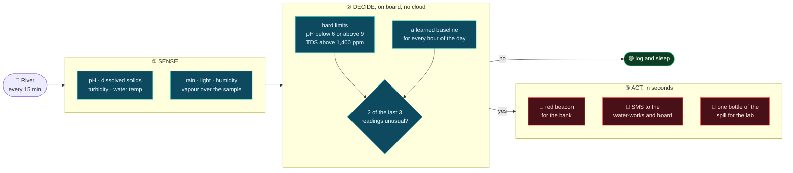

<br>

## ✨ Three ideas, one float

<table>
<tr>
<th width="33%">① It rides the river</th>
<th width="33%">② It names the spill</th>
<th width="33%">③ It keeps the evidence</th>
</tr>
<tr>
<td>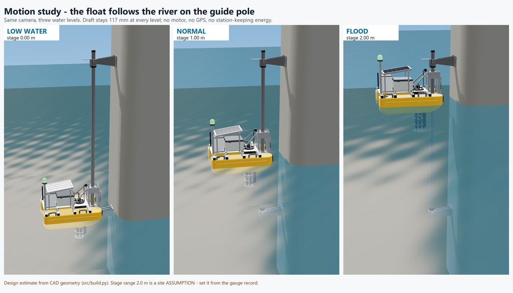</td>
<td>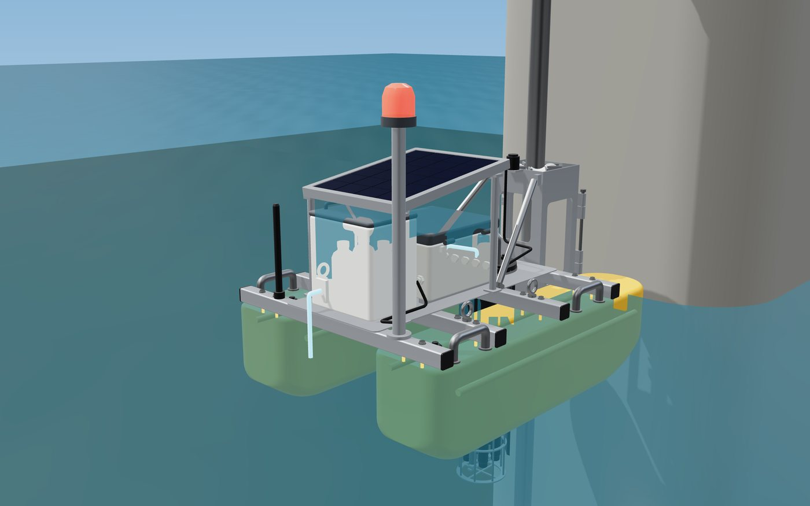</td>
<td>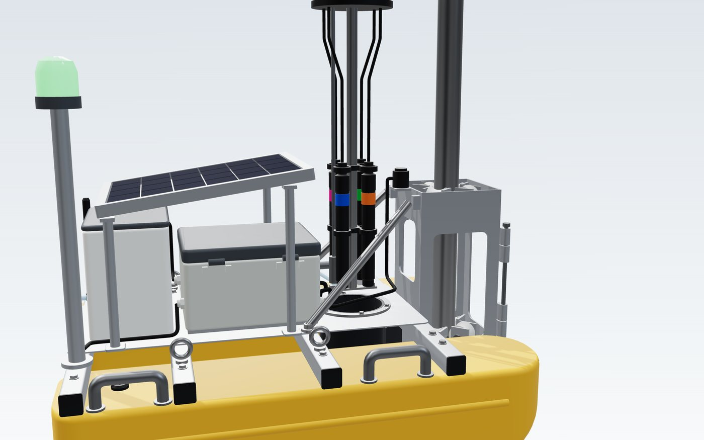</td>
</tr>
<tr>
<td>A float on a guide pole clamped to a bridge pier. The river lifts it <b>2 m</b> on 8 rollers: <b>no anchors, no motor, no riverbed work</b>. Installed and serviced from the bridge.</td>
<td>The <i>pattern</i> across its sensors says <b>industrial, acidic, runoff or solvent</b>. A broken sensor shows <b>FAULT</b>, never “normal”. The officer knows whom to call.</td>
<td>It bottles the water <b>at the moment of the spill</b>, so the lab tests the right water, not next month's. A lead for the pollution board.</td>
</tr>
</table>

<p align="center"><b>≈ 75 sentinels for the price of one real-time station</b><br><sub>≈ ₹48,000 each in production vs ₹35–40 lakh. A station measures more parameters; AquaSentinel covers more places.</sub></p>

<br>

## 🌊 It rides the river

<p align="center">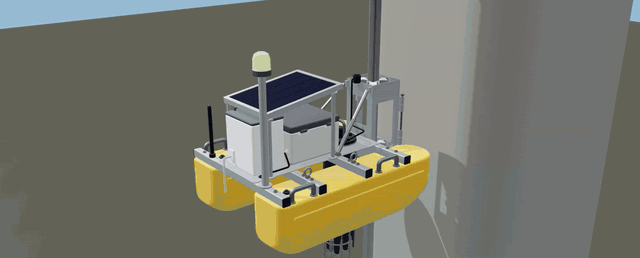<br><sub>3D animation of our R3 CAD model (2× speed): the river rises 2 m and falls back, the current turns the float like a weathervane, and the carriage gate opens for service.</sub></p>

| | | |
|:--:|:--:|:--:|
| **2 m** of river rise | **0** drive motors | **8** UHMW rollers on the pole |
| **14 / 14** design checks pass | **2.66** pole safety factor (the lowest we found) | **143 mm** freeboard · **2.27×** reserve buoyancy |

<details>
<summary><b>📏 Where the 2.66 comes from</b> (we quote the most conservative case)</summary>

<br>

The design load is a 1.5 m/s flood current plus a 500 N debris strike, applied quasi-statically at the float:

$$F_{drag} = \tfrac{1}{2}\,\rho\,v^2\,C_d\,A = \tfrac{1}{2}\cdot 1000 \cdot 1.5^2 \cdot 1.05 \cdot 0.120 \approx 142\ \text{N} \qquad F = 142 + 500 = 642\ \text{N}$$

| Idealisation of the 2-inch 316L pole | Peak stress | Safety factor (yield 170 MPa) |
|---|---:|---:|
| SOLIDWORKS Simulation, both clamp faces fixed | 38.3 MPa | 4.4 |
| Hand calculation, pinned ends | 54.8 MPa | 3.1 |
| Pinned ends + carriage moment | **64.0 MPa** | **2.66** |

Real clamps on bolted brackets are not rigid, so we quote the lowest. Not yet included: a dynamic impact factor, fatigue and vortex shedding.

</details>

<br>

## 🧠 It names the spill

Most monitors log numbers. AquaSentinel looks at the **pattern**:

| What happened | pH | Dissolved solids | Turbidity | Vapour | Rain | AquaSentinel says |
|---|:--:|:--:|:--:|:--:|:--:|:--|
| Industrial discharge | | 🔺🔺 | | | | 🔴 **INDUSTRIAL** |
| Acid spill | 🔻🔻 | | | | | 🔴 **ACIDIC** |
| Farm runoff after rain | | | 🔺 | | 🌧️ | 🟠 **RUNOFF** |
| Solvent or fuel | | | | 🔺 | | 🟣 **SOLVENT** |
| A sensor fails | ❓ | | | | | ⚪ **SENSOR FAULT**, never “normal” |

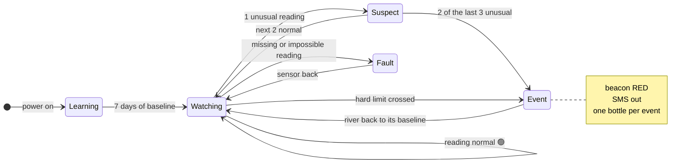

<sub>Designed logic. It is an early warning, not a chemical test: the bottle tells the lab what it was. So far proven on synthetic data (4 of 4 injected spills flagged in a 30-day test); real false-alarm rates need the pilot.</sub>

<br>

## 🧪 See it live: the 1:5 LIVE model

We did not stop at renders. We printed the float at **1:5** around the **real sensors**: pH, dissolved-solids, turbidity and temperature probes at full size, dipping into a dish of water; a Raspberry Pi in the base; rain, light and humidity sensors on the column; a gas sensor over the sample bottle; and the beacon on the mast. To show a different river, we swap the dish.

<p align="center"></p>

<table>
<tr>
<td width="50%">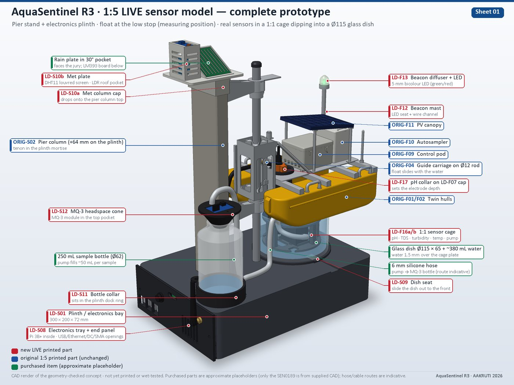</td>
<td width="50%">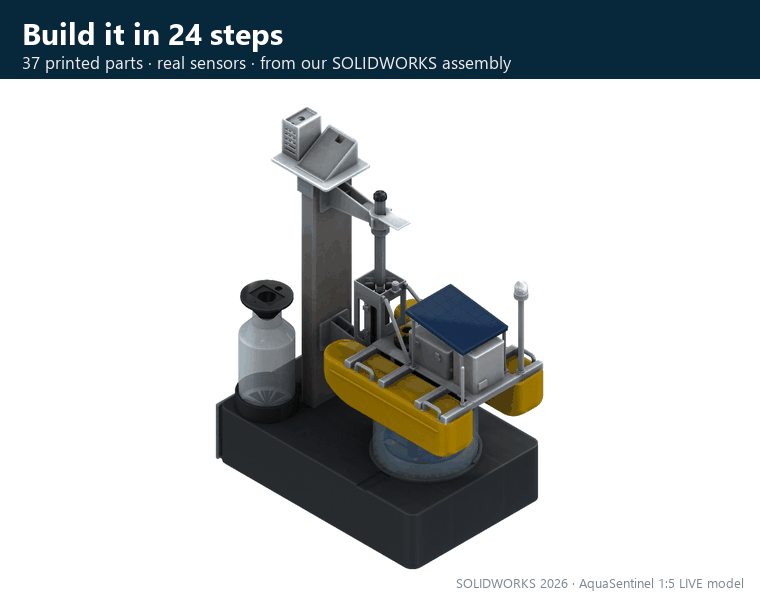</td>
</tr>
<tr>
<td align="center"><sub>Every part, labelled (render from our print files)</sub></td>
<td align="center"><sub>The 24 assembly steps, straight from our SOLIDWORKS assembly</sub></td>
</tr>
</table>

| **37** printed parts | **17** designed new in SOLIDWORKS | **1:1** real sensors, not mock-ups | **4** water samples, swapped in seconds |
|:--:|:--:|:--:|:--:|

> [!TIP]
> **Spin it in 3D right here on GitHub:** open [`AquaSentinel_LIVE_1to5_ASSEMBLED.stl`](02_LIVE_MODEL_1to5/AquaSentinel_LIVE_1to5_ASSEMBLED.stl) and drag. In colour, with the full-size R3 next to it: [**the 3D page of our website**](https://soham0777.github.io/AquaSentinel/#models).
> Build one yourself with the [**30-page SOLIDWORKS assembly manual**](02_LIVE_MODEL_1to5/00_ASSEMBLY_MANUAL/AquaSentinel_LIVE_1to5_Assembly_Manual_SOLIDWORKS.pdf) and the [37 print files](02_LIVE_MODEL_1to5/01_FINAL_STL).

<p align="center">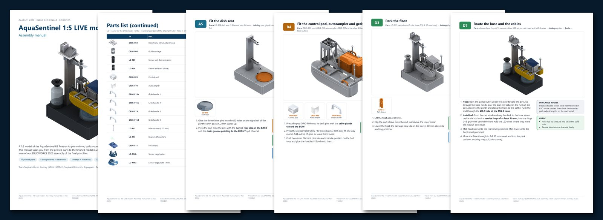</p>

<br>

## ⚡ One Raspberry Pi, eight sensors, three actions

<table>
<tr>
<td width="48%">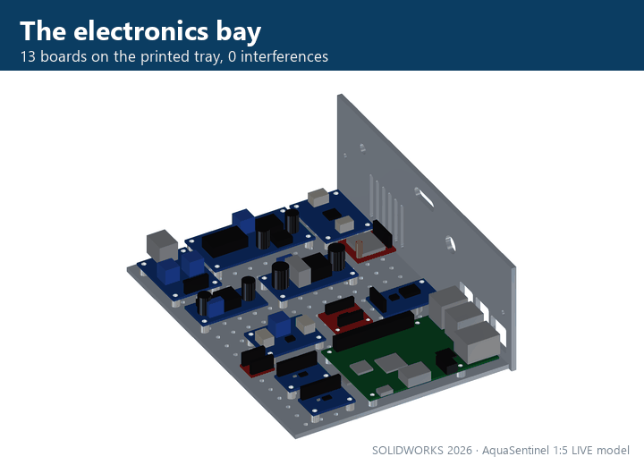</td>
<td>

**13 boards modelled as native SOLIDWORKS parts**, assembled on the printed tray of the model's base, checked with Interference Detection (the first layout had 2 clashes; we moved two boards; now **0**), and documented in drawing **AS-LIVE-ELEC-01** with a BOM, balloons, the pin map, the ADC channels and the power rails.

📄 [Electronics in SOLIDWORKS (7 pages)](03_ELECTRONICS_RASPBERRY_PI/AquaSentinel_Electronics_in_SOLIDWORKS.pdf)<br>
📄 [Raspberry Pi design document](03_ELECTRONICS_RASPBERRY_PI/AquaSentinel_RPi_Prototype_Design.pdf)<br>
📐 [Drawing AS-LIVE-ELEC-01](03_ELECTRONICS_RASPBERRY_PI/SOLIDWORKS_Electronics_Bay/AS-LIVE-ELEC-01_Electronics_Bay_Drawing.pdf)

</td>
</tr>
</table>

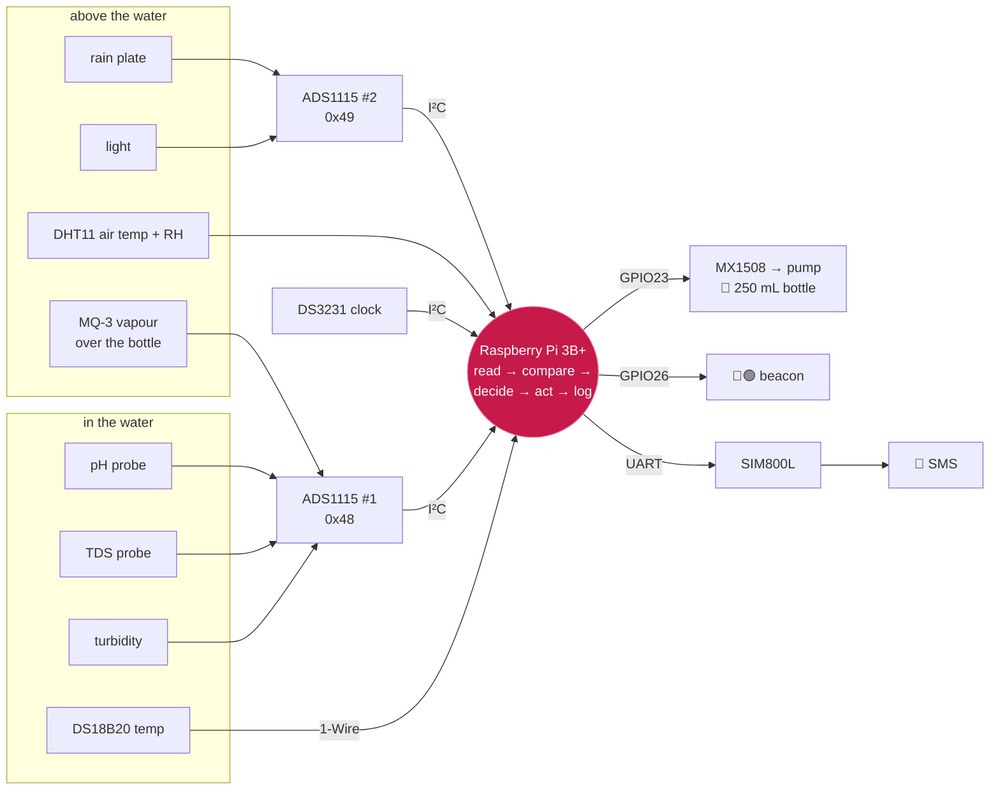

<details>
<summary><b>🔌 Pin map (BCM), ADC channels and power rails</b></summary>

<br>

| Pi pin | GPIO | Connects to | Notes |
|---|---|---|---|
| 1 | 3.3 V | ADS1115 × 2, DS3231, DHT11, DS18B20 pull-up, rain + LDR modules | about 20 mA total |
| 2, 4 | 5 V | Pi supply from Buck A | external 3 A fuse |
| 3 / 5 | GPIO2 / 3 | I²C SDA / SCL: ADS1115 0x48, 0x49, DS3231 0x68 | module pull-ups |
| 7 | GPIO4 | DS18B20 data (1-Wire) | 4.7 k to 3.3 V |
| 8 | GPIO14 TXD | SIM800L RXD via 1 k / 2 k divider | 3.3 V to 2.2 V |
| 10 | GPIO15 RXD | SIM800L TXD | 2.8 V level, read OK |
| 11 | GPIO17 | DHT11 data | dtoverlay dht11 |
| 12 | GPIO18 | SIM800L RST | |
| 13 | GPIO27 | Rain module DO | |
| 15 | GPIO22 | Rain module power switch | on only while reading |
| 16 | GPIO23 | MX1508 IN1 (pump) | IN2 tied low |
| 29 | GPIO5 | LDR module DO | |
| 31 | GPIO6 | pH board 5 V high-side switch | never with GPIO13 |
| 33 | GPIO13 | TDS board high-side switch | |
| 35 | GPIO19 | MQ-3 heater MOSFET | about 180 mA |
| 36 | GPIO16 | ACK / reset button | internal pull-up |
| 37 | GPIO26 | Status LED / beacon | via transistor |
| 6, 9, 14 | GND | Star ground at ADS1115 #1 | |

| ADC | Ch | Signal | Raw range | Conditioning | At the ADC |
|---|---|---|---|---|---|
| #1 0x48 | A0 | pH Po | 0–5 V | 12 k / 20 k, 1 k + 100 nF | 0–3.1 V |
| #1 | A1 | TDS | 0–2.3 V | 1 k + 100 nF | 0–2.3 V |
| #1 | A2 | Turbidity | 0–4.5 V | 12 k / 20 k, 1 k + 100 nF | 0–2.8 V |
| #1 | A3 | MQ-3 AO | 0–5 V | 12 k / 20 k, 1 k + 100 nF | 0–3.1 V |
| #2 0x49 | A0 | LDR AO | 0–3.3 V | 100 nF | 0–3.3 V |
| #2 | A1 | Rain AO | 0–3.3 V | 100 nF | 0–3.3 V |
| #2 | A2 | Battery voltage | 0–14.6 V | 100 k / 22 k | 0–2.6 V |

| Rail | From | Feeds | Protection |
|---|---|---|---|
| 12 V in | 12 V 3 A adapter (bench) or LiFePO4 12.8 V (field) | Buck A, B, C; pump | 3 A fuse, reverse polarity, TVS |
| 5.0 V | Buck A (5 V 5 A) | Raspberry Pi 3B+ | external fuse on the 5 V pins |
| 4.0 V | Buck B (LM2596) | SIM800L VBAT | 1000 µF low-ESR + 100 nF + 5.1 V Zener |
| 5.0 V | Buck C (LM2596S) | pH, TDS, turbidity, MQ-3 boards | switched per sensor |

</details>

<details>
<summary><b>🔋 Energy: about 3 days without sun (design estimate)</b></summary>

<br>

In the field the Pi is woken for about 3 minutes every 15 minutes by a timer board.

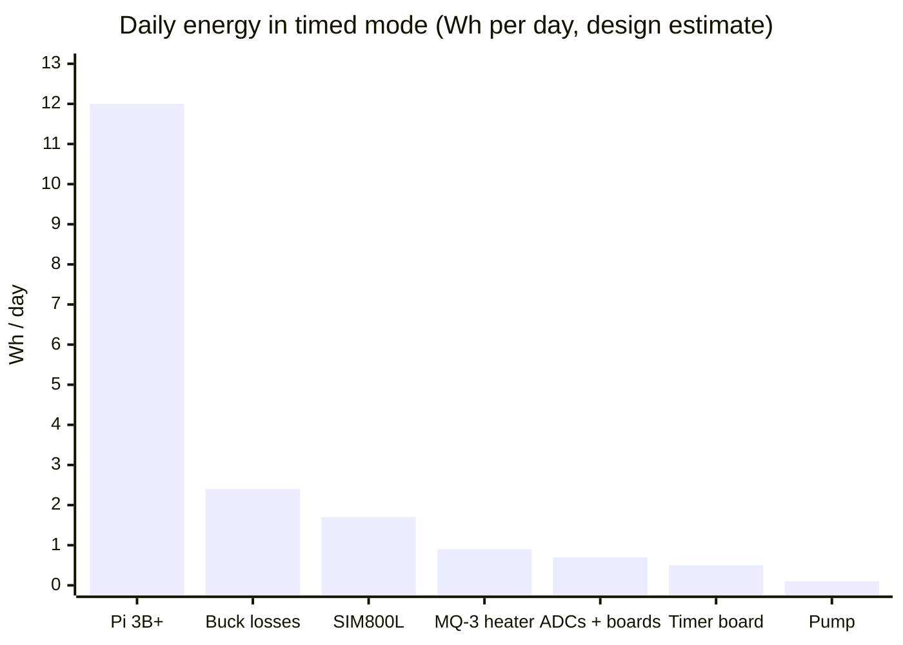

≈ 19 Wh/day against 61 Wh usable (12.8 V 6 Ah LiFePO4 at 80 % depth of discharge) gives **≈ 3 days** with no sun; a 20 W panel gives ≈ 39 Wh on a monsoon day. Nothing is measured yet: at the booth the model runs on mains.

</details>

<sub>Why we moved from the ESP32 (semi-final) to the Raspberry Pi: these are parts our team has on the bench and can test now, Python runs the logic, the data log and the SMS on one board, and the electronics fall from about ₹80,000 to about ₹11,000. Dissolved oxygen went with the industrial probes.</sub>

<br>

## 📐 The full-size R3

<p align="center">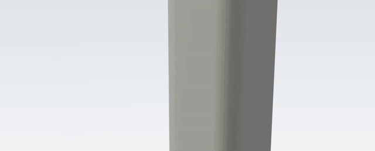<br><sub>3D animation of our 66-part R3 assembly (2× speed)</sub></p>

The R3 geometry comes from our own parametric model; it was **assembled, checked and simulated in SOLIDWORKS**: 66 parts, each with a material and a part number, packed with Pack and Go, plus a STEP file for every part.

<table>
<tr>
<td width="33%">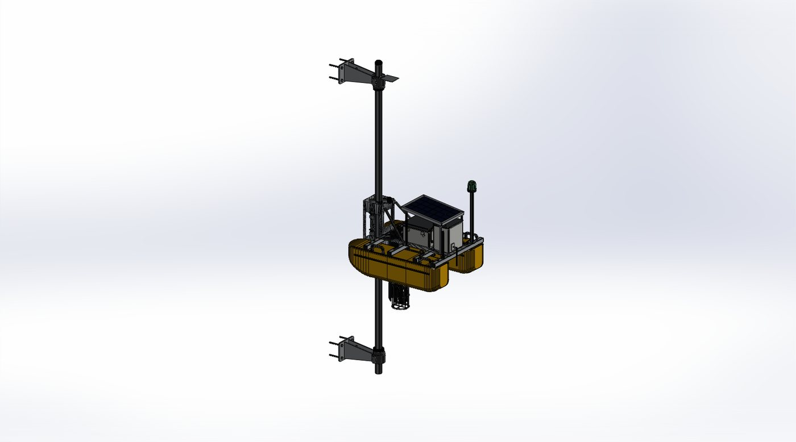<br><sub>The assembly in SOLIDWORKS</sub></td>
<td width="33%">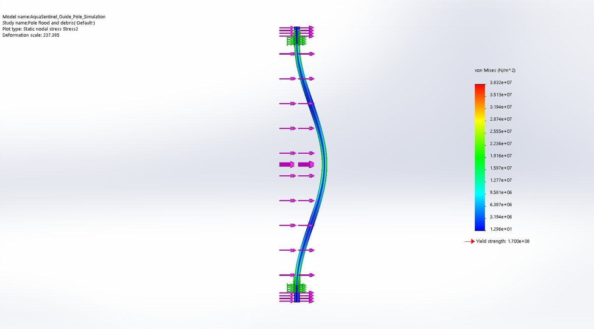<br><sub>SOLIDWORKS Simulation: the guide pole</sub></td>
<td width="33%">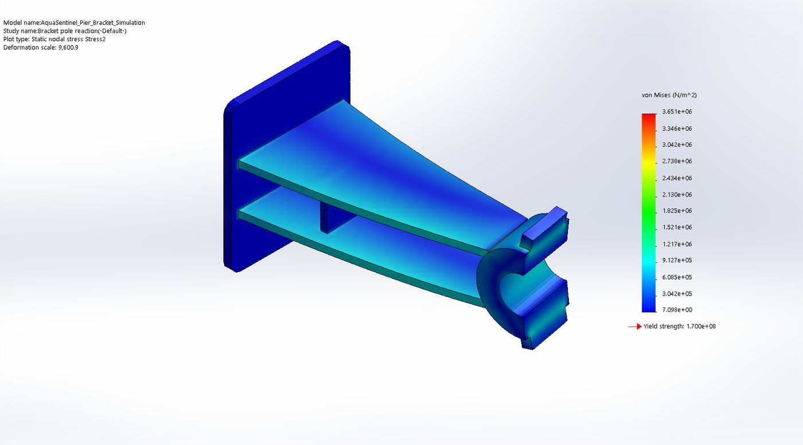<br><sub>SOLIDWORKS Simulation: the pier bracket</sub></td>
</tr>
<tr>
<td>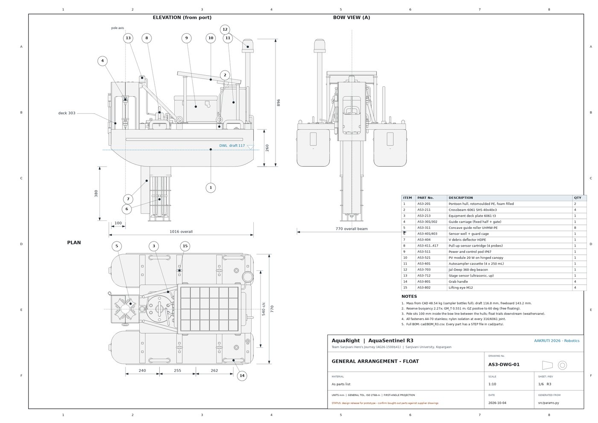<br><sub>6-sheet drawing set, computed from the CAD</sub></td>
<td>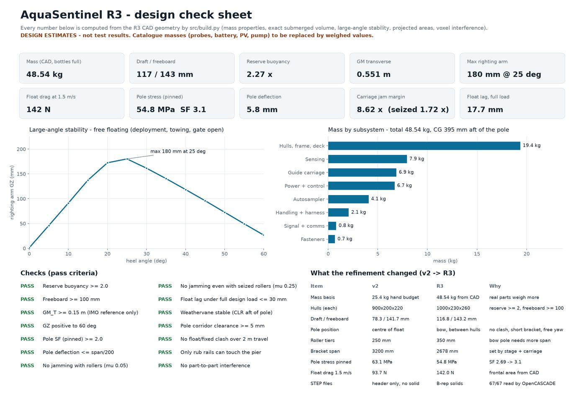<br><sub>14 design checks, computed from the CAD</sub></td>
<td>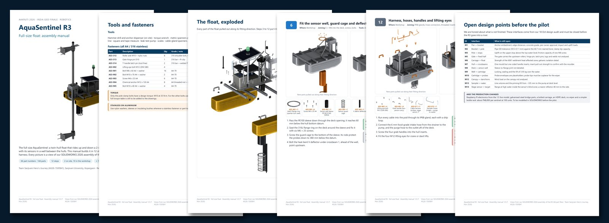<br><sub><a href="05_R3_FULL_SIZE_CAD/00_ASSEMBLY_MANUAL/AquaSentinel_R3_Assembly_Manual_SOLIDWORKS.pdf">27-page R3 assembly manual</a></sub></td>
</tr>
</table>

<details>
<summary><b>✅ All 14 design checks</b></summary>

<br>

| Check | Result | Criterion |
|---|---|---|
| Reserve buoyancy | 2.27× | ≥ 2.0× |
| Freeboard | 143 mm | ≥ 100 mm |
| Transverse GM | 0.55 m | ≥ 0.15 m (IMO reference) |
| Righting arm | positive to 60°, max 180 mm at 25° | positive to 60° |
| Pole safety factor, pinned | 3.1 (2.66 with carriage moment) | ≥ 2.0 |
| Pole deflection, pinned | 5.8 mm | ≤ span / 200 (13.4 mm) |
| Jamming, rollers (μ 0.05) | margin 8.6 | no self-locking |
| Jamming, seized rollers (μ 0.25) | margin 1.7 | no self-locking |
| Float lag at full design load | 17.7 mm | ≤ 30 mm |
| Weathervane stability | lateral centre 351 mm aft of the pole | aft of the pole |
| Pole corridor clearance | 9.7 mm | ≥ 5 mm |
| Float vs fixed parts, 2 m travel | no clash | none |
| Only rub rails touch the pier | rub rail 12 mm outboard | rub rails outermost |
| Part-to-part interference | none in 101 pairs | none |

Every value is computed from the R3 CAD geometry ([`05_Design_Checks`](05_R3_FULL_SIZE_CAD/05_Design_Checks)). Masses are partly catalogue estimates, so we weigh the parts when they are built.

</details>

> [!TIP]
> **Open the CAD:** the [SOLIDWORKS Pack and Go](05_R3_FULL_SIZE_CAD/02_SOLIDWORKS_PackAndGo) (saved in 3DEXPERIENCE SOLIDWORKS, so older desktop versions cannot open it), the [assembly STEP](05_R3_FULL_SIZE_CAD/08_Assembly_STEP_GLB) for any CAD tool, or [any single part as STL](05_R3_FULL_SIZE_CAD/07_Parts_STEP_STL), which GitHub shows in 3D.

<br>

## 💰 What it costs, and how it pays

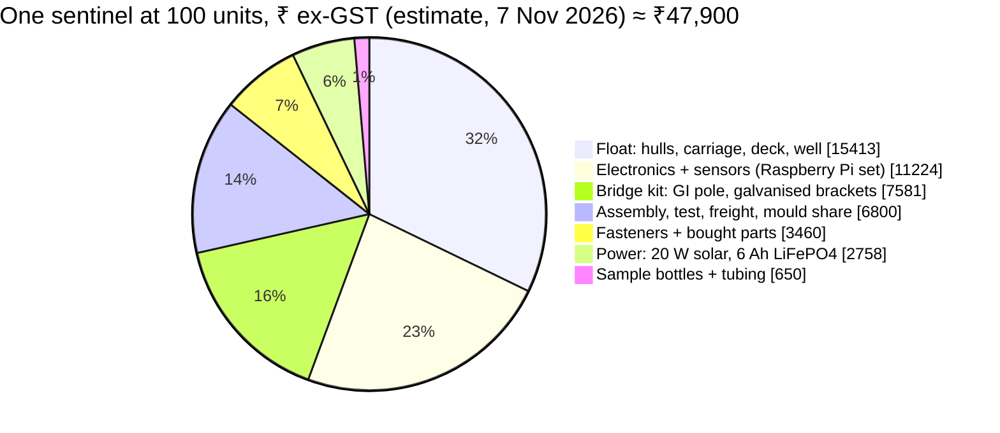

<table>
<tr>
<td align="center" width="25%"><h2>₹48,000</h2>to build one sentinel<br><sub>at 100 units, ex-GST · first prototype ≈ ₹65,000</sub></td>
<td align="center" width="25%"><h2>₹8,000 / month</h2>paid by the board or water-works<br><sub>sentinel, installation, monthly service, alerts, 4 lab samples a year</sub></td>
<td align="center" width="25%"><h2>≈ 12 months</h2>to pay back the hardware<br><sub>then ≈ 40 % margin over a 5-year contract</sub></td>
<td align="center" width="25%"><h2>−47 %</h2>value engineering<br><sub>316L → galvanised steel, welded → bolted aluminium + HDPE</sub></td>
</tr>
</table>

**Who it serves first:** the water-works operator, who can close the intake before the spill reaches town · the pollution board officer, who learns when and where to sample · farmers, who get a record of the water they use · industrial estates, who get independent proof of a clean discharge.

<sub>Estimates, not quotes: line by line in [`07_COST_AND_BUSINESS`](07_COST_AND_BUSINESS). Market sizing on 3 floats per site and ₹8,000 a month is illustrative: Maharashtra's 54 sites ≈ ₹1.56 crore a year, India's 296 ≈ ₹8.5 crore a year.</sub>

<br>

## 🧭 The journey

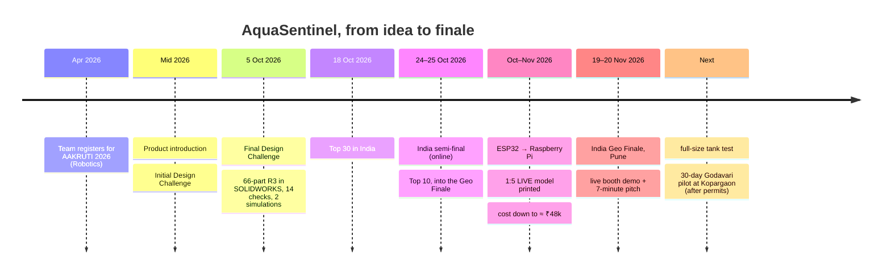

<br>

## 🚦 Where we really are

| Level | What it shows | Status |
|---|---|:--:|
| 0 · Digital design | CAD, calculations and FEA; the logic flags 4 of 4 simulated spills | ✅ done |
| 1 · 1:5 LIVE model | 37 printed parts; the float rides its rod; real sensors at 1:1 in a dish | 🟡 printed, assembly now |
| 2 · Electronics on the model | the Pi reads, decides, acts: beacon, pump, SMS; wet test with 4 samples | 🟡 before 19 Nov |
| 3 · Tank test | full-size float on a 2-inch pole: draft, 2 m travel, roller friction | ⚪ planned |
| 4 · Godavari pilot | 30 days at Kopargaon; alerts checked against lab samples | ⚪ after permits |

> [!IMPORTANT]
> Every figure here is a **design estimate** unless it says otherwise. The 1:5 model proves the measurement chain from sensor to SMS, not river-scale performance; that needs the tank test and the pilot.

<details>
<summary><b>📍 Where it all happens</b></summary>

<br>

```geojson
{
  "type": "FeatureCollection",
  "features": [
    { "type": "Feature", "properties": { "name": "Kopargaon, on the Godavari: our home and the planned pilot site (approximate)", "marker-color": "#35d0ba" },
      "geometry": { "type": "Point", "coordinates": [74.4797, 19.8833] } },
    { "type": "Feature", "properties": { "name": "Pune: AAKRUTI 2026 India Geo Finale, 19–20 Nov (approximate)", "marker-color": "#ff4d4d" },
      "geometry": { "type": "Point", "coordinates": [73.7380, 18.5910] } }
  ]
}
```

</details>

<br>

## 🗂️ What's in this repository

| Folder | Inside |
|---|---|
| 🎤 [`01_FINALE_PRESENTATION`](01_FINALE_PRESENTATION) | our 7-minute finale deck (PDF): 16 pitch slides + 12 Q&A backups |
| 🧩 [`02_LIVE_MODEL_1to5`](02_LIVE_MODEL_1to5) | the 1:5 LIVE model: SOLIDWORKS assembly manual, 37 STL print files, 17 native SOLIDWORKS parts, the SOLIDWORKS assembly, design notes |
| ⚡ [`03_ELECTRONICS_RASPBERRY_PI`](03_ELECTRONICS_RASPBERRY_PI) | Raspberry Pi design (pin map, power, logic), the electronics bay in SOLIDWORKS, drawing AS-LIVE-ELEC-01 |
| 🧴 [`04_SENSOR_HOUSING`](04_SENSOR_HOUSING) | a simple printed housing for the sensors |
| 📐 [`05_R3_FULL_SIZE_CAD`](05_R3_FULL_SIZE_CAD) | full-size R3: assembly manual, BOM, Pack and Go, drawings, design checks, renders, STEP/STL of every part, assembly STEP + GLB |
| 🧮 [`06_SIMULATION`](06_SIMULATION) | SOLIDWORKS Simulation of the pole and the pier bracket, with reports |
| 💰 [`07_COST_AND_BUSINESS`](07_COST_AND_BUSINESS) | researched costed BOM, Raspberry Pi cost, value-engineered ≈ ₹48,000 cost |
| 🌐 [`docs`](docs) | the website (GitHub Pages): 3D models, videos, an interactive spill simulator |

<sub>Looking for the semi-final version (ESP32 firmware, detector benchmark, old website)? It is preserved under the tag [`semifinal-oct2026`](../../tree/semifinal-oct2026); the October FDC under [`v1.0-fdc`](../../tree/v1.0-fdc).</sub>

<br>

## 👥 Team Sanjivani Hero's Journey

<table>
<tr>
<td align="center" width="20%"><b>Soham Kadu</b><br><sub>Team Leader · Project Lead</sub></td>
<td align="center" width="20%"><b>Prasad Ugale</b><br><sub>System Design</sub></td>
<td align="center" width="20%"><b>Bhakti Kadam</b><br><sub>Electronics Lead</sub></td>
<td align="center" width="20%"><b>Tanmay Pendbhaje</b><br><sub>Software Lead</sub></td>
<td align="center" width="20%"><b>Dr. Kiran Wakchaure</b><br><sub>Mentor · Director Projects</sub></td>
</tr>
</table>

<p align="center">Sanjivani University, Kopargaon, Maharashtra · AAKRUTI Innovation Competition 2026 by Dassault Systèmes · Team ID AG26-1500$41</p>

<div align="center">

**Built with** SOLIDWORKS 2026 · SOLIDWORKS Simulation · 3DEXPERIENCE (3DSwym, ENOVIA Project Planner) · Raspberry Pi · Python

<sub>Watching the river every 15 minutes. · Released under the [MIT License](LICENSE).</sub>

</div>
