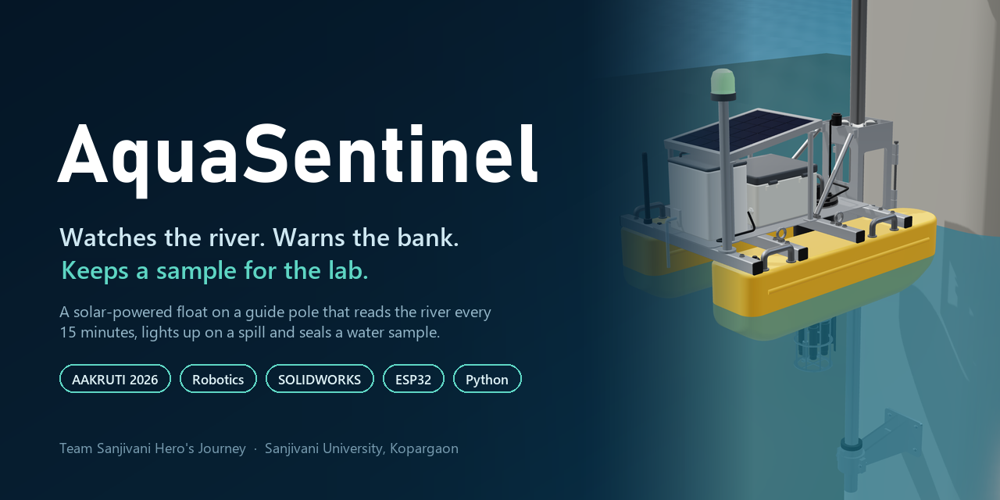

# AquaSentinel R3: a river water-quality robot on a guide pole

**Team Sanjivani Hero's Journey** · Sanjivani University, Kopargaon · AAKRUTI Innovation Competition 2026 (Robotics) · India Semi-Final

**Website, 3D viewer and dashboard:** https://soham0777.github.io/AquaSentinel/

AquaSentinel is a solar float that rides a stainless guide pole clamped to a bridge pier. It is designed to:
- read pH, conductivity, dissolved oxygen, turbidity, temperature and river level every 15 minutes;
- decide on board, on an ESP32;
- when a spill passes, turn its beacon red, send an LTE alert and bottle one sample for the lab.

The river lifts the float up and down the pole, so there is no drive motor.

> **Status, honestly:** designed, calculated and simulated. It has not yet been built at full size or tested in water. The detection
> logic has been tested on synthetic data only. Every figure below is a design estimate unless it says otherwise.

## Start here

| Want to… | Open |
|---|---|
| Read everything in one place | [`AquaSentinel_Complete_Project_Dossier.pdf`](AquaSentinel_Complete_Project_Dossier.pdf): design, checks, electronics, costs, business case, prior art, pitch script, jury Q&A, sources |
| See the semi-final presentation | [`02_PRESENTATION_SEMIFINAL`](02_PRESENTATION_SEMIFINAL): deck (.pptx and .pdf), 8-minute script, video |
| Open the CAD | [`01_DESIGN_CAD_AND_DRAWINGS`](01_DESIGN_CAD_AND_DRAWINGS) |

## Folder map

| Folder | What's inside |
|---|---|
| [`01_DESIGN_CAD_AND_DRAWINGS`](01_DESIGN_CAD_AND_DRAWINGS) | SOLIDWORKS Pack and Go (66 parts + assembly), assembly STEP and GLB, STEP/STL of every part, 6 × A3 drawings, the 14 design checks, renders, `BOM_R3.csv` |
| [`02_PRESENTATION_SEMIFINAL`](02_PRESENTATION_SEMIFINAL) | final deck, PDF backup, 8-minute pitch script, video |
| [`03_BUSINESS_COSTING_AND_BOM`](03_BUSINESS_COSTING_AND_BOM) | costed bill of materials (every line with its Indian price, source and basis) |
| [`04_SIMULATION_AND_ANALYSIS`](04_SIMULATION_AND_ANALYSIS) | SOLIDWORKS Simulation models and reports (pole, bracket), detector and plume plots, power budget, design-check data |
| [`05_SCALE_MODEL_1to5`](05_SCALE_MODEL_1to5) | 3D-print files and guide for the 1:5 model (float, stand, parts), and the scripts that generate them |
| [`06_ELECTRONICS_AND_FIRMWARE`](06_ELECTRONICS_AND_FIRMWARE) | ESP32 firmware (PlatformIO, with an Arduino IDE viewing copy), hardware notes, schematic, power budget, bench-demo plan |
| [`07_VIDEOS`](07_VIDEOS) | where each video is |
| [`09_SOURCE_CODE_AND_WEBSITE`](09_SOURCE_CODE_AND_WEBSITE) | the CAD generator, analytics and benchmark, project plan |
| [`docs`](docs) | the website (GitHub Pages), dashboard and 3D viewer |

**Opening the CAD:**
- The Pack and Go was saved in 3DEXPERIENCE SOLIDWORKS, so older desktop versions (for example 2019) can't open it.
- Use [`AquaSentinel_R3_Assembly_MidWater.step`](01_DESIGN_CAD_AND_DRAWINGS/Assembly_STEP_GLB) in any CAD tool.
- Or open the `.glb` in the Windows 3D Viewer.

## Key figures

| Topic | Figure | Support |
|---|---|---|
| Float | 48.5 kg (CAD estimate), freeboard 143 mm, reserve buoyancy 2.27×, righting arm positive to 60° | calculated from the CAD |
| Level tracking | rides 2 m of river rise on 8 UHMW rollers; anti-jam margin 8.6 | calculated |
| Structure | pole safety factor **2.66**, our most conservative **static** load case (1.5 m/s current + 500 N debris); FEA with fixed ends gives 4.4. Dynamic impact and anchors are still to verify | calculated + SOLIDWORKS Simulation |
| Power | ≈ 12 days without sun, including an assumed beacon load | preliminary estimate |
| Detection | 4 of 4 injected spills flagged within 30 minutes | synthetic data only |
| Alarm limits | our operating limits, tunable per site: pH outside 6–9; DO below 4 mg/L (the CPCB Class C/D criterion); EC above 2,250 µS/cm (the CPCB Class E limit) | design |
| Cost (ex-GST, Indian prices of 23 Oct 2026) | prototype float ₹1,57,492 + bridge kit ₹29,218 = ₹1,86,710; ≈ ₹1,48,055 at 100 units | estimate |
| Proposed service | ₹12,000 a month per float on a 5-year contract; hardware paid back in ≈ 20 months; ≈ 46 % margin over the contract | proposal |
| Problem | 296 polluted river stretches/locations in India; Maharashtra 54, the most (CPCB, published 2025) | published |

## Not in this repository

- Private competition notes.
- Official evaluation reports.
- Personal contact details.
- The two 1080p video masters, which are too large for GitHub.

## Team

Soham Kadu (Project Lead) · Shriraj Kamble (System Design) · Bhakti Kadam (Electronics Lead) · Tanmay Pendbhaje (Software Lead) · Mentor: Dr. Kiran Wakchaure

Released under the [LICENSE](LICENSE) in this repository.
