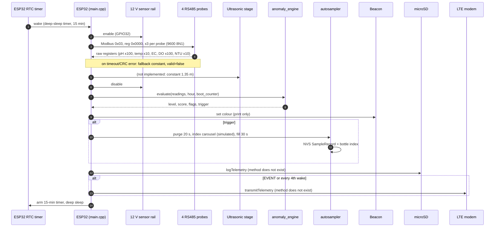
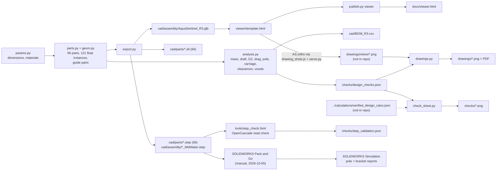
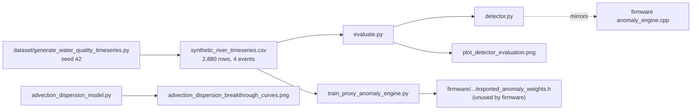

# Data flow

Three independent data flows exist in the repository: the **field flow** the device is meant to run, the **design flow** that
produces every mechanical artefact from one parameter file, and the **analytics flow** that exercises the decision logic on
synthetic data. Each is shown as designed, with its verified status. Interfaces are catalogued in [INTERFACE_REGISTER.md](INTERFACE_REGISTER.md).

## 1. Field data flow (designed; firmware does not compile)

### 1.1 Data items and units along the path

| Stage | Item | Type / unit | Source |
|---|---|---|---|
| Probe register | pH | uint16, pH × 100 (assumed) | [sensor_interface.cpp:122](../../firmware/edge_node/src/sensor_interface.cpp#L122) |
| Probe register | water temperature | uint16, °C × 10 (assumed; signed temperatures not handled) | [:121](../../firmware/edge_node/src/sensor_interface.cpp#L121) |
| Probe register | EC | uint16, µS/cm (0–65,535; probe range 10–20,000) | [:132](../../firmware/edge_node/src/sensor_interface.cpp#L132) |
| Probe register | DO | uint16, mg/L × 100 | [:142](../../firmware/edge_node/src/sensor_interface.cpp#L142) |
| Probe register | turbidity | uint16, NTU × 10 (confirmed by DFRobot forum) | [:152](../../firmware/edge_node/src/sensor_interface.cpp#L152) |
| `SensorReadings` | ph, ec, do_val, turbidity, temperature, stage | float32; stage in m | [anomaly_engine.h:20-29](../../firmware/edge_node/include/anomaly_engine.h#L20-L29) |
| `SensorReadings` | timestamp | uint32 seconds from `time(NULL)` (clock never set) | [sensor_interface.cpp:168](../../firmware/edge_node/src/sensor_interface.cpp#L168) |
| `SensorReadings` | valid[6] | bool per channel (ignored downstream) | [:196-198](../../firmware/edge_node/src/sensor_interface.cpp#L196-L198) |
| `AnomalyResult` | level, max_score, reason[128], contributing_flags, autosampler_trigger | enum, float, text, bitmask (bit0 pH, bit1 EC, bit2 DO, bit3 turbidity) | [anomaly_engine.h:31-37](../../firmware/edge_node/include/anomaly_engine.h#L31-L37) |
| RTC memory | 24-bin pH/DO baselines, EC/turbidity baselines, outlier history, risk state, boot counter | float pairs (μ, d), bytes | [anomaly_engine.cpp:14-26](../../firmware/edge_node/src/anomaly_engine.cpp#L14-L26) |
| NVS (`aquasampler`) | `bottle_idx`, `last_ts`, `rec_0`…`rec_3` (`SampleRecord`: index, timestamp, pH, EC, DO, turbidity, reason[64], collected) | binary struct | [autosampler.cpp:106-115](../../firmware/edge_node/src/autosampler.cpp#L106-L115) |
| microSD CSV (older schema) | epoch_timestamp, ph, turbidity_ntu, temp_c, ec_us_cm, do_mg_l, depth_m, battery_v, anomaly_score, is_anomaly, alert_desc | text | [microsd_logger.cpp:23](../../firmware/edge_node/src/microsd_logger.cpp#L23) |
| Telemetry JSON (older schema) | device_id, fw_ver, stretch, boot_seq, ts, telemetry{ph, turb_ntu, temp_c, ec_us, do_mg, depth_m, v_batt}, anomaly_engine{is_alert, score, z_score, type} | ArduinoJson ≤ 512 B | [telemetry_comm.cpp:9-36](../../firmware/edge_node/src/telemetry_comm.cpp#L9-L36) |

Gaps on this path: no battery-voltage measurement (INA226 has no driver), so the `battery_v`/`v_batt` fields have no source; no
stage data; no time base; the logger and telemetry modules belong to an older data model and must be rewritten against
`SensorReadings`/`AnomalyResult`.

### 1.2 Time base

The only clock in use is the ESP32 system time, never set from SNTP, the LTE network or the DS3231. After a power-on reset it starts
at 1970-01-01, and between deep sleeps it is kept by the RC slow clock, whose drift is large. Consequences: the hour-of-day bins
are not local time, sample time stamps are not evidence-grade, and the sampler lockout can be bypassed after a reset
([autosampler.cpp:61-68](../../firmware/edge_node/src/autosampler.cpp#L61-L68)). The dataset and the dashboard label times "UTC";
the diurnal photosynthesis cycle follows local solar time (IST = UTC + 5:30).

## 2. Design data flow (working, reproducible)

Units: millimetres and kilograms inside the engine; STEP files declare millimetres; GLB uses metres under a Y-up root
(`np.diag([0.001]*3) @ Rx(-90)`, [build.py:396](../../mechanical/src/build.py#L396)); the viewer converts with `m2t()`
([template.html:194](../../mechanical/viewer/template.html#L194)).

Verified: `build.py` regenerates every CAD/BOM/check file identically (STEP differs only in its header time stamp);
`publish.py viewer` regenerates `docs/viewer.html` exactly. Not reproducible from the repository: drawing views, drawings,
check-sheet v2 table, motion-study triptych, assembly GIF, renders, videos, SOLIDWORKS files and FEA reports.

## 3. Analytics data flow (working on synthetic data)

Dataset schema (actual, not the one in `dataset/README.md`): `timestamp` (ISO, naive, starting 2026-03-01T00:00), `step_index`,
`ph`, `turbidity_ntu`, `temp_c`, `ec_us_cm`, `do_mg_l`, `depth_m`, `flow_velocity_m_s`, `event_label` (NORMAL/CONTAMINATION),
`is_anomaly` (0/1), `anomaly_type` (NONE, INDUSTRIAL_ACID_DUMP, RAW_SEWAGE_OVERFLOW, CHEMICAL_SALT_SPILL, HEAVY_SILT_SURGE).
Full analysis in [ANALYTICS_AND_DATA_REVIEW.md](../analytics/ANALYTICS_AND_DATA_REVIEW.md).

## 4. Presentation data flow

`docs/index.html` embeds `viewer.html` (iframe) and links the dashboard, PDF deck and videos. The dashboard has no data input: all
values are constants in `app.js` changed by demo buttons. There is no path today from a float, or from any file in the repository,
into the dashboard.
