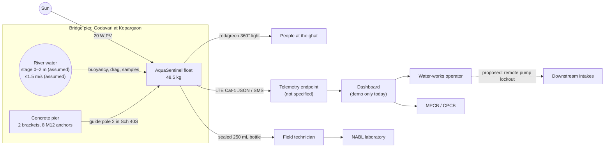
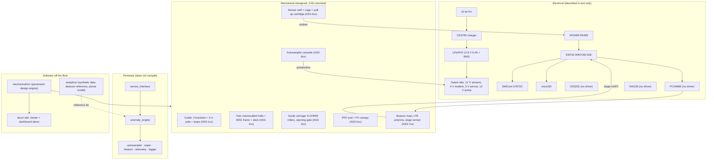

# System architecture

What AquaSentinel is designed to be, reconstructed from the repository at commit `840f1a6`, and how much of each part exists.
Companion documents: [DATA_FLOW.md](DATA_FLOW.md) (data paths and formats), [INTERFACE_REGISTER.md](INTERFACE_REGISTER.md)
(every interface with its status), [CODE_REVIEW.md](../audit/CODE_REVIEW.md), [MECHANICAL_DESIGN_REVIEW.md](../mechanical/MECHANICAL_DESIGN_REVIEW.md).

## 1. Purpose, problem and users

**Problem.** Indian rivers are sampled monthly or quarterly under the national programme, so a pollution pulse lasting hours (a
night-time effluent dump, a sewage overflow) usually passes unseen, and by the time anyone samples there is nothing left to test
([README.md:39-44](../../README.md#L39-L44)). The target site is the Godavari at Kopargaon, Maharashtra.

**Concept.** A solar-powered, unpowered-for-station-keeping float that rides a stainless guide pole clamped to a bridge pier. Every
15 minutes it measures pH, conductivity, dissolved oxygen, turbidity, temperature and river stage; it decides on board whether the
water is abnormal; when it is, it turns a 360° beacon red, sends an LTE/SMS alert and pumps a 250 mL sample into a sealed bottle for
a certified laboratory.

**Intended users** ([docs/index.html:206-208](../index.html#L206-L208), dashboard): water-works operators (close intakes in time),
the pollution control board / MPCB (a timed physical sample), and people at the ghats (a light that needs no phone).

**What the project is today:** a complete, reproducible *mechanical design* with design-stage checks and two SOLIDWORKS static
studies; a *decision algorithm* exercised on synthetic data; a *firmware architecture* that does not compile; a *demo dashboard*
and an *interactive 3D viewer*. Nothing has been built or put in water ([README.md:106-109](../../README.md#L106-L109)).

## 2. System context

External dependencies the design relies on but the repository does not specify: telemetry server / MQTT broker / SMS gateway,
an operator organisation, permits for installation on a bridge pier and for sampling, a laboratory agreement, site flood data.

## 3. Subsystems

| Subsystem | Responsibility | Primary evidence |
|---|---|---|
| Guide (AS3-101…114) | Hold the float laterally, let it travel 2 m vertically, react current and debris loads into the pier | [parts.py:652-729](../../mechanical/src/parts.py#L652-L729), DWG-02/06, pole & bracket FEA |
| Float structure (AS3-201…213, 801-802) | Buoyancy, stability, mounting for everything else, handling | [parts.py:161-216](../../mechanical/src/parts.py#L161-L216), DWG-01/05 |
| Guide carriage (AS3-301…321) | Low-friction vertical motion without jamming; tool-free release from the pole | [parts.py:218-332](../../mechanical/src/parts.py#L218-L332), DWG-03 |
| Sensing well & cartridge (AS3-401…424) | Protect probes, place them at fixed depth, lift out for service, carry wiper and sample intake | [parts.py:334-442](../../mechanical/src/parts.py#L334-L442), DWG-04 |
| Power & control (AS3-501…523) | Energy harvest/storage, controller, enclosure, shading | [parts.py:444-535](../../mechanical/src/parts.py#L444-L535), [power_budget.csv](../../hardware/power_budget.csv) |
| Autosampler (AS3-601…606) | Purge, fill, store four 250 mL samples | [parts.py:537-572](../../mechanical/src/parts.py#L537-L572), [autosampler.cpp](../../firmware/edge_node/src/autosampler.cpp) |
| Signalling & comms (AS3-701…712) | Beacon, LTE antenna, upward ultrasonic stage sensor | [parts.py:574-599](../../mechanical/src/parts.py#L574-L599) |
| Firmware | Sense → decide → act in a 15-min deep-sleep cycle | `firmware/edge_node/src/*` |
| Analytics | Synthetic benchmark, decision reference, transport scenario | `analytics/*` |
| Design engine | Geometry, checks, CAD/BOM/drawings from one parameter file | `mechanical/src/*` |
| Presentation | Website, 3D viewer, dashboard demo, deck, videos | `docs/*` |

## 4. Operating concept (as designed)

1. **Install:** anchor two identical 316L brackets to the pier face 2,678 mm apart, drop in the pole, fit stop collars, buffers and the
   stage target plate; place the float, close the carriage gate with two T-handle pins ([DWG-02](../../mechanical/drawings/AS3-DWG-02_Installation_and_Stage_Envelope.png)).
2. **Operate:** the river lifts the float on eight concave rollers; the current turns it about the pole like a weathervane. Every
   15 minutes the ESP32 wakes, powers the probes, reads them, decides, logs, sends hourly (or immediately on an event), sleeps.
3. **Alert:** hard limits (pH outside 6–9, DO < 4 mg/L, EC > 2250 µS/cm) act on one reading; statistical outliers act on 2 of the last
   3 readings after a 7-day learning period. On EVENT: beacon red, alert, purge 20 s + fill 30 s into the next bottle.
4. **Service:** canopy hinges up, pod and sampler lids open, the bottle carousel lifts out for the lab, the sensor cartridge lifts
   out through a deck hatch; wiper runs every 6 h.
5. **Flood:** beyond 2 m stage or 1.5 m/s, "park at the top stop or open the gate and retrieve" ([drawings.py:161](../../mechanical/src/drawings.py#L161)).

The float cannot carry a person (reserve buoyancy ≈ 62 kg above its own weight), so "service from the deck" means from a boat,
or after retrieving the float to the bank.

## 5. Implementation status matrix

Legend — **Code**: implemented and exercised; **Code (untested)**: implemented, never run on hardware; **Stub**: code exists but only
prints or simulates; **Simulation**: demonstrated only on synthetic data or in a model; **Design**: geometry/drawings/analysis only;
**Document**: described in text only; **Absent**.

| Function | Status | Evidence / gap |
|---|---|---|
| Float geometry, mass, buoyancy, stability | Design (reproducible) | build.py rerun identical; no weighed parts, no tank test |
| Guide pole / bracket strength | Design (hand calc + FEA) | FEA uses fixed ends; carriage couple omitted (SF 2.66 pinned with couple) |
| Carriage anti-jamming, clearances | Design | checked at yaw 0, gate closed only |
| Probe reading over RS485 Modbus | Code (untested) | correct framing/CRC; baud/address mismatch with probe defaults; fallback constants on failure |
| River stage measurement | Stub | constant 1.35 m |
| Temperature | Code (untested) | from the pH probe register |
| Probe warm-up | Stub | 1 s instead of 30 s |
| Timekeeping (RTC, time-stamps) | Absent | `time(NULL)` never set; DS3231 has no driver |
| Smoothing / DSP | Absent (dead code) | `dsp_filters` never called |
| Hard-limit + statistical decision | Code (untested) on device; Simulation | logic replayed in Python (port + reference) |
| Learning persistence across resets | Absent | RTC memory only |
| Sensor-fault handling | Absent | `valid[]` ignored |
| Beacon (Jal-Deep) | Stub | serial print |
| Autosampler pump | Code (untested) | GPIO14 on/off only |
| Purge valve, carousel, reverse purge | Stub | prints / delays |
| Wiper | Stub | prints / delays |
| microSD evidence log | Does not compile | undefined types; backlog pop broken |
| LTE telemetry / SMS | Does not compile; Absent | no AT driver, modem never powered |
| Chain-of-custody hash / signature | Document | spec example hash is SHA-256 of empty string |
| Power gating | Code (untested) | polarity conflicts with schematic notes |
| Power budget ≈ 3.4 Wh/day | Document | beacon not included; not measured |
| Electronics schematic / PCB | Absent | `.kicad_sch` is prose only |
| Remote intake-pump lockout | Document (dashboard demo) | safety-critical; no design |
| Plume travel-time warning | Simulation | dispersion formula error; 1-D validity limits |
| Dashboard / community portal | Demo | static, synthetic scenario |
| 3D viewer, renders, videos | Code (working) | runs without errors |

## 6. Design rationale recorded in the repository

* Float on a pole instead of a motorised boat: zero station-keeping energy, no propeller fouling ([jury_QA.md Q7](../../docs/engineering/jury_QA.md)).
* Pole at the bow (R3): v2 had the pole through the pod/canopy/beacon (a CAD clash); the bow position gives free yaw, weathervaning
  and a short bracket ([mechanical/README.md:38-48](../../mechanical/README.md#L38-L48)).
* Two roller tiers 350 mm apart: bow mounting puts the buoyancy centre 406 mm from the pole; the drawer rule needs a larger tier
  spacing to avoid self-locking.
* Industrial RS485 probes instead of hobby analogue boards; pull-up cartridge for cleaning and calibration from above.
* Surrogate sensing plus a physical sample, because probes cannot detect metals, pathogens or pesticides ([slide 3](../presentation/AquaSentinel_FDC_AAKRUTI_2026.pdf)).
* PV canopy to shade the pod: LiFePO4 should not be charged above ≈ 45 °C.

A full decision log with evidence is in the [knowledge base](../learning/ENGINEERING_KNOWLEDGE_BASE.md#9-decision-log).

## 7. Architectural risks (summary)

1. **Fail-silent sensing** (F2): the system's failure mode is "green light" — the most dangerous direction for a public warning device.
2. **Site envelope unknown**: the 2 m stage range and 1.5 m/s current are assumptions; above the top stop the float is held under
   water. The float also sits in the bridge pier's wake, where flow is unsteady and can reverse.
3. **Evidence claims vs law**: under the Water Act 1974 §21, an analysis of an effluent sample is admissible only if the sample was
   taken with notice and split/sealed in the occupier's presence; an unattended float sample cannot meet that. It can trigger official
   sampling, not replace it.
4. **Single-node automated actions** (proposed pump lockout) need a governance and fail-safe design that does not exist.
5. **Power**: the beacon is outside the 3.4 Wh/day budget; the LTE modem's ≈ 2 A bursts can brown out the board and erase the learned
   state (F5).

See [SECURITY_AND_RISK_REGISTER.md](../audit/SECURITY_AND_RISK_REGISTER.md) for the full register.
