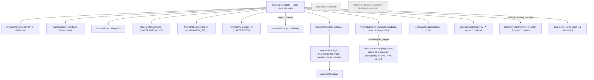

# Code review — file by file, line referenced

Scope: every first-party source file at commit `840f1a6` (41 files, 9,337 lines of code and markup), read in full.
Line numbers refer to that commit. Links open the file at the cited lines on GitHub-style viewers.

How each claim was checked is stated inline: **read** (static reading), **ran** (executed in an isolated copy under
`%TEMP%\as_repro`, never in the repository), **ported** (re-implemented and replayed), **validated** (independent tool such as
OpenCascade or Node). Nothing in the original project was modified.

Severity: **Critical** (blocks the claimed function or can mislead people about water safety) · **High** (wrong result or
major gap) · **Medium** (correctness or robustness issue with a workaround) · **Low** (quality, consistency) · **Info**.

---

## 1. Summary of findings

| # | Severity | Finding | Evidence |
|---|---|---|---|
| F1 | Critical | Firmware does not compile: two modules use types, macros and methods that exist nowhere | [microsd_logger.h:13](../../firmware/edge_node/include/microsd_logger.h#L13), [telemetry_comm.cpp:9-14](../../firmware/edge_node/src/telemetry_comm.cpp#L9-L14), [main.cpp:104-109](../../firmware/edge_node/src/main.cpp#L104-L109) |
| F2 | Critical | A failed probe read returns a plausible "normal" constant, and the anomaly engine never looks at the validity flags, so dead sensors read as clean water (all four synthetic events missed when all probes fail) | [sensor_interface.cpp:112-153](../../firmware/edge_node/src/sensor_interface.cpp#L112-L153), [anomaly_engine.cpp:80-178](../../firmware/edge_node/src/anomaly_engine.cpp#L80-L178), [firmware_engine_port.py](verification/firmware_engine_port.py) scenario B |
| F3 | Critical | Actuators are print statements: beacon, valve, carousel, wiper; modem never powered or driven with AT commands | [main.cpp:38-50](../../firmware/edge_node/src/main.cpp#L38-L50), [autosampler.cpp:32-57](../../firmware/edge_node/src/autosampler.cpp#L32-L57), [wiper_actuator.cpp:16-29](../../firmware/edge_node/src/wiper_actuator.cpp#L16-L29), [telemetry_comm.cpp:38-50](../../firmware/edge_node/src/telemetry_comm.cpp#L38-L50) |
| F4 | High | River stage is a constant (1.35 m) flagged valid; warm-up is 1 s, not 30 s; the clock is never set, so timestamps and diurnal bins are not real time | [sensor_interface.cpp:155-164](../../firmware/edge_node/src/sensor_interface.cpp#L155-L164), [:35](../../firmware/edge_node/src/sensor_interface.cpp#L35), [:168](../../firmware/edge_node/src/sensor_interface.cpp#L168) |
| F5 | High | Learned baselines and the 7-day counter live in `RTC_DATA_ATTR` memory, which a power loss or brown-out clears; one reset on day 20 delays one event and misses another | [anomaly_engine.cpp:14-26](../../firmware/edge_node/src/anomaly_engine.cpp#L14-L26), [main.cpp:28](../../firmware/edge_node/src/main.cpp#L28), scenario C |
| F6 | High | Sensor power-rail polarity in firmware (LOW = on) contradicts the schematic notes (2N7002 driver, i.e. HIGH = on) | [sensor_interface.cpp:20-40](../../firmware/edge_node/src/sensor_interface.cpp#L20-L40), [AquaSentinel_Mainboard.kicad_sch:55-58](../../hardware/kicad/AquaSentinel_Mainboard.kicad_sch#L55-L58) |
| F7 | High | Hard-limit trips re-trigger the sampler every cycle; with the 60-min lockout and 4 bottles the first two synthetic events use all bottles | [anomaly_engine.cpp:91-98](../../firmware/edge_node/src/anomaly_engine.cpp#L91-L98), [detector_event_metrics.py](verification/detector_event_metrics.py) |
| F8 | High | Pole stress check applies the float load as one point force; the two-tier carriage also transmits a couple. Pinned SF falls from 3.10 to 2.66 | [build.py:126-142](../../mechanical/src/build.py#L126-L142), [pole_carriage_couple.py](verification/pole_carriage_couple.py) |
| F9 | High | `evaluate.py` never compares detections with the ground-truth labels; the "4/4 within 30 min" headline is not computed anywhere in the repo (it is true, see F-A1) | [evaluate.py:57-67](../../analytics/evaluate.py#L57-L67) |
| F10 | High | Kashefipour–Falconer dispersion coefficient coded in a form that matches no published version (778 vs 97 or 429 m²/s) | [advection_dispersion_model.py:44](../../analytics/advection_dispersion_model.py#L44), [dispersion_check.py](verification/dispersion_check.py) |
| F11 | Medium | Stale risk state: a hard-limit event during the learning period leaves `current_risk = EVENT` latched, so the first three post-learning cycles report EVENT | [anomaly_engine.cpp:95](../../firmware/edge_node/src/anomaly_engine.cpp#L95), [:118-131](../../firmware/edge_node/src/anomaly_engine.cpp#L118-L131), [:154-159](../../firmware/edge_node/src/anomaly_engine.cpp#L154-L159) |
| F12 | Medium | Hourly baselines converge slowly: α = 1/96 applied only 4 times a day per bin, so after the 7-day learning period each pH/DO bin has moved about 25 % from its default | [anomaly_engine.cpp:28](../../firmware/edge_node/src/anomaly_engine.cpp#L28), [detector_event_metrics.py](verification/detector_event_metrics.py) |
| F13 | Medium | Build and analytics scripts write over tracked files in place (STEP/STL/GLB/BOM/checks, dataset, firmware header) | [build.py:276-283](../../mechanical/src/build.py#L276-L283), [train_proxy_anomaly_engine.py:119](../../analytics/train_proxy_anomaly_engine.py#L119) |
| F14 | Medium | Drawing set, motion-study image, GIF and v2 table cannot be regenerated: inputs are not in the repository | [drawings.py:25](../../mechanical/src/drawings.py#L25), [publish.py:27](../../mechanical/src/publish.py#L27), [check_sheet.py:12-13](../../mechanical/src/check_sheet.py#L12-L13) |
| F15 | Medium | Local dev server accepts unauthenticated POST writes; the viewer injects GLB metadata with `innerHTML` and loads `?glb=` from any URL | [serve.py:23-39](../../mechanical/tools/serve.py#L23-L39), [template.html:296](../../mechanical/viewer/template.html#L296), [:306](../../mechanical/viewer/template.html#L306), [:764](../../mechanical/viewer/template.html#L764) |
| F16 | Medium | Public dashboard can be switched to look live; SMS sign-up confirms a registration that never happens | [app.js:575-580](../../docs/dashboard/js/app.js#L575-L580), [:592-595](../../docs/dashboard/js/app.js#L592-L595), [index.html:47-58](../../docs/dashboard/index.html#L47-L58) |
| F17 | Low | "Bit-for-bit" Python reference differs from the firmware in flags (8 cycles) and scores (2,462 cycles); decisions agree on the dataset | [detector.py:3](../../analytics/detector.py#L3), [firmware_engine_port.py](verification/firmware_engine_port.py) |
| F18 | Low | EC ≤ 2250 µS/cm is labelled CPCB "Class C"; it is the CPCB Class E (irrigation) criterion | [config.h:81-86](../../firmware/edge_node/include/config.h#L81-L86) |

All findings are carried into the [risk register](SECURITY_AND_RISK_REGISTER.md) with mitigations and verification methods.

---

## 2. Cross-module structure

### 2.1 Firmware call graph (as written)

### 2.2 Python / web call graphs

* `mechanical/src/build.py` → `parts.build_float()` / `build_guide()` / `build_environment()` (geometry from `params.py` via `geom.py`) → `analysis.*` (mass, hydrostatics, GZ, areas, clearances, voxels) → writes `cad/BOM_R3.csv`, `checks/design_checks.json` → `export.*` (STEP, STL, GLB).
* `mechanical/src/drawings.py` → `drafting.Sheet/View` + `parts.hull_local`, `guide_levels` + images from `drawings/views/` (missing) + `checks/design_checks.json`.
* `mechanical/src/check_sheet.py` → `checks/design_checks.json` (+ optional `../calculations/verified_design_calcs.json`, missing).
* `mechanical/src/publish.py` → `renders/*` (missing), `animation/gif_frames` (missing), `viewer/template.html` + `cad/assembly/AquaSentinel_R3.glb` → standalone viewer (copied manually to `docs/viewer.html`; verified byte-identical).
* `mechanical/tools/step_check.html` (served by `serve.py`) → reads 67 STEP files with occt-import-js → POSTs `checks/step_validation.json`.
* `mechanical/tools/drawing_shots.js` (run in the viewer page) → `AS.ortho()` → POSTs `drawings/views/*.png`.
* `analytics/evaluate.py` → `detector.DualTrackEventDetector` → CSV → plot. `train_proxy_anomaly_engine.py` → CSV → `firmware/.../exported_anomaly_weights.h` (unused by firmware). `dataset/generate_water_quality_timeseries.py` → CSV. `advection_dispersion_model.py` is standalone.
* `docs/index.html` → iframe `viewer.html`; `docs/dashboard/index.html` → `js/app.js` (no network I/O).

### 2.3 Representative traces

**One firmware wake with a disconnected pH probe** (static trace): `queryModbusRegisters` times out after 200 ms
([sensor_interface.cpp:82-91](../../firmware/edge_node/src/sensor_interface.cpp#L82-L91)) → `readModbusPH` sets `HEALTH_TIMEOUT`, returns
**7.42** and temperature **24.5** ([:114-119](../../firmware/edge_node/src/sensor_interface.cpp#L114-L119)) three times → median 7.42 →
`r.valid[0] = false` ([:196-198](../../firmware/edge_node/src/sensor_interface.cpp#L196-L198)) → `evaluate()` never reads `valid[]`, scores
7.42 against the pH bin (z ≈ 0.2), and during NORMAL cycles folds 7.42 into the baseline ([anomaly_engine.cpp:164-165](../../firmware/edge_node/src/anomaly_engine.cpp#L164-L165))
→ level NORMAL → beacon "green" (print only). Replayed for all probes in [firmware_engine_port.py](verification/firmware_engine_port.py): 0 of 4 events detected.

**Mixed success within one median**: reads 1–2 fail (7.42, 7.42), read 3 succeeds (e.g. pH 5.0, a real spill). The median is 7.42, and
because the health flag is overwritten by the *last* read, the reading is marked **valid**. The spill is hidden by a fabricated value
flagged as good data.

**A dataset row through the Python reference** ([detector.py:40-149](../../analytics/detector.py#L40-L149)): row 490 (acid dump, pH 4.33)
→ hard limit pH < 6 → `EVENT`, `sample_trigger=True`, `current_risk="EVENT"`; rows 491-500 keep tripping, each returning
`sample_trigger=True` (25 triggers over the run). After the event the cycle is still inside the learning period, so `current_risk`
stays `EVENT` until cycle 675 (F11).

**`build.py` from parameters to draft**: `params.PONT_*` → `parts.hull_local()` lofts 40+ rounded sections
([parts.py:122-158](../../mechanical/src/parts.py#L122-L158)) → `Part.mass_kg()` uses wall area × 5 mm × 955 kg/m³ + 32 kg/m³ foam
([parts.py:40-46](../../mechanical/src/parts.py#L40-L46), [:170-174](../../mechanical/src/parts.py#L170-L174)) → `mass_properties` sums 121
instances = 48.54 kg → displaced volume 48.54 L → `solve_waterplane` bisects the exact clipped-polyhedron volume
([analysis.py:97-129](../../mechanical/src/analysis.py#L97-L129)) → draft 116.8 mm. Reproduced exactly.

---

## 3. Firmware — `firmware/edge_node` (17 files + `platformio.ini`)

Classification: **prototype / architecture sketch**. Status line in [firmware/README.md](../../firmware/README.md) says it has not been compiled;
this review shows it cannot compile as committed (F1). No C/C++ compiler is installed on this PC, so the compile failure is established
by symbol analysis: each missing symbol was searched for across the whole repository.

### 3.1 `platformio.ini` (14 lines)
* `platform = espressif32` without a version (line 2): a fresh build will pull whatever platform is current, including Arduino-ESP32
  3.x API changes. Pin a version once the code builds.
* `lib_deps` lines 12-14: ArduinoJson ^6 is used by `telemetry_comm`; **OneWire and DallasTemperature are never used** (probe
  temperature comes over Modbus).
* No PCA9685, INA226 or DS3231 libraries, although `config.h` and the schematic depend on all three.

### 3.2 `include/config.h` (88 lines) — pin map and constants
* Lines 16-17 claim the map "strictly avoids ESP32 strapping pins"; line 50 puts the status LED on GPIO2, a strapping pin (usually
  harmless, but the claim is not true). GPIO5 (SD CS, line 33) is also a strapping pin, acceptable with the stated pull-up.
* Lines 42-47 describe the rails as "P-MOSFET load switches – active LOW". The schematic notes put a 2N7002 inverter between GPIO and
  gate, which makes them active HIGH (F6). One of the two is wrong and must be fixed against the real board.
* GPIO34/35 (lines 40, 47) are input-only and have **no internal pull-ups**; `INPUT_PULLUP` in `autosampler.cpp:16` does nothing there.
* GPIO14 (pump gate, line 46) toggles during boot on many ESP32 modules; with a low-side MOSFET and no gate pull-down the pump can
  twitch at every wake. Add a 10–100 kΩ gate pull-down.
* Timing (lines 73-78): `PURGE_DURATION_MS 20000` is described as a "reverse purge", but the sampler runs it forward;
  `FILL_DURATION_MS 30000` "≈ 250 mL" implies 500 mL/min, while the v2 spec quotes 150 mL/min (75 mL in 30 s).
* Lines 81-86 label EC ≤ 2250 µS/cm as a CPCB Class C limit. CPCB's designated-best-use table puts 2250 µmhos/cm under **Class E**
  (irrigation, industrial cooling); Class C is coliforms ≤ 5000, pH 6–9, DO ≥ 4, BOD ≤ 3 (F18). Using 2250 as an alarm level is
  still a defensible engineering choice, but it should not be cited as Class C.
* Modbus IDs 1–4 (lines 65-68): all DFRobot probes ship with address 1 and (pH, EC, turbidity) 4800 baud; the bus is opened at
  9600 (`sensor_interface.cpp:25`). Every probe must be re-addressed and re-bauded before they can share the bus.

### 3.3 `src/main.cpp` (121 lines) — wake / decide / act / sleep
* Everything runs in `setup()`; `loop()` is unreachable (lines 119-121). Correct pattern for timer deep sleep.
* `RTC_DATA_ATTR boot_counter`, `wiper_hour_counter` (lines 28-29) survive deep sleep only. `wiper_hour_counter` actually counts
  15-minute boots (24 boots = 6 h), so the name is misleading.
* Lines 38-50 `setVisualBeacon` only prints; no PWM, no PCA9685 (F3).
* Line 88: `hour_of_day = (timestamp / 3600) % 24` — UTC hour from `time(NULL)`, which is never set (F4), so bins are "hours since
  first boot", drifting with the RC slow clock between wakes.
* Lines 98-101: sampler called whenever the engine sets `autosampler_trigger` (see F7 for hard-limit behaviour).
* Line 104 `sdLogger.logTelemetry(...)` and line 108 `telemetryMgr.transmitTelemetry(...)`: **neither method exists**
  (`MicroSDLogger` has `logReading`, `TelemetryManager` has `serializePayload` + `transmit`) → compile errors (F1).
* Line 112 prints "15 uA" deep-sleep current as a constant; the power budget assumes far more (board floor 0.6 mA at 12.8 V).
* Line 115: the 15-minute timer starts *after* the awake work, so the true period is 15 min + awake time (≥ 30-90 s with real warm-up,
  sampling and LTE), i.e. fewer than 96 readings/day.

### 3.4 `include/sensor_interface.h` (51 lines) + `src/sensor_interface.cpp` (201 lines)
* Health codes CRC_ERROR, OUT_OF_BOUNDS, FLATLINE, DRIFT_AFTER_WIPE (header lines 16-23) are never set; CRC failures are reported as
  TIMEOUT (`queryModbusRegisters` returns false for both).
* `init()` lines 18-27: rail "off" = HIGH (F6), DE/RE low, UART1 9600 8N1 on GPIO26/27.
* `powerOnSensors()` lines 29-36 prints "Stabilizing probes for 30000 ms" but waits **1 s** ("1s simulation delay in demo"). The
  optical DO probe's datasheet response time is ≤ 60 s.
* `calculateCRC16` lines 43-56: standard Modbus CRC-16 (poly 0xA001, init 0xFFFF), low byte first — correct.
* `queryModbusRegisters` lines 58-104: builds function 0x03 frames correctly. Gaps: no flush of stale RX bytes before sending; no
  check that the reply's address, function code and byte count match; exception replies wait the full 200 ms; back-to-back polling
  with no inter-frame gap, while DFRobot advises ≥ 200 ms polling interval and response wait; `rx_buf[32]` is safe only because
  `reg_count ≤ 2` here.
* Scaling (lines 121-152): pH ×100, temperature ×10, EC raw µS/cm, DO ×100, turbidity ×10. DFRobot's forum confirms turbidity
  register 0x0000 ÷ 10; the other register maps are in DFRobot reference documents not yet checked — verify on the bench.
* **Fallback constants** lines 114-151: on failure return pH 7.42 / 24.5 °C, EC 380, DO 6.85, turbidity 8.2 (F2). Health flag is set
  by the last of three reads (F2, mixed-success case above).
* `readUltrasonicStage()` lines 155-164: no UART read at all; returns 3.40 − 1.85 − 0.20 = 1.35 m and sets `HEALTH_OK` (F4). The
  constant 3.40 m does not match R3 geometry.
* `acquireReadings()` line 168 `time(NULL)`: nothing sets the system time (no SNTP, no DS3231 read) (F4).

### 3.5 `include/anomaly_engine.h` (58 lines) + `src/anomaly_engine.cpp` (189 lines) — decision logic
Algorithm, in order of execution ([:80-178](../../firmware/edge_node/src/anomaly_engine.cpp#L80-L178)):
1. Hard limits ([:58-78](../../firmware/edge_node/src/anomaly_engine.cpp#L58-L78)): pH ∉ [6, 9], DO < 4, EC > 2250 → `EVENT`,
   score 99, `autosampler_trigger = true` **every cycle** while tripped (F7); all three checked and OR-ed into flags; the reason
   string keeps the last one.
2. Robust z-scores ([:50-56](../../firmware/edge_node/src/anomaly_engine.cpp#L50-L56), [:101-104](../../firmware/edge_node/src/anomaly_engine.cpp#L101-L104)):
   z = |x − μ| / max(1.4826·d, floor). μ and d are EWMAs of the value and of |x − μ|. 1.4826 is the constant that turns a
   **median** absolute deviation into σ; applied to a **mean** absolute deviation (σ·√(2/π) ≈ 0.80σ) it overstates σ by ≈ 18 %, so
   z > 3 behaves like ≈ 3.5σ for Gaussian noise. pH and DO use 24 hourly bins; EC and turbidity a single bin each; the 24
   temperature bins are initialised but never used.
3. `max_z` starts at `z_ph` and other z values join only if > 3 ([:106-112](../../firmware/edge_node/src/anomaly_engine.cpp#L106-L112)),
   so the reported score is not a true maximum.
4. Learning: first 672 boots (7 days) update baselines unconditionally and report NORMAL ([:118-131](../../firmware/edge_node/src/anomaly_engine.cpp#L118-L131)).
   With α = 1/96 per update and 4 updates per hourly bin per day, a bin moves 1 − (1 − 1/96)²⁸ ≈ 25 % from its default in that
   week (F12). EC/turbidity (single bins, 96 updates/day) converge.
5. Persistence: 3-bit history; ≥ 2 outliers → EVENT (trigger once on transition), 1 → WATCH; 4 clean cycles needed to return to
   NORMAL ([:134-173](../../firmware/edge_node/src/anomaly_engine.cpp#L134-L173)). Any single-parameter outlier counts, despite the
   "multi-parameter" message ([:147](../../firmware/edge_node/src/anomaly_engine.cpp#L147)).
6. Baselines update only when the risk is NORMAL, so a long EVENT cannot be learned as normal (good), but slow real drift (seasonal
   change) can push the engine into a lock-out where it never re-learns.
Defects: `valid[]` ignored (F2); state in RTC memory (F5); stale `rtc_current_risk` after learning (F11); line 152 passes `flags` to a
format string with no matching specifier (harmless, compiler warning); `rtc_prev_reading` written but never read; `getBaseline` never
called. Port and replay: [firmware_engine_port.py](verification/firmware_engine_port.py).

### 3.6 `include/autosampler.h` (49) + `src/autosampler.cpp` (140)
* Sequence ([:59-120](../../firmware/edge_node/src/autosampler.cpp#L59-L120)): lockout 60 min → capacity check → purge 20 s → carousel
  → fill 30 s → write `SampleRecord` to NVS (`Preferences`), increment bottle index.
* `setPurgeValve` (lines 32-35) prints only; `runPeristalticPump` (37-43) drives GPIO14 but ignores `reverse` (no H-bridge
  direction pin); `rotateCarouselToNextBottle` (45-57) waits 1.2 s and prints "[CONFIRMED]" without moving or sensing anything (F3).
* Lockout uses timestamps from the unset clock; after a power loss `timestamp_utc < last_sample_timestamp`, the unsigned difference
  wraps to a large number and the lockout is silently skipped.
* No chain-of-custody hash or signature is generated (the v2 spec describes one); NVS records are plain structs.
* Line 118 prints that a collection alert was dispatched; nothing is sent.

### 3.7 `include/wiper_actuator.h` (21) + `src/wiper_actuator.cpp` (29)
Print + two 400 ms delays; PCA9685 channel 3 is never configured (F3).

### 3.8 `include/microsd_logger.h` (25) + `src/microsd_logger.cpp` (89)
Uses `WaterQualityReading`, `AnomalyReport` (header line 13) and `PIN_SPI_SCK/MISO/MOSI` (cpp line 6), none defined anywhere (F1); the
CSV header (line 23) belongs to an older data model (depth_m, battery_v, anomaly_score). `popBacklogRecord` (82-89) reads the first line
but never removes it, so a backlog would replay forever. `f.flush(); // Atomic sector commit` (line 54) is not atomic on FAT.

### 3.9 `include/telemetry_comm.h` (18) + `src/telemetry_comm.cpp` (50)
`serializePayload` (9-36) uses undefined `DEVICE_ID`, `FIRMWARE_VERSION`, `RIVER_STRETCH_ID` and the undefined types (F1).
`transmit` (38-50) prints the JSON and writes it to UART2; the modem is never powered (GPIO33/GPIO4 unused), no AT commands, no
network attach, no TLS or authentication, no SMS. `"ALERT_PRIORITY_HIGH"` would be an invalid AT command.

### 3.10 `include/dsp_filters.h` (15) + `src/dsp_filters.cpp` (26)
Correct 5-sample insertion-sort median and EMA, **never called** — the README's "exponential smoothing of each probe before any
decision" is not implemented.

### 3.11 `include/exported_anomaly_weights.h` (41)
Generated by `analytics/train_proxy_anomaly_engine.py` (regeneration verified identical). Mahalanobis model (means, stds, 6×6 inverse
covariance, threshold 4.0112) plus hand-written gradient limits. **Included by no file**. Line 4 calls the data "validated Maharashtra
river timeseries"; it is the synthetic dataset.

---

## 4. Analytics — `analytics/` (5 Python files)
Classification: **simulation and reference code**. All five scripts were run in an isolated copy with Python 3.14.4, numpy 2.4.6,
matplotlib 3.11.0.

### 4.1 `detector.py` (163 lines)
Mirror of the firmware engine (class `DualTrackEventDetector`). Differences from the C++ (F17): hard limits return at the first violated
limit (pH, then DO, then EC) with a single flag (lines 47-77) instead of OR-ing all; `max_z` is the true maximum (line 91); the learning
branch reports `flags = 0` (lines 94-102); double precision. Replay of 2,880 cycles against the float32 port: 0 level mismatches,
0 trigger mismatches, 8 flag mismatches, 2,462 score mismatches. Same F11 and F12 behaviour as the firmware.

### 4.2 `evaluate.py` (115 lines)
Lines 2-4 promise "detection latency, events identified, and false alarm rate"; lines 57-67 only count levels and triggers (F9) and
print the 25 triggers as "Physical Forensic Samples Sealed". Hour taken from the ISO string (line 44). Plot labels each trigger
"AUTOSAMPLER SEALED" (line 101). Output reproduced: 2,808 NORMAL, 15 WATCH, 57 EVENT, 25 triggers.

### 4.3 `dataset/generate_water_quality_timeseries.py` (129 lines)
Seeded (line 14), starts 2026-03-01 (line 15), 96 steps/day. Baseline (lines 41-53): sinusoidal diurnal temperature/DO/pH peaking at
14:00 plus i.i.d. Gaussian noise; EC and turbidity have no diurnal cycle; depth has a 4-day sinusoid. Four events (lines 59-102) shaped
as `sin(π·k/N)`, so the first labelled row of each event is unperturbed. No sensor drift, fouling, gaps, spikes, rain events or
autocorrelation. Writes CRLF on Windows (csv default line terminator), which is the only difference from the committed file.

### 4.4 `train_proxy_anomaly_engine.py` (120 lines)
Uses the labels to choose "normal" rows (lines 30-33), fits mean/covariance, sets the threshold at the 99.5th percentile of the same rows
and reports in-sample recall 87.5 % and FPR 0.53 % (lines 61-70): no hold-out set, threshold chosen on the evaluation data. Writes the
header into the firmware tree (line 119) — an in-place overwrite of a tracked file.

### 4.5 `advection_dispersion_model.py` (158 lines)
1-D slug solution C(x,t) = M / (A√(4πDt)) · exp(−(x−Ut)²/(4Dt) − kt) (lines 49-65) — correct form for a fully mixed cross-section.
Fischer (line 40) correct. Kashefipour–Falconer (line 44) does not match the published piecewise equation (F10). Receptors use
straight-line distances (19 km) although the comment notes ≈ 22.8 km of channel (lines 88-93). The 1-D solution is not valid within
the transverse mixing length (≈ 1.8 km for a centreline release, ≈ 7 km for a bank outfall at the scenario values).

---

## 5. Mechanical design engine — `mechanical/src`, `tools`, `viewer` (14 files)
Classification: **design tooling, working**. `build.py` was run in an isolated copy (28.6 s): 66 STL + GLB byte-identical, 67 STEP
identical except the timestamp line, BOM and checks identical after line-ending normalisation.

### 5.1 `params.py` (121 lines)
Single source of truth, millimetres and kilograms. Frame convention (lines 4-9): origin on the pole axis at keel level, +X downstream,
+Z up; pier upstream (x < 0). Tags each value `(v2)`, `(R3)` or `(ASSUMPTION)` — good traceability practice. Key assumptions:
`STAGE_RANGE 2000` (line 22), `RIVERBED_Z −1400` (26), `PROBE_LEN 300` placeholder (77), PV size (82). Material densities lines 96-121.

### 5.2 `geom.py` (475 lines) — mesh kernel
Rodrigues rotations (24-34); `Shell` with orientation fix by signed volume (98-111) and a strict closed-manifold test (113-124);
ear-clipping triangulation with convex fast path (130-181) — if no ear is found it stops silently (179-180) and could leave a hole;
`resample_by_angle` (221-242) returns `c + None*d` (TypeError) if a ray misses a non-star-shaped outline; lofts, extrusions,
revolves (r = 0 end points become flat caps, not apexes), sweeps with projection-based parallel transport (386-413), bolts.

### 5.3 `parts.py` (740 lines) — 66 parts, 121 float instances
Mass rules (40-46): solid volume × density, shell area × wall + fill, or catalogue value. Notable geometry: 8 concave rollers at
r = 52 mm, throat = pole radius + 1.5 mm (283-305); gate carries the upstream rollers (135°, 225°) so the gate, its hinge pin and the
two T-handle pins carry the full drag load — not analysed; stage sensor on the carriage top looking up at a target plate on the upper
clamp (596-599, 691-692) — see the [mechanical review](../mechanical/MECHANICAL_DESIGN_REVIEW.md) for the blind-zone and first-echo
problem; grab handles mounted on each hull's **outboard** side (602-610) while drawings specify one-sided inserts for a single mould;
bottle modelled as HDPE 250 mL (559-561) while v2 docs and the dashboard say borosilicate.

### 5.4 `analysis.py` (305 lines)
`submerged()` (97-115) is the divergence-theorem integral over triangles clipped at z = d; the cap term is handled through the
`−d²/2` correction (checked). `gz_curve` (156-168) heels to **port** (positive rotation raises starboard) although the comment says
starboard; the sign convention is still consistent, and the CG sits 1.3 mm to starboard, so the opposite heel has ≈ 2.6 mm less arm.
Fixed-trim GZ (no trim re-balance with heel). `projected_area` rasterises at 2 mm. `voxel_inside` uses scan-line parity with tiny
offsets to avoid grazing hits; 2 mm voxels miss overlaps thinner than ≈ 2 mm.

### 5.5 `build.py` (414 lines)
Load case (line 114): 1.5 m/s, 500 N debris, Cd 1.05 float, 1.2 pole. Pole (126-142): textbook pinned and fixed formulas with the
whole float load at mid-span (F8); `w` applied over the full span (conservative, the pole is not fully submerged). Carriage (145-164):
correct drawer-rule jam check e < s/(2μ) with e = LCF; seized-roller float lag (88.7 mm, 62 % of freeboard) is reported but not checked
against any criterion (only μ = 0.05 lag is checked, line 255). Clearances (166-237): pole corridor, float vs fixed hardware swept over
travel (XY overlap + Z interval), yaw contact, voxel interference for 101 pairs — all at yaw 0, gate closed, canopy down. Writes
outputs in place (276-283, 340-406) (F13).

### 5.6 `export.py` (402 lines)
Binary STL, GLB (sRGB → linear colours, creased normals, node matrices column-major) and STEP AP214 with planar faces only
(256-320): every cylinder is facetted, which is why STEP files are large and why SOLIDWORKS imports are dumb solids. Assembly placement
(389-393) passes the assembly origin as `ITEM_DEFINED_TRANSFORMATION` item 1 instead of the part's origin; geometrically equivalent
here, but strict validators may complain. STEP header timestamp (335) makes files non-deterministic (only that line differs on rebuild).
OpenCascade 7.9 independent check: 66/66 part files read, 65/66 valid B-reps (AS3-416 probe cables invalid), STL/STEP volumes agree to
< 0.03 %.

### 5.7 `drafting.py` (215), `drawings.py` (424), `check_sheet.py` (111), `publish.py` (85)
Matplotlib A3 framework with ISO-style title block, dimensions, leaders, balloons and tables. `pt()` contains a no-op `*0.72/0.72`.
`drawings.py` requires `drawings/views/` renders (line 25) → fails here (F14); dead loop at 70-71; the hull drawing places the four
handle inserts on one side only (326-333) although both hulls come from one mould. `check_sheet.py` reads an absent v2 JSON (12-13).
`publish.py` needs `renders/` and `animation/` (27, 53); its viewer step reproduces `docs/viewer.html` exactly; uses Windows font paths.
General tolerance ISO 2768-m on a rotomoulded hull is unrealistic.

### 5.8 Tools
* `tools/serve.py` (54): binds 127.0.0.1; `POST /save?path=` writes any body into `renders|animation|drawings|checks|viewer` with
  path-traversal checks that hold on Windows and POSIX, but no origin/token check (any web page open in the same browser can make
  the write) and no size limit (F15).
* `tools/step_check.html` (28): occt-import-js 0.0.23 from jsDelivr without Subresource Integrity; produced `step_validation.json`.
* `tools/drawing_shots.js` (5): orthographic shot list for the drawing views.

### 5.9 `viewer/template.html` (775 lines) — three.js 0.169 viewer
Import map from jsDelivr (76-77, pinned versions, no SRI). Scene setup, procedural water normal map, assembly/demo timeline
(373-426), capture API (`AS.still`, `seek`, `recordWC` via WebCodecs + mp4-muxer 5.1.3, `record` via MediaRecorder), hidden-line
drawing mode by normal/depth edge shader (614-677). Security: part list and info panel write GLB `extras` with `innerHTML`
(296, 306); `load()` fetches `?glb=` from any URL when no model is embedded (764) → a crafted link to the template served by
`serve.py` can run script and call `/save` (F15). The published `docs/viewer.html` embeds the model, so `?glb=` is ignored there.
Runtime check in the browser: 66 parts listed, 14/14 checks PASS, no console errors.

---

## 6. Project website — `docs/` (5 code files)
Classification: **presentation and demo**. All run in the built-in browser from a localhost static server: no console errors.
* `index.html` (391): static page, lazy iframe for the viewer, IntersectionObserver reveal, Google Fonts (third-party request).
  Hero copy describes beacon, alert and sample as working (178-179); a disclaimer appears lower (284-285).
* `viewer.html` (775): generated (§5.9).
* `dashboard/index.html` (453): status pills hard-coded "NODE 01: ACTIVE", "MicroSD: COMMITTED", "20W Solar: FLOAT" (47-58);
  placeholder toll-free number (265); a printable "Legal Chain-of-Custody" sheet with fixed demo values (381-449).
* `dashboard/js/app.js` (602): trilingual strings (7-152); `innerText` everywhere (no injection); sensor colouring uses pH 6.5–8.5,
  turbidity > 25, EC > 800 (350-353) — different thresholds from the firmware; 1-D "plume" animation at 2.7 km/h with 1 s = 1 min
  (407-458); lockout button raises an "EMERGENCY SIGNAL SENT" alert (545-558); SMS prompt collects a phone number and confirms a
  registration that does not exist (575-580); demo toggle hides the only demo banner (592-595) (F16).
* `dashboard/css/styles.css` (1066): no external resources; the print stylesheet prints only the CoC modal (1035-1066).

---

## 7. Pseudo-source in `hardware/`
`kicad/AquaSentinel_Mainboard.kicad_sch` (81 lines) holds a title block and `#` prose describing nets; there are no symbols, wires,
labels or footprints, so it is not a schematic and cannot drive a PCB. Its notes rate the AO3401A at VGS ±20 V (line 26); the AOS
datasheet rating is **±12 V**, which a 12.8–14.6 V LiFePO4 rail exceeds when the gate is pulled to ground. Details in the
[mechanical/electrical review](../mechanical/MECHANICAL_DESIGN_REVIEW.md#7-electronics-and-power-hardware-artefacts).
