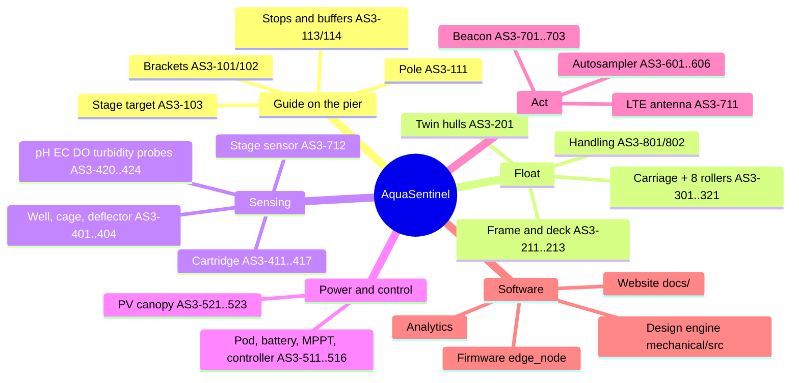

# AquaSentinel engineering knowledge base

A teaching document built from the repository evidence. Three levels: **(1) overview** for anyone, **(2) engineering deep dive**
with files, equations and numbers, **(3) research and development** with limits, validation methods and open problems. Every number
was reproduced or checked in this audit unless marked otherwise.

---

## Level 1 — Project overview

**The problem.** A spill or sewage overflow can pass a river town in a few hours, but rivers are sampled about once a month. Nobody
sees it, and nothing is left to test.

**The idea.** Fix a stainless pole to a bridge pier and let a small yellow catamaran (about 1 m long, 48.5 kg) slide up and down it
with the river. Because it is pushed by the water, it needs no motor to stay put; because the pole is at its front, the current swings
it round to trail downstream like a weather vane. Under the float, four probes hang in a protected well and measure acidity (pH),
salt content (conductivity), oxygen and cloudiness (turbidity), plus temperature. A small computer reads them every 15 minutes and
decides, on the float, whether something is wrong. If so, it should turn a beacon red for people on the bank, send an alert to the
water-works, and pump a water sample into a bottle that a laboratory can analyse. A 20 W solar panel and a small battery power it.

**What exists today.**
* A complete, reproducible digital design: every part generated by a Python program, checked for buoyancy, stability, strength,
  jamming and clashes, exported to CAD, drawn on six engineering drawings, and checked in SOLIDWORKS Simulation.
* Decision logic that catches four simulated spills within 30 minutes on synthetic data.
* An interactive 3D model, a demo dashboard in three languages, a 13-slide deck and three videos.

**What does not exist yet.** No float has been built or put in water. The firmware does not compile, its actuators are placeholders,
the electronics have no schematic, and there is no field data. Those are the next steps, in roughly that order.

### Subsystem map

---

## Level 2 — Engineering deep dive

### 2.1 Buoyancy and draft — [analysis.py:97-129](../../mechanical/src/analysis.py#L97-L129)
Archimedes: the float sinks until the weight of displaced water equals its own weight, ρ_w g V = m g, so V = m/ρ_w =
48.54 kg / 1000 kg/m³ = 48.54 L. The program finds the waterline height d at which the volume of geometry below z = d equals that
volume. It computes the submerged volume exactly for a closed triangle mesh with the divergence theorem: V(d) = Σ_triangles
A_z (z̄ − d), summed over triangles clipped below the plane, and bisects d (60 iterations). Result: **draft 116.8 mm, freeboard
260 − 116.8 = 143.2 mm**. Sensitivity: one extra kilogram sinks the float m/(ρ_w A_wp) = 1/(1000 × 0.4517) m = **2.2 mm**.
Reserve buoyancy = hull volume / displaced volume = 110.3 / 48.54 = **2.27**.

### 2.2 Stability (GM and GZ) — [analysis.py:156-168](../../mechanical/src/analysis.py#L156-L168), [build.py:84-96](../../mechanical/src/build.py#L84-L96)
When the float heels, its centre of buoyancy B moves towards the immersed side; the horizontal distance GZ between the gravity line
through G and the buoyancy line through B is the righting lever. For small angles GZ ≈ GM sin φ, with GM = KB + BM − KG and
BM = I_T / V (I_T: transverse second moment of the waterplane). Twin hulls far apart give a large I_T: roughly
2 × (0.2259 m² × 0.27² + 1.0 × 0.23³/12) ≈ 0.035 m⁴, BM ≈ 0.72 m, GM ≈ 0.053 + 0.72 − 0.250 ≈ 0.52 m (exact CAD value **0.551 m**).
Large angles are computed by rotating the whole mesh, re-solving the waterline and measuring GZ: maximum **180 mm at 25°**, near the
deck-edge immersion angle atan(143/385) ≈ 20°, and still positive at 60°.

### 2.3 Drag and the weathervane — [build.py:111-123](../../mechanical/src/build.py#L111-L123)
F = ½ ρ C_d A V². Frontal area below the waterline (union of hulls, well, cage, deflector) 0.1202 m², C_d = 1.05, V = 1.5 m/s →
F = 0.5 × 1000 × 1.05 × 0.1202 × 2.25 = **142 N**. The centre of lateral area is 351 mm aft of the pole, so a sideways flow
component produces a moment that turns the float back downstream: it is directionally stable, like a vane — **in uniform flow**.

### 2.4 The guide pole as a beam — [build.py:126-142](../../mechanical/src/build.py#L126-L142)
Section of 2 in Sch 40S pipe (D = 60.3 mm, t = 3.91 mm): I = π(D⁴ − d⁴)/64 = 2.7665×10⁻⁷ m⁴, Z = I/(D/2) = 9.176×10⁻⁶ m³.
Loads: P = 142 + 500 (debris) = 642 N at the float, w = ½ρ C_d D V² = 81.4 N/m on the pole. Span L = 2.678 m.
* Pinned ends: M = PL/4 + wL²/8 = 429.8 + 73.0 = 502.8 N·m → σ = M/Z = **54.8 MPa**, SF = 170/54.8 = **3.10**; deflection
  PL³/48EI + 5wL⁴/384EI = **5.8 mm**.
* Fixed ends: M = PL/8 + wL²/12 → 28.7 MPa (SF 5.92).
* The carriage reality: the load acts 428 mm below the carriage centre, so the two roller tiers push with r₁ = P/2 + P·h/s = 1,107 N
  and r₂ = −465 N. Putting both forces on the beam and moving the carriage along its travel gives **64.0 MPa (SF 2.66)** pinned and
  38.5 MPa fixed — run [pole_carriage_couple.py](../audit/verification/pole_carriage_couple.py).
* The SOLIDWORKS study used fixed ends and got 38.3 MPa and 1.26 mm, matching the fixed-end beam; the pinned values are the safe bound.

### 2.5 Why the carriage does not jam — the drawer rule — [build.py:145-164](../../mechanical/src/build.py#L145-L164)
A sleeve guided by two contact rows a distance s apart, pushed along the guide by a force F acting at a lateral offset e, develops
contact forces ≈ F·e/s at each row. Friction μ at both rows resists with 2μF e/s. It self-locks if 2μ e/s ≥ 1, i.e. **e ≥ s/(2μ)**.
Here the push is the extra buoyancy when the water rises, acting at the centre of flotation e = LCF = 406 mm from the pole; s = 350 mm.
μ = 0.05 (rollers) → s/(2μ) = 3.5 m → margin 3.5/0.406 = **8.62**; μ = 0.25 (seized, sliding) → 0.7 m → **1.72**.
Separately, the drag-induced roller forces cause friction that the water must overcome before the float moves (the "lag"):
lag = μ(r₁ + r₂)/(ρ g A_wp) = 78.6 N / 4,430 N/m = **17.7 mm**, or **88.7 mm** with seized rollers.

### 2.6 Interference and clearance checks — [build.py:166-237](../../mechanical/src/build.py#L166-L237)
Pole corridor (no float part within 5 mm of the pole except rollers: minimum gap 9.7 mm), float vs fixed hardware swept over the
2 m travel (XY overlap and Z interval), only rub rails reach the pier in yaw, and 2 mm voxel intersection of 101 part pairs. All pass —
at yaw 0, gate closed, canopy down.

### 2.7 Sensing chain — [sensor_interface.cpp](../../firmware/edge_node/src/sensor_interface.cpp)
Each probe is a Modbus RTU slave on a half-duplex RS485 bus. The ESP32 raises DE/RE, sends a request frame, lowers DE/RE and listens.
Example: read registers 0x0000-0x0001 (pH, temperature) from address 1 → `01 03 00 00 00 02 C4 0B`; read one register from address 4
(turbidity) → `04 03 00 00 00 01 84 5F` (last two bytes: CRC-16/Modbus, low byte first). The reply carries 2 bytes per register.
Scaling used: pH = reg/100, °C = reg/10, EC = reg µS/cm, DO = reg/100 mg/L, turbidity = reg/10 NTU (only the last confirmed).
Three reads per probe are combined by a median to reject a single bad value. In the field, what matters more is warm-up (optical DO
≤ 60 s), fouling, calibration drift and what happens when a probe does not answer (today: a fabricated normal value — fix first).

### 2.8 The decision logic — [anomaly_engine.cpp](../../firmware/edge_node/src/anomaly_engine.cpp), [detector.py](../../analytics/detector.py)
* **Hard limits** act at once: pH < 6 or > 9, DO < 4 mg/L, EC > 2250 µS/cm.
* **Baselines** are exponentially weighted moving averages: μ ← μ + α(x − μ), d ← d + α(|x − μ| − d), α = 1/96. pH and DO keep one
  pair per hour of the day (diurnal cycle: photosynthesis raises DO and pH in the afternoon); EC and turbidity keep one pair.
* **Score** z = |x − μ| / max(1.4826 d, floor). Outlier when z > 3.
* **Persistence:** EVENT if at least 2 of the last 3 readings are outliers; one outlier is a WATCH. Four clean readings clear it.
* **Learning:** the first 7 days only learn. Because an hourly bin sees only 4 readings a day, 7 days move it 1 − (1 − 1/96)²⁸ ≈ **25 %**
  of the way from its default — so learning is far from complete when detection starts.
* Worked example: DO at 14:00 = 8.4 mg/L against the default bin (6.5, 0.40): z = |8.4 − 6.5| / (1.4826 × 0.40) = 1.9/0.593 = 3.2.
* Replay and test it: [detector_event_metrics.py](../audit/verification/detector_event_metrics.py), [firmware_engine_port.py](../audit/verification/firmware_engine_port.py).

### 2.9 Energy — [power_budget.csv](../../hardware/power_budget.csv)
Energy = power × time. Sensors 1.3 W × 45 s × 96 = 5,616 J = 1.56 Wh/day; MCU 0.4 W × 50 s × 96 = 0.53 Wh; modem 2 W × 45 s × 24 =
0.60 Wh; standby 7.7 mW × 24 h = 0.18 Wh; conversion losses 0.48 Wh → 3.39 Wh/day, 4.07 Wh with 20 % margin. Battery 12.8 V × 6 Ah =
76.8 Wh, 80 % usable = 61.4 Wh → 15.1 days without sun. PV: 20 W × 3 sun-hours × 0.65 ≈ 39 Wh/day in monsoon. The beacon is not in
the budget; a light visible in daylight would dominate it.

### 2.10 Plume travel — [advection_dispersion_model.py](../../analytics/advection_dispersion_model.py)
Downstream, a pollutant pulse moves with the mean velocity U and spreads by longitudinal dispersion D:
C(x,t) = M/(A√(4πDt)) · exp(−(x − Ut)²/(4Dt)). Arrival time at 19 km is x/U = 19,000/0.6 s ≈ 8.8 h (5.3–26 h for 1.0–0.2 m/s).
The 1-D formula only holds once the plume has mixed across the river (≈ 2–7 km here), and the coded Kashefipour–Falconer D needs
correcting — [dispersion_check.py](../audit/verification/dispersion_check.py).

### 2.11 How the design engine works — [mechanical/src](../../mechanical/src)
`params.py` → `parts.py` (each part is a list of closed polygon shells built with `geom.py` primitives: loft, extrude, revolve, sweep,
box, bolt) → `analysis.py` (mass from volume or wall area, exact hydrostatics, voxels) → `export.py` (STEP planar B-rep, STL, GLB)
→ `drawings.py` / `check_sheet.py` (matplotlib) → `viewer/template.html` (three.js) → `publish.py`. Change a parameter, rebuild, and
everything stays consistent: the project's best engineering asset.

---

## Level 3 — Research and development

### 3.1 Limits of the current evidence
| Area | Strongest evidence | Main gap | How to close it |
|---|---|---|---|
| Buoyancy, stability | exact CAD hydrostatics (reproduced) | 20 % of mass assumed | weigh parts; tank test |
| Structure | hand calcs + linear FEA | boundary conditions, couple, dynamics, fatigue, anchors, gate pins | pinned-plus-couple calc; VIV screening; anchor test; proof load |
| Hydrodynamics | drag estimate, CLR | pier wake, flood range, debris | flume test with pier model; site gauge data |
| Sensing | datasheets | fouling, drift, warm-up, accuracy at river levels | bench then side-by-side with a reference sonde |
| Detection | synthetic 4/4 | realism, false alarms, faults | harder synthetic set; pilot data with lab samples |
| Sampling | concept | preservation, legal procedure | lab protocol; legal advice |
| Electronics | text description | no schematic | design, build, test |

### 3.2 Experimental designs
1. **Mass and draft:** weigh every component (±10 g); assemble; measure draft at four corners in a tank; compare with `build.py`
   after replacing catalogue masses. Acceptance: draft within ±5 mm of prediction.
2. **Carriage friction:** 2 m pole on a test frame, float dummy with adjustable eccentric load; measure the vertical force to start
   motion dry, wet and with silt slurry; estimate μ and lag; repeat after 100 h of cycling.
3. **Stage sensing:** full-scale mock-up of sensor, collar, buffer and plate; record range readings from 0.1 to 2.3 m in 50 mm steps;
   repeat with alternative sensors.
4. **Detection:** two-to-four-week supervised river trial; reference sonde and daily grab samples; injected tracer (food-grade salt,
   with permission) to measure response and travel time; compute recall, latency, false alarms per week.
5. **Fouling:** weekly before/after-cleaning readings (USGS TM1-D3 method) to separate fouling drift from calibration drift.

### 3.3 Promising directions
Sensor-fault-aware detection; CANARY comparison; persisting learned baselines; travel-time alerts driven by real flow; low-cost sample
preservation; side-of-pier mounting outside the wake; open data with an established platform (Monitor My Watershed) for credibility.

---

## 4. Glossary
| Term | Meaning in this project |
|---|---|
| AAKRUTI / FDC | AAKRUTI Innovation Competition 2026 (Dassault Systèmes); FDC = Final Design Concept stage |
| AquaRight | Project name in drawing title blocks and the dashboard badge |
| AS3-xyz | R3 part number; hundreds digit = subsystem |
| BOD / COD | Biochemical / chemical oxygen demand (lab tests) |
| CANARY | US EPA/Sandia open-source event-detection software for water-quality sensors |
| CPCB / MPCB | Central / Maharashtra Pollution Control Board |
| CLR | Centre of lateral resistance |
| Drawer rule | Anti-jamming criterion e < s/(2μ) for a guided sleeve |
| EC | Electrical conductivity (µS/cm) — proxy for dissolved salts |
| EWMA | Exponentially weighted moving average |
| GM / GZ | Metacentric height / righting lever |
| IDC | Initial Design Concept (earlier competition stage) |
| Jal-Deep (जलदीप) | Name of the beacon ("water lamp") |
| LCB / LCG / LCF | Longitudinal centres of buoyancy / gravity / flotation |
| MAD | Median absolute deviation (×1.4826 ≈ σ for Gaussian data) |
| MLD | Million litres per day |
| Modbus RTU | Serial master/slave protocol; frame = address, function, data, CRC-16 |
| NABL | National Accreditation Board for Testing and Calibration Laboratories (India) |
| NTU | Nephelometric turbidity unit |
| NVS | ESP32 non-volatile storage (flash key-value) |
| Pack and Go | SOLIDWORKS export bundling an assembly with all referenced parts |
| R3 | Third design state after v2 |
| RTC_DATA_ATTR | ESP32 variable placement in RTC memory; survives deep sleep, not power loss |
| SDR26 | Pipe standard dimension ratio (OD/wall = 26) |
| SF | Safety factor = yield stress / working stress |
| Stage | River water-surface level relative to a datum |
| UHMW-PE | Ultra-high-molecular-weight polyethylene (rollers) |
| VIV | Vortex-induced vibration |

## 5. Variables and units
| Symbol / name | Meaning | Unit | Value (R3) | Where |
|---|---|---|---|---|
| `POLE_OD`, `POLE_WALL` | pole diameter, wall | mm | 60.3, 3.91 | params.py:17-18 |
| `STAGE_RANGE` | design water travel | mm | 2000 (assumed) | params.py:22 |
| `PIER_STANDOFF` | pole axis to pier face | mm | 360 | params.py:25 |
| `PONT_L/W/H` | hull size | mm | 1000/230/260 | params.py:30 |
| `TIER_Z` | roller tier positions | mm | 180, 530 | params.py:58 |
| m | float mass (bottles full) | kg | 48.54 | design_checks.json |
| T, f | draft, freeboard | mm | 116.8, 143.2 | " |
| A_wp | waterplane area | m² | 0.4517 | " |
| LCF | flotation centre aft of pole | mm | 406.2 | " |
| GM_T | transverse metacentric height | m | 0.551 | " |
| V_FLOOD, DEBRIS_N | design current, debris | m/s, N | 1.5, 500 | build.py:114 |
| C_d | drag coefficient float/pole | – | 1.05 / 1.2 | build.py:114 |
| L | bracket span | m | 2.678 | design_checks.json |
| σ_y | 316L yield (annealed) | MPa | 170 | build.py:130 |
| μ | roller / seized friction | – | 0.05 / 0.25 | build.py:163 |
| `ALPHA` | EWMA weight | per update | 1/96 | anomaly_engine.cpp:28 |
| z threshold | outlier score | σ-like | 3.0 | anomaly_engine.cpp:109 |
| `SAMPLING_INTERVAL_MIN` | wake period | min | 15 | config.h:73 |
| `PURGE/FILL_DURATION_MS` | sampler timing | ms | 20000 / 30000 | config.h:75-76 |
| `SAMPLE_LOCKOUT_MIN` | minimum time between samples | min | 60 | config.h:78 |
| U, W, H, S | river velocity, width, depth, slope (scenario) | m/s, m, m, – | 0.6, 50, 1.8, 0.00035 | advection model |
| D_L | longitudinal dispersion coefficient | m²/s | 70 (Fischer) | " |

## 6. Executable examples
The scripts in [`docs/audit/verification/`](../audit/verification/README.md) double as worked examples: detector replay with event
metrics, a line-by-line port of the C++ decision engine with failure scenarios, the pole-with-couple beam calculation, dispersion
formulas, stage-sensor geometry, and data-integrity checks. Each runs read-only against the repository.

## 7. Open questions
Tracked in [OPEN_QUESTIONS_AND_NEXT_STEPS.md](../audit/OPEN_QUESTIONS_AND_NEXT_STEPS.md), each with the evidence available and the
experiment that would resolve it.

## 8. Further reading
See [TECHNICAL_RESEARCH.md](../research/TECHNICAL_RESEARCH.md): CPCB criteria, Water Act §21, USGS TM1-D3, CANARY, Leigh et al. 2019,
Kashefipour & Falconer 2002, DFRobot probe wikis.

## 9. Decision log
Decisions found in the repository, with the evidence and the audit's view.

| # | Decision | Rationale given | Evidence | Audit view |
|---|---|---|---|---|
| D1 | Pole-guided float instead of a motorised boat or moored buoy | zero station-keeping energy; no propeller fouling | jury_QA Q7, README | Sound for a pier site; consider a pier-mounted stilling pipe as a simpler baseline |
| D2 | Pole moved from the centre (v2) to the bow (R3) | v2 pole passed through pod/canopy/beacon; bow gives free yaw and weathervaning | mechanical/README.md:42 | Good decision; it also puts the float in the pier wake |
| D3 | Roller tiers 250 → 350 mm | bow mounting moves the buoyancy centre 406 mm from the pole | mechanical/README.md:45 | Correct use of the drawer rule |
| D4 | Hulls 900×200×220 → 1000×230×260 | CAD mass 48.5 kg vs 25.4 kg hand budget | mechanical/README.md:44 | Right response; keep weighing |
| D5 | Opening gate with two T-pins | remove the float before floods without tools | DWG-03 | Useful; analyse the pins and lugs, which carry the drag |
| D6 | Pull-up sensor cartridge in a well with cage and deflector | clean and calibrate from above; protect probes | DWG-04 | Good serviceability; check flushing of the well |
| D7 | Industrial RS485 probes (DFRobot) | hobby boards leaked | slide 3 | Reasonable cost point; coarse FS accuracy, K=10 EC cell |
| D8 | Hard limits + diurnal robust z + 2-of-3 | act fast on gross spills, avoid single-spike alarms | README | Sensible structure; fix state/fault handling |
| D9 | Physical sample on alert | probes cannot see metals, pathogens, pesticides | slide 3 | Strong idea; legal and preservation constraints apply |
| D10 | 20 W PV canopy shading the pod | LiFePO4 charge temperature | mechanical/README.md:48 | Sound |
| D11 | Single parametric Python source for all CAD | consistency of geometry, checks, BOM, drawings | mechanical/README.md:3-4 | Excellent; add regression tests and output directories |
| D12 | Upward ultrasonic stage sensor on the carriage | no submerged level sensor | parts.py:596-599 | Revisit: blind zone and collar echo |
