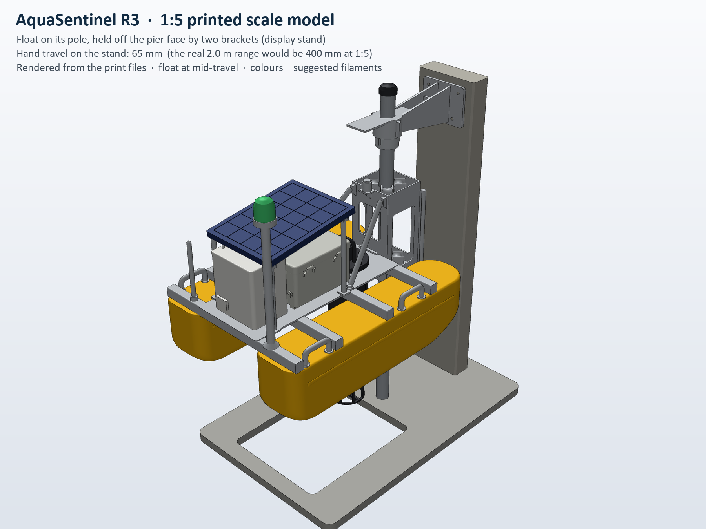
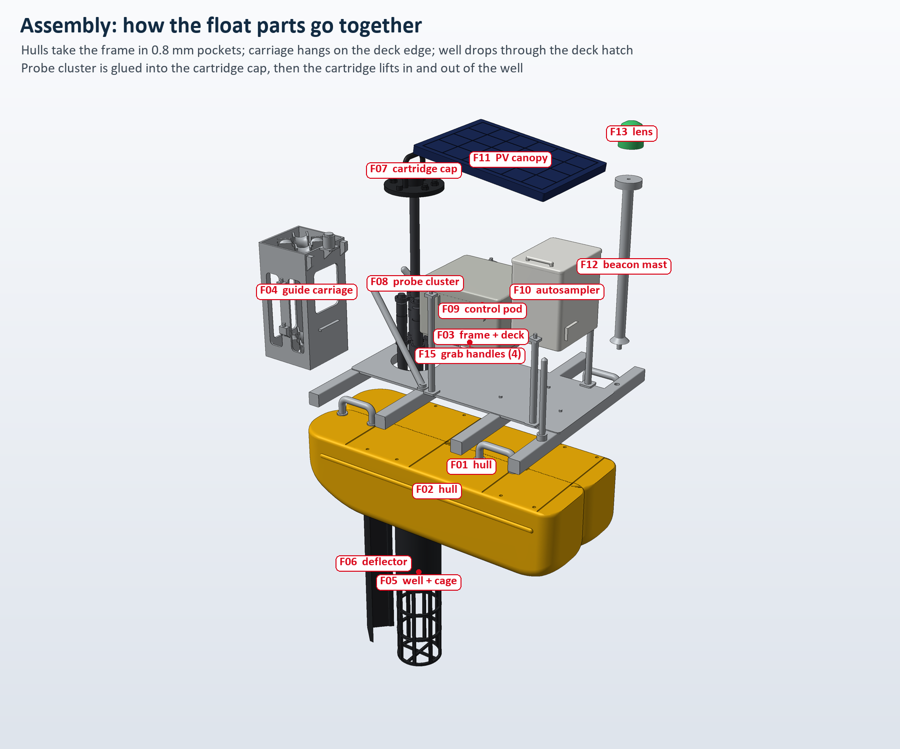
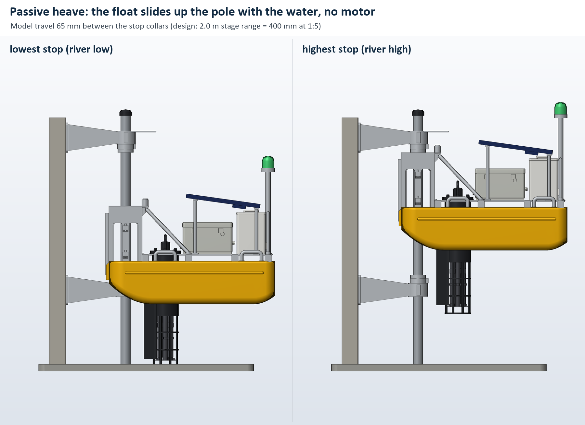

# AquaSentinel R3: 1:5 printable scale model

A desk-sized model of the R3 float on its pole and pier brackets, printed on a Bambu Lab H2D. Every part comes from our R3 CAD
parameters (`mechanical/src/params.py`), scaled 1:5, so the model has the real proportions: 200 mm hulls, a 12 mm pole, a
1:5 sensor cartridge that lifts out, and a beacon whose lens you can swap from green to red.



## Which prototype is this?

This is a scale model, not a working prototype. It shows **form and mechanism**: what the system looks like, how big it is,
and how the float rides the pole. There are no electronics inside it.

| Level | What it is | What it shows | What it does not show | Status |
|---|---|---|---|---|
| 0. Digital design | R3 CAD (66 parts), hand calculations, 2 FEA studies, decision logic replayed on synthetic data | It fits together, floats with reserve buoyancy 2.27, stresses are within limits on paper; 4 of 4 simulated spills flagged | Anything physical; all data is synthetic | **Done** (submitted at the Final Design Challenge) |
| **1. Scale model (this folder)** | 1:5 PLA model on a display stand with a 12 mm pole | Layout and scale; passive heave (the float slides up the pole); weathervaning around the pole; the cartridge lifting out; the green/red beacon | Sensing, strength, river current, debris, corrosion | **Ready to print** |
| 1b. Water check of the scale model | Float the model in a tub and raise the water | Floats level at the predicted draft; rises with the water without binding | Full-scale behaviour, current, debris | Planned before the 19–20 Nov finale (about 1 hour once printed) |
| 2. Electronics bench demo | ESP32 + one or more real probes + decision logic + LED beacon + pump on a table | Read, decide, act on real hardware (for example, add salt and EC rises, the light turns red, the pump runs) | Field robustness, multi-day power budget, fouling | Next, before the finale; the firmware needs its P0 fixes first (it doesn't compile today) |
| 3. Tank prototype | Full-size (or half-size) float and carriage on a real 2 in pole | Draft, roller friction and jamming, 2 m of travel, sampler hydraulics | Long-term reliability | Planned after the finale (needs a full-size float, which isn't built yet) |
| 4. Pilot | 30 days at the Kopargaon bridge, with permission | Real alerts compared with lab samples | — | Later |

**One line for the jury:** "This is a 1:5 scale model printed from our CAD. It shows the layout and how the float rides the
pole and how the sensor cartridge comes out. It isn't a working prototype; the electronics bench demo is our next step."

## Files

| File | What it is |
|---|---|
| [`AquaSentinel_R3_1to5_FLOAT.stl`](AquaSentinel_R3_1to5_FLOAT.stl) | **The one file to print first.** All 18 float parts on one plate, each already turned the right way up for printing |
| [`AquaSentinel_R3_1to5_STAND.stl`](AquaSentinel_R3_1to5_STAND.stl) | Second plate: the display stand (base, pier column, 2 brackets, 2 stop collars, pole cap) |
| [`AquaSentinel_R3_1to5_ASSEMBLED_view.stl`](AquaSentinel_R3_1to5_ASSEMBLED_view.stl) | The assembled model, for viewing only (don't print it) |
| [`parts/`](parts/) | Every part as its own STL, for printing in different colours or reprinting one part |
| [`parts/OPT_rod_half_print_2.stl`](parts/OPT_rod_half_print_2.stl) | Only if you can't get a 12 mm rod: print two halves and glue them together |
| [`previews/`](previews/) | Renders: assembled views, exploded assembly, the two print plates, low and high positions. `08_slide_render.png` is the picture on deck v2's backup slide A9 |
| [`build_report.json`](build_report.json) | Every check: sizes, volumes, watertightness, overhangs, fits, clearances, mass and draft estimate |
| `make_scale_model.py`, `render_previews.py` | The scripts that make everything above (see the end of this file) |

## Printing on the H2D

**The build volume we assumed:** 300 × 320 mm when both nozzles print (325 × 320 with one nozzle), 325 mm high. Both plates fit
inside 300 × 320, and the tallest part is 139 mm.

1. Open Bambu Studio and pick the **H2D** printer with a **0.4 mm nozzle**. Use a textured PEI plate.
2. Drag in `AquaSentinel_R3_1to5_FLOAT.stl`. It loads as one object. Right-click it and choose **Split → To objects**, so you
   can give parts their own colours or settings.
3. Use these settings:

| Setting | Value |
|---|---|
| Filament | PLA (Matte looks best on models) |
| Layer height | 0.20 mm (Standard) |
| Walls | 2 (use 3 on the hulls if you'll float the model) |
| Top / bottom layers | 5 / 4 |
| Infill | 15 % gyroid |
| Supports | **Off.** Everything is designed to print without them; the only unsupported spans are short bridges |
| Brim | Auto. Make sure the tall, thin parts F05, F08 and F12 get one |

4. Slice. Bambu Studio will show the real time. Our rough estimate is 8–12 h and about 450 g of PLA for plate 1, and 5–7 h
   and about 270 g for plate 2.
5. **Time plan:** the semi-final is online (24–25 Oct), so print plate 1 first, assemble it by 22 Oct and take photos. The stand
   (plate 2) matters for the in-person finale (20 Nov).

**Colours.** One colour (light grey or white) looks clean, like an architectural model. To use the H2D's two nozzles, put the
hulls (F01, F02) on yellow and everything else on grey. For more colours, print the parts from `parts/` in batches.

| Colour | Parts |
|---|---|
| Yellow | F01, F02 hulls |
| Silver or grey | F03 frame, F04 carriage, F12 mast, F15 handles, S03–S05 brackets and stop collars |
| Black | F05 well and cage, F06 deflector, F07 cartridge cap, S06 pole cap |
| Dark grey | F08 probe cluster (paint the four ID bands: blue pH, orange EC, green DO, magenta turbidity) |
| Light grey | F09 control pod |
| White | F10 autosampler |
| Dark blue | F11 solar canopy |
| Translucent green / red | F13 / F14 beacon lenses |
| Concrete grey | S01 base, S02 pier column |

## What else you need

- **A 12 mm round rod, 310 mm long.** It's the pole: 60.3 mm ÷ 5. An aluminium or stainless rod from a hardware shop is best;
  a straight hardwood dowel works if you sand it smooth. If you have none, print `OPT_rod_half_print_2.stl` twice and glue the
  halves with 1.75 mm filament pins.
- **1.75 mm filament offcuts** for 10 small pins: 1 for each lens and 2 for each grab handle.
- Super glue (CA): a thin one and a gel one.
- 240 and 400 grit sandpaper and a craft knife.
- Optional: paint markers for the probe bands, and black for the LTE antenna.

## The parts

| ID | Part | Notes |
|---|---|---|
| F01 / F02 | Pontoon hulls, starboard / port | Print upside down. The 4 pockets in the top are 0.8 mm deep and closed at the outboard end, so each hull only fits one way |
| F03 | Frame: 4 crossbeams, deck, 2 carriage struts, 4 canopy stanchions, LTE antenna | The two diagonal struts are the most delicate part; hold the frame by its beams |
| F04 | Bow guide carriage | 8 concave rollers in 2 tiers (fixed, they don't turn), stage sensor on top. The gate is shown but doesn't open |
| F05 | Sensor well, hatch flange and guard cage | Prints flange-down |
| F06 | V debris deflector | Prints lying on one arm |
| F07 / F08 | Sensor cartridge cap and probe cluster | Glue together into one removable cartridge |
| F09 / F10 | Control pod / autosampler | Sit on locating pins on the deck; each only fits one way round |
| F11 | Solar (PV) canopy | Prints glass-face down; lifts off its 4 stanchion pins |
| F12 | Beacon mast and beacon base | Prints upside down |
| F13 / F14 | Beacon lens, green and red | Swap them to show "normal" and "alert" |
| F15 | Grab handles (4) | Optional detail |
| S01 | Display base | Has a window under the sensor cage, the pole socket, and the engraved name |
| S02 | Pier column (the bridge-pier face) | Prints lying on its back; the pins on its face stand for the chemical anchors |
| S03 / S04 | Pier brackets, lower / upper | The upper one carries the stage target plate; its pins are keyed so it can't go on upside down |
| S05 | Stop collars with buffer rings (2) | Friction fit on the rod |
| S06 | Pole cap | |

## Assembling



**The float**

1. Remove brims. Check that each crossbeam drops into its hull pockets; if one is tight, sand the pocket edges lightly.
2. **Hulls and frame.** Set the frame (F03) into the pockets of both hulls. The handle holes face outboard. Run thin CA into the
   eight joints. Check on a flat table that the deck is level and the hulls are parallel.
3. **Carriage.** Push the 12 mm rod through the carriage (F04) first. Then hang the carriage on the deck's front edge by its
   hook, back plate against crossbeam 1, and let the two strut tips meet the lugs at the top of the carriage. With the rod held
   vertical, glue the back plate (thin CA) and the strut tips (gel CA). The rod keeps the carriage straight while the glue sets.
4. **Deflector.** Glue the V deflector (F06) under crossbeam 1, its point facing the carriage.
5. **Pod and sampler.** Press the pod (F09, cable glands facing forward) and the sampler (F10) onto their deck pins. A drop of
   glue, or leave them loose.
6. **Mast and lens.** Glue the mast pin (F12) into the hole in crossbeam 4, starboard side. Put a 5 mm piece of filament into
   the bottom of the green lens and press it onto the beacon base. Don't glue it, so you can swap in the red lens.
7. **Handles.** Push 4 mm filament pins into the hull-top holes and glue the handles (F15) on them.
8. **Well and cage.** Drop the well (F05) cage-first through the deck hatch until the flange sits on the deck, then glue the
   flange (three dots) and the deflector tabs to the tube. From now on the cage hangs 77 mm below the keel, so rest the float
   on its stand or on a cup.
9. **Sensor cartridge.** Glue the probe cluster's spine pin (F08) into the socket under the cartridge cap (F07), probes hanging
   straight. Lower it into the well, handle up. Don't glue it; lifting it out is part of the demonstration.
10. **Canopy.** Lower the canopy (F11) onto the four stanchion pins. It only fits one way. Leave it loose so it can come off to
    show the pod and sampler.

**The stand**

1. Glue the column's tenon (S02) into the slot in the base (S01). The pins on the column face point toward the pole socket.
2. Press the lower bracket (S03) onto the lower pins and the upper bracket (S04, target plate on top) onto the upper pins.
   Before the glue sets, push the rod through both clamp rings into the base socket, so the rings line up.
3. Pull the rod out again. Feed it down through:
   - the upper clamp;
   - the upper stop collar (S05, buffer ring facing down);
   - the float's carriage;
   - the lower stop collar (S05, buffer ring facing up);
   - the lower clamp;
   - finally into the base socket.
4. Push the upper collar up against the upper clamp, then put the cap (S06) on the rod.
5. The float now slides 65 mm between the stops and turns freely around the pole.

## Presenting with it



What to show, in about 20 seconds each:
- **No motor.** Slide the float from the lower stop to the upper stop: "the river lifts it; the pole keeps it in place."
- **Weathervaning.** Turn the float around the pole: "the current turns it to trail downstream of the pier."
- **Service from the deck.** Lift the cartridge out by its handle: "the probes come out of the river without a boat or a
  diver."
- **The alert.** Swap the green lens for the red one: "the beacon is for people on the bank, no phone needed."
- **Inside.** Lift off the solar canopy to show the pod and the autosampler.

What to say carefully:
- Call it a **1:5 scale model printed from our CAD**, not a prototype that works or has been tested.
- The stand's travel is shortened to fit the printer: 65 mm here is 325 mm on the real float. The design range is 2.0 m, which
  would be 400 mm at this scale.

For the online semi-final, take three photos and a 10-second clip of sliding the float and lifting the cartridge. Put one photo
on a backup slide, and keep the model on your desk in case the jury asks to see it.

Once the model exists, the Q&A answer to "Have you built or tested it?" can become: "We've 3D-printed a 1:5 scale model from the
CAD to check the arrangement and show the mechanism. It isn't a working prototype. Before the finale we'll float it in a tank and
show the electronics bench demo; the full-size tank test comes after the finale."

## The water check (level 1b)

This is part of the team's plan for before the 19–20 Nov finale, together with the electronics bench demo (deck slide 8 and
backup slide A8).

What the numbers predict, from `build_report.json`:
- At 15 % infill the printed float weighs about **445 g**, so it should float at a draft of about **26 mm**. Its centre of mass
  is within a millimetre of the centre of buoyancy, so it should float level.
- The R3 design scaled to 1:5 would weigh 388 g and float at 23.4 mm (116.8 mm at full size). The printed parts are a little
  heavier than scale.

How to run it:
1. Print the hulls with 3 walls and 5 top and bottom layers. For longer tests, brush on a coat of clear varnish.
2. Stand the model in a clear tub at least 25 cm deep. Weigh the base down with about 1 kg, or stick it to the floor of the
   tub: printed PLA has air inside and will float otherwise.
3. Fill slowly. The float should lift off the lower stop at about 107 mm of water and follow the water up to the upper stop.
4. Mark the waterline on a hull and measure the draft. Compare it with 26 mm.

This shows that the model floats level at the predicted draft and follows the water up the pole. It does not validate river
current, debris loads, the full-size structure or the electronics. Dry the model afterwards.

## Where the model differs from the CAD

All of these changes are for printing or display only:
- **Scale 1:5.** The 60.3 mm pole becomes a 12 mm rod.
- **Thickened so they print:**
  - deck 0.6 → 1.6 mm (its top stays at the CAD height);
  - carriage tier plates 1.2 → 2.0 mm;
  - well wall 1.24 → 1.6 mm;
  - carriage struts Ø 4.0 → 4.4 mm.
- **Guard cage** is a slotted tube (8 bars, 3 rings) instead of Ø 1.2 mm rods.
- **Carriage:**
  - The rollers are fixed and have 0.4 mm running clearance to the rod (the CAD's 1.5 mm is 0.3 mm at 1:5).
  - The gate is fused shut.
- **Added for the model:**
  - beam pockets in the hull tops;
  - a hook on the carriage;
  - small gussets under the stage-sensor shelf and the strut lugs;
  - locating pins for the pod, sampler and canopy;
  - filament-pin holes for the lens and handles;
  - a web between the bracket arms;
  - keyed anchor pins on the upper bracket.
- **Canopy stanchions** sit at ±32.6 mm instead of ±33.0, to leave a 1.1 mm wall around the pin holes in the canopy.
- **The stand:** the pier is a slab, and the travel is 65 mm instead of the scaled 400 mm.
- **Left out:**
  - fasteners, cables and hoses;
  - the canopy hinge;
  - vent plugs;
  - electronics;
  - sampler bottles.

## Checks (all in `build_report.json`)

- Every part is one valid, watertight solid with no open edges. Both plates fit inside 300 × 320 × 300 mm.
- No part needs supports. The overhang check lists every downward-facing area, and they are all short bridges (the deck between
  beams, window tops, the pod floor between its rails) or small 45° chamfers.
- Fits and clearances measured on the solids:

| Check | Value |
|---|---|
| Rod to roller throats | 0.39 mm |
| Strut tips to carriage lugs (glue gap) | 0.2 mm |
| Well to deck hatch | 0.5 mm |
| Probe cluster to well and cage | 1.0 mm |
| Canopy to sampler lid | 2.5 mm |
| Struts to the cartridge lift path | 1.6 mm |
| Float against the stand at the lowest and highest stops | no overlap; the cage clears the table by 4 mm |

## Regenerating

Requires Python 3 with numpy, Pillow and OCP (OpenCascade). Run these from this folder:

```bash
python -I make_scale_model.py
```

```bash
python -I render_previews.py
```

`make_scale_model.py --fast` skips the slower fit and draft checks and keeps the previous results. The scripts only write inside
this folder and read `../src/params.py`.
